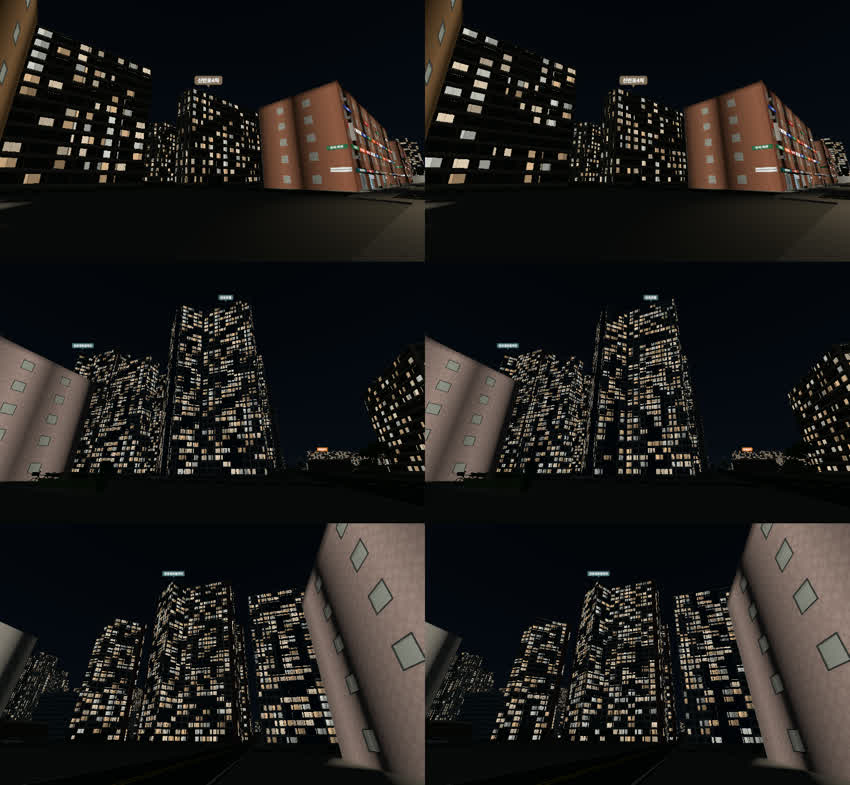

# 신반포로 아파트 외관

[Blender 단지 외관 열기](banpo-apartments.blend) · [신반포4차 보도에서 본 낮과 밤](shinbanpo4-facade.jpg) · [반포르엘·센트럴자이 낮](facade-finishes.jpg) · [반포르엘·센트럴자이 밤](facade-night.jpg)

게임에서는 **M → 단지명 검색 → 여기로 이동**으로 외벽을 볼 수 있는 보도에 도착한다.

Blender에서는 장면 속성의 **카메라** 목록에서 **신반포4차 · 보도 카메라**, **반포르엘 · 보도 카메라**, **반포센트럴자이 · 보도 카메라** 중 하나를 선택한다. 숫자패드 0으로 그 시점을 보고 F12로 렌더할 수 있다. 시점의 높이, 보는 방향과 수직 화각 72°는 게임의 보도 시점과 같다. 개별 원본에서는 다섯 단지 외관과 그림자를 받는 지형이 보인다. 회색 바닥의 높이는 게임의 서울 표고 격자를 따른다. 가로수와 주변 건물이 있는 [통합 도시 원본](../world/gangnam-terminal.blend)에서도 같은 카메라를 선택할 수 있다. [세 단지 Blender 보도 시점과 서울 시각 비교](native-street-views.jpg)

타임라인 1프레임이 서울 시각 1분이다. 아침·낮·노을·밤 마커를 선택하면 태양 방향과 창문 불빛이 바뀐다. 오늘 서울 시각을 따르며 편집하려면 저장소 루트에서 아래 명령으로 연다.

```sh
blender assets/models/banpo-apartments/banpo-apartments.blend -P assets/models/world/seoul-clock.py
```

| 게임 지도 검색 | 게임용 외관 | 현재 삼각형 | 파일 크기 |
| --- | --- | ---: | ---: |
| 신반포4차 | [apt-a13790828.glb](../../re/apt-a13790828.glb) | 6,443 | 129,796 B |
| 반포르엘 | [apt-a10023673.glb](../../re/apt-a10023673.glb) | 11,608 | 228,224 B |
| 반포센트럴자이 또는 반센자이 | [apt-a10024913.glb](../../re/apt-a10024913.glb) | 9,640 | 210,612 B |
| 반포르엘2차 | [apt-a10023462.glb](../../re/apt-a10023462.glb) | 2,058 | 38,736 B |
| 신반포한신2차 | [apt-a13790929.glb](../../re/apt-a13790929.glb) | 2,868 | 54,664 B |

### 단지별 동 소속

신반포로 북측의 반포센트럴자이(반포대로 310-6)와 반포르엘(신반포로23길 23)은 각각 101~107동이다. 반포르엘 북측에 붙은 반포르엘2차(신반포로23길 33)는 201~203동이다. 네이버지도에서 단지명과 동 번호를 읽고 각 동 지붕을 게임의 OSM 외곽과 대조했다. [동 번호가 표시된 네이버지도](https://map.naver.com/p?c=14137820.74,4510093.65,17.20,0,0,0,dh) · [반포센트럴자이 단지 안내](https://bpcxi.aptner.com/v2/page/menu/872) · [서울시 반포르엘2차 단지 정보](https://openapt.seoul.go.kr/commonPortal/programLink.do?aptCode=A10023462&jspNm=%2FopenApt%2FdMenu%2FdangiInfo%2FdangiInfo.open)

원본에서 자이 파일에 들어 있던 르엘 102·104·106동과 신반포한신2차 파일에 들어 있던 자이 107동을 제 단지로 옮겼다. 건물의 월드 좌표는 유지했다. 르엘2차 202동과 신반포4차 201·202동은 원래 파일에 해당 기하가 있어 지도 외곽의 소속을 바로잡았다. 35개 동은 각 단지 메시의 동별 정점 그룹으로 선택할 수 있다. [동별 OSM 대응표](towers.json)

### 지도 이름표와 보도에서 보는 방향

2026년 11월 27일 네이버 지도에서 각 단지의 장소 카드를 열고 도착지와 도로명주소를 대조했다. 지도에 찍는 점은 네이버의 단지 대표 위치다. 게임에서 **여기로 이동**을 누르면 입면을 볼 수 있는 공공 보도에 선다. 3D 이름표는 그 보도에서 실제로 보이는 모델의 지붕에 맞췄다.

| 단지 | 도로명주소 | 네이버 도착지 위도 · 경도 | 보도에서 보는 동 |
| --- | --- | --- | --- |
| [신반포4차](https://map.naver.com/p/entry/place/18760860) | 잠원로 37-48 | 37.5086681 · 127.0062614 | 203동 |
| [반포르엘](https://map.naver.com/p/entry/place/1981182918) | 신반포로23길 23 | 37.5075999 · 127.0028246 | 101동 |
| [반포센트럴자이](https://map.naver.com/p/entry/place/791855299) | 반포대로 310-6 | 37.5072530 · 127.0016159 | 101동 |

기존 게임 지도에서 단지 대표점을 북쪽에 있는 실제 단지 안으로 옮겼다. 지도상 이동 거리는 신반포4차 263.3m, 반포르엘 97.2m, 반포센트럴자이 44.9m다. [네이버 지도에서 세 단지 보기](https://map.naver.com/p?c=14137820.74,4510093.65,17.20,0,0,0,dh) · [신반포4차 서울시 단지 정보](https://openapt.seoul.go.kr/openApt/index.do?aptCode=A13790828) · [반포르엘 서울시 단지 정보](https://openapt.seoul.go.kr/openApt/index.do?aptCode=A10023673) · [반포센트럴자이 단지 홈페이지](https://bpcxi.aptner.com/v2/page/menu/872)

네이버 지도 검색에서 잠원동 세 단지의 이름을 대조했다. 신반포4차는 서울시 정비사업 현황에 잠원동 70의 기존 단지로 올라 있다. 외벽의 무늬와 색은 아래에 명시한 연도의 사진을 참고했다. [네이버 지도 신반포4차](https://map.naver.com/p/search/신반포4차아파트) · [반포르엘](https://map.naver.com/p/search/반포르엘아파트) · [반포센트럴자이](https://map.naver.com/p/search/반포센트럴자이) · [서울시 정비사업 현황](https://cleanup.seoul.go.kr/cafe/mastr-cleanup-bsnsSumry/execute.do?cafeId=650900000560N91&div=sumry&stepSeCode=102)

세 단지의 외곽과 옥상은 서울 부동산 지도의 게임용 모델에서 가져왔다. 세 단지는 기존 외벽의 좌표와 지면 높이를 유지하고 공개 사진을 참고해 입면을 다시 그렸다. [원본 모델 기록](https://github.com/minwoo19930301/seoul-real-estate-map/blob/ede67d9f3909395d346ab67e492d63fd10142d08/public/models/manifest.json)

### 잠원동 신반포4차의 기존 입면

2024년 2월 26일 잠원동 신반포4차에서 신유진 기자가 촬영한 사진 세 장에는 긴 복도 쪽의 그늘과 각 층의 밝은 난간, 그 사이를 세로로 나누는 바랜 살구색 기둥이 보인다. 다른 면에는 청록색 유리를 끼운 발코니와 크림색 벽이 있다. 이 차이를 기존 판상형 건물의 외곽과 옥상 아래에 반영했다. 면별 배치와 난간 두께는 근사치다. 서울시 공동주택 단지 코드는 게임 원본과 같은 A13790828이다. [촬영일과 장소가 명시된 현장 사진](https://v.daum.net/v/20240306040551178) · [서울시 단지 정보](https://openapt.seoul.go.kr/commonPortal/programLink.do?aptCode=A13790828&jspNm=%2FopenApt%2FdMenu%2FdangiInfo%2FdangiInfo.open)

같은 보도에서 찍은 비교 사진의 왼쪽은 수정 전, 오른쪽은 수정 후다. 위는 낮, 아래는 서울 시각 00시 30분이다. 새 모델은 5,681삼각형이며 한 번에 받는 GLB는 363,292바이트에서 114,252바이트로 줄었다. [게임 보도 시점 비교](shinbanpo4-facade.jpg)

### 반포르엘과 반포센트럴자이의 보도 시점

반포르엘의 가운데 짙은 청색 유리와 은색 가로 프레임, 양옆 밝은 창틀은 조경 설계진의 2022년 11월 준공 지면 사진을 참고했다. 반포센트럴자이는 GS건설이 제공한 2020년 5월 준공 사진을 바탕으로 회청색 유리, 밝은 창 격자 사이에 솟은 연한 적갈색 기둥과 어두운 저층부 석재를 표현했다. 층당 약 2.9m를 기준으로 기존 외곽에 맞춰 창을 반복했다. 창의 폭과 색 배치는 사진에서 읽히는 동별 인상을 옮긴 근사치다. [반포르엘 조경 설계진의 사진](https://lak.co.kr/greenn/view.php?ca=all&cid=66086&id=565) · [GS건설 제공 반포센트럴자이 사진](https://www.mt.co.kr/estate/2020/05/26/2020052508590769578)

왼쪽은 수정 전, 오른쪽은 수정 후다. 위는 반포르엘, 아래는 반포센트럴자이다. 게임 지도에서 각 단지를 선택해 도착하는 보도의 같은 시점으로 촬영했다. [낮 비교](facade-finishes.jpg) · [서울 시각 00시 30분 비교](facade-night.jpg)

단지마다 불투명 외벽, 창, 옥상의 세 그리기 단위를 쓴다. 창틀 영역을 잘라내는 96×96 이미지는 Blender 파일과 각 GLB에 내장되어 있다. 야간 조명은 기존 게임 셰이더가 창 부분에만 적용한다.

### 반포르엘 101동 공도 쪽 옥상

2026년 1월 신반포로 거리뷰에서 101동 남동쪽 면을 보면 가운데의 푸른 유리가 상층에서 오른쪽으로 넓어진다. 그 위로 밝고 가느다란 지붕 테두리가 돌출되며, 테두리 아래에 그늘과 가느다란 세로 지지대가 보인다. 같은 면의 기존 옥상선 아래에 이 마감을 맞췄다. 지지대 간격과 돌출 깊이는 사진에 근거한 근사값이다. [네이버 거리뷰](https://map.naver.com/p?c=18.00,0,0,0,adh&p=oiNrUmRprFHkZl-wjC2ZVg,318,17,78,Float)

지도에서 반포르엘을 찾아 이동한 보도에서 찍었다. 사진은 지붕 주변을 잘랐다. 왼쪽은 변경 전, 오른쪽은 변경 후이며 위가 낮, 아래가 밤이다. [게임 화면 비교](leel-101-crown.jpg)

### 보도에서 보이는 야간 창문

이전 창문 재질은 다섯 칸 옆, 여섯 층 아래에 밝기와 색까지 같은 창을 반복했다. 게임과 Blender 양쪽에서 층과 가로 위치를 함께 계산해 대각선 반복을 줄였다. 가상 창 격자 한 주기 안에서 이 방향으로 비교할 수 있는 6,006쌍의 색·밝기 일치율이 100%에서 5.2%로 줄었다. 창별 불빛은 장면을 위한 고정 패턴이다.



반포센트럴자이의 2024년 5월 방문자 사진은 밤의 조경을 담았다. 반포르엘의 2022년 준공 기록에는 문주와 주출입구 수경시설의 밤 마감이 실려 있다. 신반포4차의 최근 도로 쪽 야간 사진은 확인하지 못했다. [반포센트럴자이 야경](https://kbland.kr/se/otd/1427997) · [반포르엘 조경 설계진 기록](https://lak.co.kr/greenn/view.php?ca=all&cid=66086&id=565)

## 편집

통합 도시의 **건축 · 외관 → 신반포로 · 아파트 원본**에 단지별 외관 컬렉션을 연결합니다. 위 Blender 파일에서 단지 이름의 컬렉션을 열고 건물 메시를 편집합니다. 기본 형상 키인 **Basis**에 외관을 편집하면 게임과 도시에서 같은 수정이 보입니다. **게임 지형 높이** 키를 1로 두면 통합 도시의 서로 다른 지면고를 미리 볼 수 있습니다.

저장소 루트에서 한 단지만 게임용 파일에 반영하는 예입니다. 마지막 인수에 표의 파일 이름에서 확장자를 뺀 ID를 넣습니다.

```sh
blender -b assets/models/banpo-apartments/banpo-apartments.blend --python-exit-code 1 \
  -P assets/models/banpo-apartments/export.py -- assets/re apt-a10024913
```

`assets/re` 대신 임시 출력 폴더를 지정하면 내보낸 파일을 먼저 확인할 수 있습니다. 게임에 반영할 때는 파일 크기와 외관 범위를 등록하고, 이후 원본 지도 데이터를 다시 가져와도 편집한 모델을 보존합니다. 지형 높이와 야간 조명은 게임에서 서울 시각과 각 건물 위치에 맞게 적용합니다.

초기 편집본을 재현할 때는 원본 저장소의 `public/models`를 입력 폴더로 사용합니다. `build.py`는 입력 파일 5개의 SHA-256을 확인한 뒤 그 형상과 선형 정점 색을 읽습니다.

```sh
blender --factory-startup -b --python-exit-code 1 \
  -P assets/models/banpo-apartments/build.py -- /path/to/seoul-real-estate-map/public/models
node tests/apartment-ownership.mjs /path/to/seoul-real-estate-map/public/models
```

입면 마감을 바꾸기 전 최초 외관 복원 시점의 기록이다. 당시 게임의 보도 시점에서 서울 시각 12시 30분과 0시 30분을 비교했다. 창문 발광만 껐을 때와 비교해 밤 화면 상단에서 달라진 픽셀 수는 반포르엘 4,038개, 반포센트럴자이 8,251개, 신반포4차 6,984개였다. 같은 시점의 낮에는 모두 0개였다. 반포센트럴자이 앞 공공 보도에 서울시 가로수 대장의 대왕참나무 10그루를 반영했다. 줄기 위치는 대장 좌표를 따르고 나무 높이는 약 8m로 표현했다. [게임에서 본 세 단지의 낮과 밤](game-night.jpg) · [가로수 전후](../../../docs/map-audit/banpo-central-xi-street-trees.jpg) · [서울시 자치구 가로수 위치정보](https://data.seoul.go.kr/dataList/OA-23040/S/1/datasetView.do)

### 신반포4차 201동 공도 모서리

잠원로와 신반포로23길이 만나는 쪽에서 201동의 꺾인 두 날개를 함께 볼 수 있다. 2026년 1월 거리뷰에는 한쪽으로 둥근 모서리의 창이 나란히 이어지고, 꺾이는 자리에는 작은 창 두 줄이 반 층씩 엇갈려 있는 살구색 수직벽이 지붕보다 높이 솟아 있다. 이 두 면에만 마감을 적용했다. 해당 동은 공개 지도에 201동으로 표시된 ㄱ자 외곽 및 이웃 202동의 일자 외곽으로 식별했다. 사진에서 흐린 동번호 글씨는 옮기지 않았다. [네이버 거리뷰 정면](https://map.naver.com/p?p=hdzDnOLgOaWphShLW31BAQ,40,18,62,Float) · [지붕 모서리 확대](https://map.naver.com/p?p=hdzDnOLgOaWphShLW31BAQ,42,29,25,Float) · [201동 공개 지도 외곽](https://www.openstreetmap.org/way/413367405)

기존 201동 기단 외곽 여덟 꼭짓점은 게임에 쓰인 OSM 외곽의 대응점과 평면상 약 0.8~1.2m 차이가 난다. 건물의 위치는 그대로 유지했다. 창 모서리와 수직벽 폭, 지붕 위 약 3.2m 돌출부는 사진 비례로 추정한 모델 치수다. 현장 측량 오차는 알 수 없다.

[201동 보도 시점의 통합 도시 Blender 렌더](shinbanpo4-201-native.jpg) · [가까운 보도와 건너편 보도에서 본 게임 전후 비교](shinbanpo4-201.jpg) · [가까운 보도에서 보기](https://minwoo19930301.github.io/gangnam-terminal-world/#/street?p=-66.3,0.1,-179,-55.08,29) · [건너편에서 보기](https://minwoo19930301.github.io/gangnam-terminal-world/#/street?p=-78,0.1,-151,-37.55,24)

같은 아파트 파일 안의 기존 외벽·창 재질을 쓴다. 동별 메시 범위와 원점, 보도 카메라 행렬을 전후 비교하면 201동의 높이와 정점 수만 바뀐다. 다른 네 단지는 기존 파일과 바이트 단위로 동일하게 다시 내보내졌다. 수정 후 단지 파일은 15,552바이트, 762삼각형 늘었고 단지 드로콜은 3회다. 헤드리스 Chromium 저화질에서 보도 두 시점의 낮·밤을 각각 90프레임씩 확인한 p95는 전후 모두 16.7~16.8ms였다.
