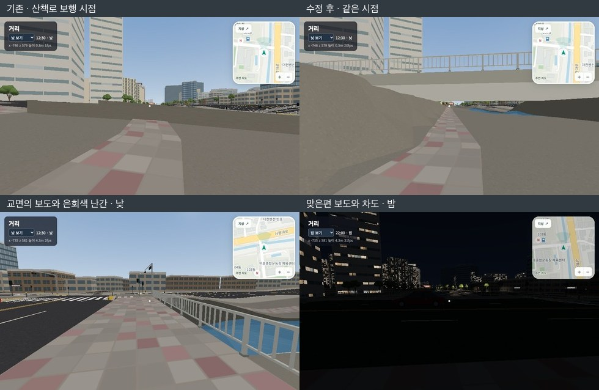

# 반포천1교와 신반포로16길

게임의 25m 지형 격자는 교면과 둔치를 한 면으로 이어 버렸다. 교면을 하나의 연속된 차도와 양쪽 보도로 구성하고 하천과 산책로를 아래에 두었다. 도로와 보도에는 각자의 지지면이 있고, 양쪽 바깥 난간은 교면 위에서 보행을 막는다. 하천 수면은 제방 사면을 따라 솟았던 부분을 낮췄다.



## 형태와 자료

국토교통부의 2025년 말 도로교량 자료에서 반포천1교의 총연장은 33.4m, 폭은 26m, 보도 폭은 10m다. 게임에서는 양쪽 보도에 폭을 절반씩 배분하고 OpenStreetMap의 차도·보도 중심선을 사용했다. 같은 자료의 교량높이 5m는 교면에서 지표 또는 수면까지 잰 최대 수직거리다. [국토교통부 교량 자료](https://www.data.go.kr/data/15081953/fileData.do) · [통계 정의](https://www.index.go.kr/unity/potal/FileDown.do?seq=17404&id=1213&div=1)

서울시 공개 지형도에서 도로 중심선 부근에 표고 16.00m인 점이 있다. 이를 게임 교면의 근삿값으로 삼았다. 지형도는 이 점의 대상물을 별도로 명명하지 않는다. 아래 산책로의 높이와 둔치 경사는 두 층의 관계를 보여 주기 위한 게임용 근사다. 서초구 공개 영상에는 하천 옆 산책로가 보인다. [서울시 1:5,000 수치지형도](https://data.seoul.go.kr/dataList/OA-22241/F/1/datasetView.do) · [서초구 반포천 산책 영상](https://www.seocho.go.kr/site/seocho/ex/bbs/internet/news/BbsCustomFView.do?bcIdx=351506)

거리뷰에서 보이는 은회색 상부 손스침, 아래 가로대, 좁은 세로살과 차로의 황색 중앙선을 표현했다. 난간 한 칸의 길이·살 간격·부재 단면과 교면 마감 두께는 사진에 맞춘 조형 치수다. [네이버 거리뷰](https://map.naver.com/p?c=19.00,0,0,0,adh&isMini=true&p=IUKps7l6IoYzfbLUpW6pow,39,10,80,Float)

## Blender 편집과 게임 검증

`rail.blend`의 `BanpoStreamRail` 컬렉션에서 난간 부품을 개별 편집할 수 있다. 저장 후 이 폴더에서 아래 명령을 실행하면 게임이 기존 거리 재질로 그리는 `rail.js`가 갱신된다.

```sh
blender -b rail.blend --python build.py -- --export-current
```

통합 도시를 재생성하면 **반포 · 도시 전경** 장면의 **반포천1교 · 신반포로16길과 양쪽 보도** 컬렉션에 교면, 경계석, 차선, 연결된 난간이 놓인다. 도로와 난간 위치는 게임과 같은 `layout.js`에서 읽는다. 국소 둔치는 **지형 표고 · 편집 격자**의 `creek` 항목에 있다.

`node tests/banpo-stream-bridge.mjs`는 일반 게임 보행 컨트롤러로 위·아래 두 방향을 걷고, 상부 난간과 이동 차량의 도로 접촉을 검사한다.

기존과 같은 19,030개 지점을 검사했을 때 해당 산책로는 351개 지점 모두 판정됐고 충돌 후보는 4개에서 0개로 줄었다. 일반 게임에서 같은 시간만큼 앞으로 걸은 거리는 두 방향에서 각각 9.8m와 19.5m였던 것이 수정 후 모두 약 50m였다. 지형 데이터는 기존 지형 텍스처에 26.6KiB를 덧붙인다. 난간 36칸은 기존 거리 재질 배치에 합친다.

[통합 Blender 도시에서 렌더한 반포천1교](blender-overview.jpg)
