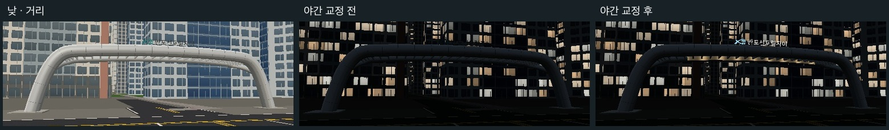
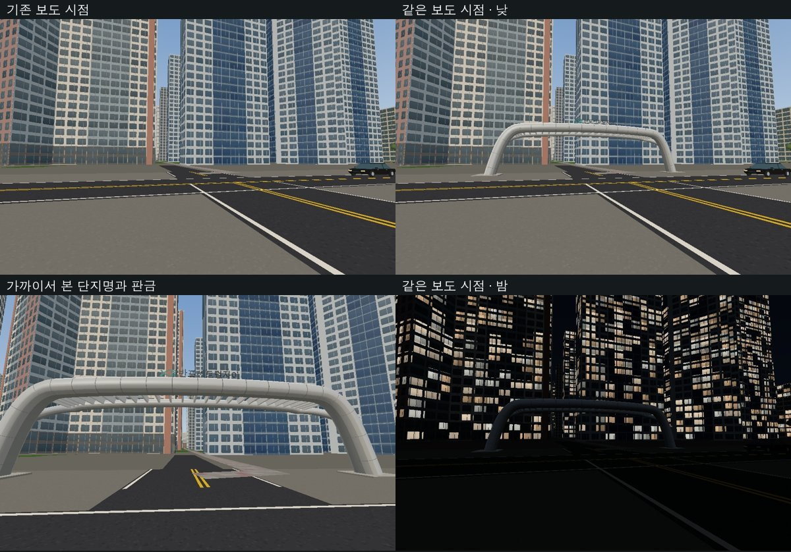
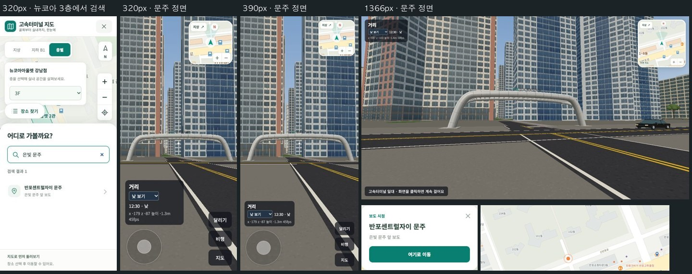

# 반포센트럴자이 은빛 문주

2020년 송선옥 기자가 직접 촬영한 사진에는 아치처럼 휘는 은색 판금, 앞뒤 띠 사이로 하늘이 비치는 가로 날개, 청록색 옛 자이 표식과 짙은색 단지명이 보인다. 두 발치에는 밝은 보도 포장이 있다. 같은 달 현장 방문 기사와 2026년 1월 상가 앞 공개 도로 파노라마에서 단지와 거리 쪽 입면을 대조했다. 사진 원본은 각 출처에서 볼 수 있다. [머니투데이 현장 사진, 2020-05-17](https://www.mt.co.kr/estate/2020/05/17/2020051316395722478) · [파이낸셜뉴스 방문 기사, 2020-05-27](https://www.fnnews.com/news/202005270805330773) · [네이버 거리뷰, 2026년 1월](https://map.naver.com/p?p=pQWchXb7ZCfKBLnKm71yiw,-25,0,80,Float)

게임에서는 상가 인근 공개 도로에서 보이는 방향과 기존 차로 중심에 맞췄다. 대략 23m 폭과 6m 높이, 판 줄눈과 날개 간격은 사진 비례에서 추정했다. 밤의 차가운 금속 반사는 게임 조명에 맞춘 표현이다. 지도에서 **반포센트럴자이 문주** 또는 **은빛 문주**를 검색하면 정면을 바라보는 보도로 이동한다. 세로 화면에서는 두 발치가 함께 보이는 보도 시점을 사용한다. 기본 관찰 시점은 게임 주소 `#/street?p=-186.61,0,-103.16,4.57,4`이다.

2025년 5월 7일 뉴스핌이 게재한 거리 야경 사진에는 두 단지의 문주가 나란히 보인다. 사진 왼쪽의 반포센트럴자이는 청백색 Xi 표식과 흰 단지명이 켜져 있고, 앞 판금 아래로 물러난 안쪽 띠에는 따뜻한 빛이 일정한 간격으로 비친다. 이 세 면은 게임의 서울 일몰과 Blender 도시 시간에 맞춰 밝아진다. 빛의 간격과 세기는 사진을 보고 맞춘 값이다. [뉴스핌 기사](https://www.newspim.com/news/view/20250507000936) · [야간 현장 사진](https://img.newspim.com/news/2025/03/19/2503191036326930.jpg)



`silver-portal.blend`의 `BanpoCentralXiStreetPortal` 컬렉션에서 앞 판금, 뒤 띠, 날개, 이름 글자, 자이 표식과 발치 판석을 각각 편집할 수 있다. 옛 자이 윤곽선은 기존 반포 아파트 에셋의 원본을 공유한다. 앞 판금의 단면당 정점 10개와 순서를 유지하면 거리용 실루엣도 같은 편집에서 갱신된다.

```sh
blender -b assets/models/banpo-xi-portal/silver-portal.blend -t 4 --python-exit-code 1 --python assets/models/banpo-xi-portal/export.py
```

처음부터 다시 제작하려면 같은 폴더의 `build.py`를 Blender에서 실행한다. 생성 스크립트는 macOS AppleGothic으로 단지명을 만들며, 저장된 원본은 글자를 메시로 보관한다. 게임에서는 원거리 실루엣 96삼각형과 40m 이내 전면 상세 5,592삼각형을 한 번에 한 드로로 표시한다. 근접 GLB는 95,228바이트다. 지면 높이는 기존 도로의 지형에서 가져온다.



통합 Blender 파일의 ‘반포 · 도시 전경’ 씬에서도 문주 양쪽 발치와 위로 열린 날개를 볼 수 있다. 아래 두 장은 같은 보도에서 찍었다. [도시 전경 안의 문주, 낮과 밤](native-city.jpg)


