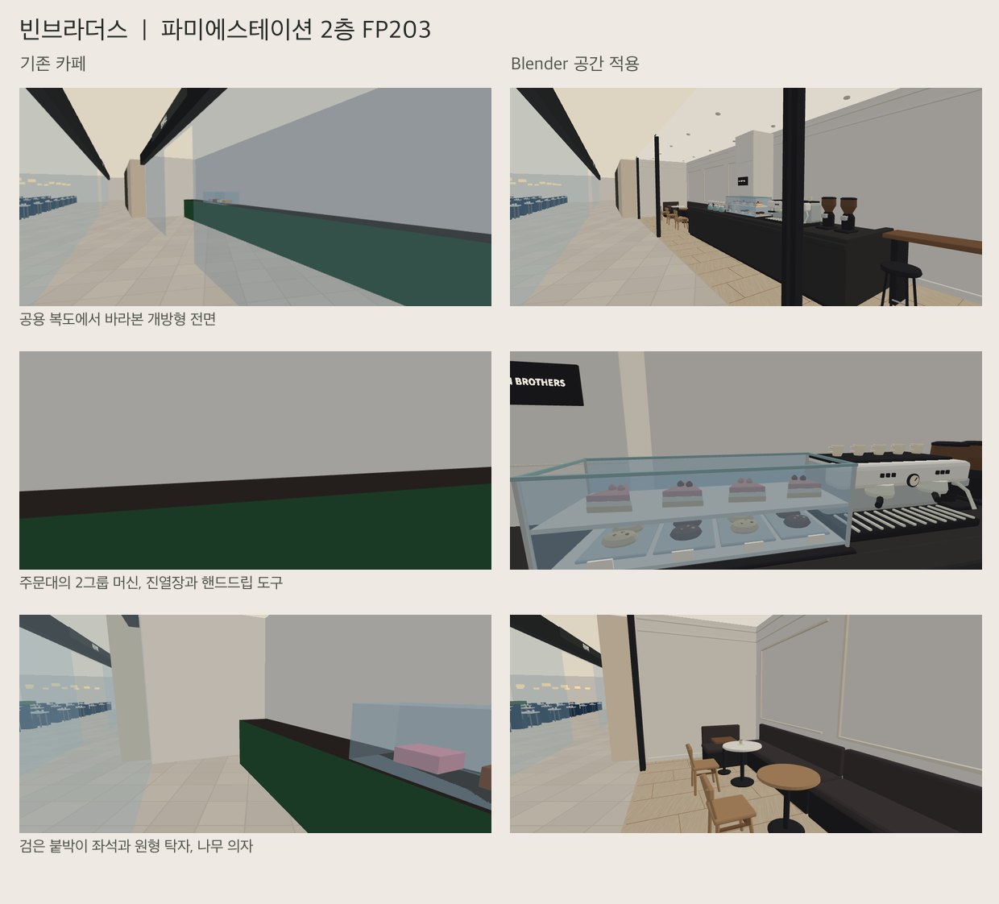

# 빈브라더스 파미에스테이션 FP203

빈브라더스의 파미에스테이션 매장은 사평대로 205, 2층 FP203호다. 운영사가 공개한 매장 사진 두 장에서 전면의 검은 기둥, 긴 검은 바, 흰 기둥에 붙은 명판, 쇼케이스, 커피 장비를 확인했다. [빈브라더스 매장 안내](https://www.beanbrothers.co.kr/info/location) · [운영사 매장 사진](https://www.beanbrothers.co.kr/info/location_detail?goodsNo=1000000527)

2023년 3월 설계 소개는 매장 면적을 191.5㎡로 표기한다. 박현성의 실내 사진에는 벽을 따라 꺾이는 검은 좌석, 원형 탁자와 목재 의자, 밝은 벽 몰딩, 나무 무늬 타일이 보인다. [INTERNI & Decor 프로젝트 기록](https://www.interndeco.com/en/projects/project-14322186)

게임의 점포 영역은 기존 도면에 맞춘 가로 14.86m, 깊이 3.0m다. 뒤쪽 공용 산책로를 유지하면서 그 안에 바와 좌석을 배치했다. 가구 치수, 주문대 안의 기기 모델과 수량, 원두·제과 구성과 색상은 공개 사진을 바탕으로 재구성했다.

[Blender 원본](fp203.blend)에서 바 몸체, 커피 장비, 제과 진열, 좌석, 마감에 속한 개별 물건을 편집할 수 있다. 편집 후 다음 명령으로 게임 파일을 갱신한다.

```sh
blender -b assets/models/bean-brothers/fp203.blend --python-exit-code 1 -P assets/models/bean-brothers/export.py
node assets/models/bean-brothers/check.mjs
```

통로에선 단순화한 외형이 보이고, 가까이 오면 한 번 받은 GLB를 다시 사용한다. 검증은 실제 게임에서 카운터 옆으로 들어가 좌석 앞까지 걸어간 뒤 뒤쪽 산책로와 재방문 상태를 확인한다.


