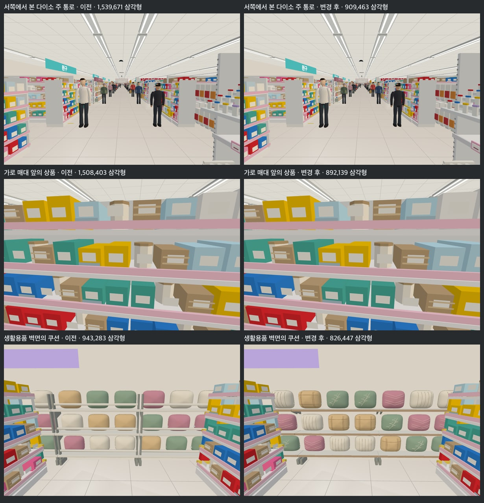

# 경부선 매표기와 다이소 패브릭 진열

[Blender 원본](concourse-fixtures.blend)에는 컬렉션 6개, 편집할 수 있는 메시 77개가 있습니다. 본체·화면·카드 인식부, 쿠션 겉감·자수·파이핑, 진열대 선반과 받침대를 개별적으로 수정할 수 있습니다. [통합 GLB](fixtures.glb)는 각 컬렉션을 하나의 메시로 담습니다. 게임은 1층 매표기와 지하 쿠션을 각각 받습니다. [게임 화면](preview.jpg)

| 컬렉션 | 적용 위치와 수량 |
| --- | --- |
| `TicketKiosk` | 경부선 1층 무인발권기 14대 |
| `CushionLinen`, `CushionSage`, `CushionRose`, `CushionIvory` | 다이소 패브릭 코너의 격자·잎사귀·갈매기·누빔 무늬 쿠션 총 126개 |
| `CushionRack` | 쿠션 세 칸을 받치는 3단 진열대 14조 |

겉감 색과 매표기 외형은 기존 게임의 표현을 따랐습니다. 쿠션 자수와 매표기 세부 부품은 이 장면을 위해 디자인했습니다.

저장소 루트에서 `npm ci`로 의존성을 설치한 뒤 이 폴더에서 실행합니다. 첫 번째 명령은 저장한 모델의 모양과 재질을 웹으로 내보냅니다. 두 번째 명령은 초기 디자인으로 원본과 GLB를 다시 만듭니다.

```sh
blender -b concourse-fixtures.blend --python-exit-code 1 -P export.py
blender --factory-startup -b --python-exit-code 1 -P build.py
```


## 다이소 지하 1층 통로

게임은 처음 경부선을 열 때 1층 매표기 파일 10,720바이트를 받는다. 지하 쿠션 72,384바이트는 매대 앞 6.1m 안에서 쿠션이 화면에 들어올 때 한 번 불러온다. 먼 곳에서는 원본과 같은 겉감 색, 부푼 모양과 선반을 3칸당 1,596삼각형으로 그린다. 가까운 쪽의 격자, 누빔과 나뭇잎 자수는 Blender 원본 메시를 쓴다. 이전 통합 파일과 분리한 6개 메시의 꼭짓점, 인덱스와 색 데이터는 일치한다.

홈·욕실용품 벽에 붙은 동쪽 선반은 쿠션 자수가 손님 쪽을 보도록 돌렸다. 서쪽 선반은 반대쪽 열린 통로를 향한다. [통합 월드](../world/README.md)의 실내 장면에는 같은 게임 배치에서 읽은 쿠션 126개와 선반 14개를 각각 연결할 수 있다. 개별 원본을 편집한 뒤 다시 동기화해도 사용자가 옮기거나 삭제한 배치를 보존한다.

기존 가로 매대는 9m 안에서 개별 용기와 가격표를 그린다. 너머에서는 같은 상품 순서와 선반의 색, 상자 윗면과 안내표를 묶어 그린다. 매대에 바짝 다가간 화면은 변경 전후의 1000×640 픽셀이 전부 같았다. 주 통로에서 동쪽을 볼 때 전체 삼각형은 1,539,671→909,463개, 그리기 호출은 394→393회였다. 가로 통로에서는 1,569,107→952,843개, 392→391회였다.

같은 컴퓨터에서 63.6m를 이동한 3쌍의 Chromium 테스트 모두 프레임 간격 99백분위가 16.8ms였다. 새 진열을 생성한 프레임의 생성 시간 95백분위는 7.9~9.3ms에서 6.3~6.5ms로 줄었다. 서쪽에서 출발해 가까운 매대를 보고 돌아왔을 때 먼 매대가 간략한 모습으로 복귀하는지, 쿠션 매대 뒤에서는 다운로드가 0회인지 다음 명령으로 확인할 수 있다.

```sh
node assets/models/daiso/check-aisle.mjs
```


