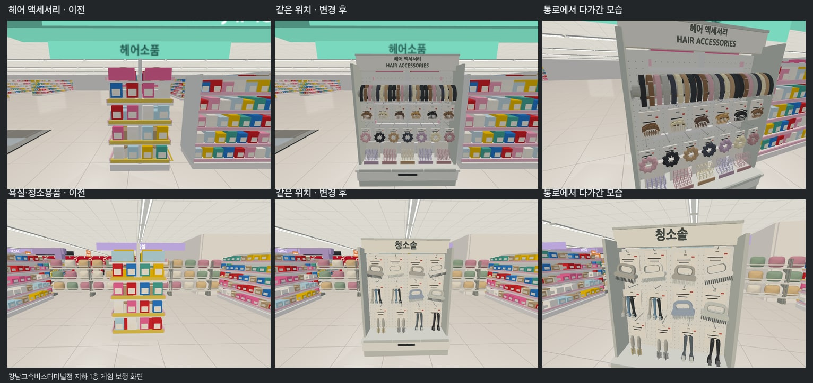

# 강남고속버스터미널점 다이소 · 헤어 액세서리와 청소솔

신반포로 194 서울고속버스터미널 지하 1층 44호에 있는 매장이다. 2026년 4월 6일 지점 방문자가 공개한 사진에는 긴 봉에 걸린 머리띠, 카드에 단 집게핀·곱창밴드, 분홍색과 연보라색 원통 헤어롤이 보인다. 같은 방문 기록의 별도 코너에서 손을 끼우는 청소솔, 작은 틈새솔 묶음, 원통형 금속모도 확인했다. [아성다이소 매장검색](https://www.daiso.co.kr/cs/shop?name_address=%EA%B0%95%EB%82%A8) · [네이버 지도 지점](https://map.naver.com/p/entry/place/931234931) · [지점 방문 사진](https://noopy0402.tistory.com/464)

게임의 기존 뷰티 안내 바로 아래에 머리띠 매대를 놓고, 계단 아래 가림을 피해 욕실·청소용품 통로 끝에 청소솔을 배치했다. 매대의 정확한 지점 내 위치, 1.50~1.54m 폭, 제품 색·수량과 11월 재고는 추정이다. 게임 속 표찰에는 확인되지 않은 가격과 품번을 넣지 않았다.

[Blender 원본](accessories.blend)에서 각 매대의 서랍, 원봉, 집게핀의 가동 턱과 살, 곱창밴드의 주름, 헤어롤의 열린 격자, 청소솔 손잡이의 구멍과 솔모를 수정할 수 있다. 원본에 편집 가능한 메시가 475개다. 게임은 매대 앞 6.6m 안에서 상품이 화면에 들어올 때 그룹별로 한 파일을 받는다. 머리띠는 112,892바이트·12,978삼각형, 청소솔은 112,160바이트·10,440삼각형이다. 뒤쪽 통로에서는 각각 576·684삼각형의 매대 외곽을 사용한다.

두 매대 사이의 선큰 통로는 실제 플레이어로 오갔다. 바닥 높이는 매장 -4.0m, 다섯 단 아래참 -4.6m였다. 처음 서쪽 입구와 매대 뒤쪽에서 두 웹 파일 요청은 0건, 매장을 왕복한 뒤에는 각 1건이다. 동일한 여섯 시점에서 1000×640 Chromium의 72프레임을 측정했다. 전후 95백분위 프레임 간격은 16.7~16.8ms였다.

```sh
blender -b assets/models/daiso-accessories/accessories.blend --python-exit-code 1 -P assets/models/daiso-accessories/export.py
node assets/models/daiso-accessories/check.mjs
```

두 매대 원본을 처음부터 재생성하려면 Blender에 `--python-exit-code 1 -P assets/models/daiso-accessories/build.py`를 전달한다.


