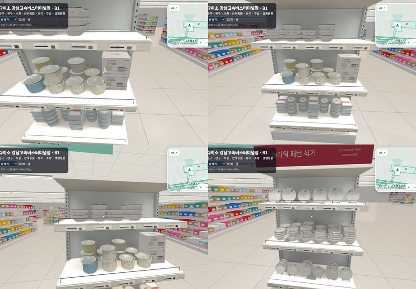
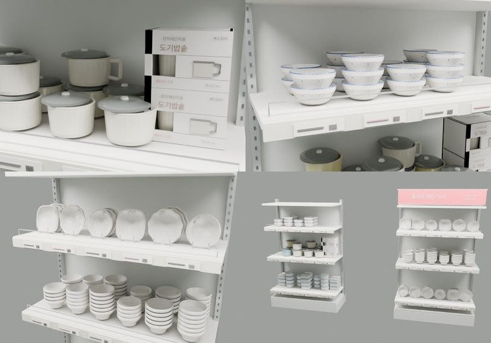

# 경부선 다이소 지하 1층 도자기와 식기

2026년 4월 6일 강남고속버스터미널점 방문 사진에는 3,000원·약 610mL가 인쇄된 도기밥솥 상자, 옆면에 골이 난 도기, 투명 뚜껑과 손잡이, 파란 테 찬기와 아래 칸의 보관 용기가 보인다. 옆 식기 코너 사진에는 붉은 한영 표지, 받침에 세운 원형·사각·물결 접시와 포갠 공기가 있다. 11월 26일 네이버 지도에서 같은 지점을 다시 확인했다. 기존 게임의 도자기 구역과 통로 폭에 맞춘 배치이며 가격과 진열은 방문 당시의 것이다. [지점 사진](https://noopy0402.tistory.com/464) · [네이버 지도](https://map.naver.com/p/entry/place/931234931)

`ceramics.blend`에는 편집 가능한 메시 2,048개와 조명 5개가 있다. 두 매대의 10개 배치가 게임에 들어간다. 가까이서 본 제품은 9개의 GLB를 공유한다. 5개 표면에는 Cycles 간접광을 구웠고, 덮개와 유약에는 이 통로의 천장등을 반사한다.

`node assets/models/daiso-ceramics/check.mjs`는 다른 층·진열 뒷면·등진 방향·문구 매대에서 요청 0건, 복도 12.8m 왕복과 재진입, 같은 에셋 다운로드 1회를 확인한다. 1,000×650 Metal Chromium에서 최종 보행 p95·p99 16.8ms였다.
