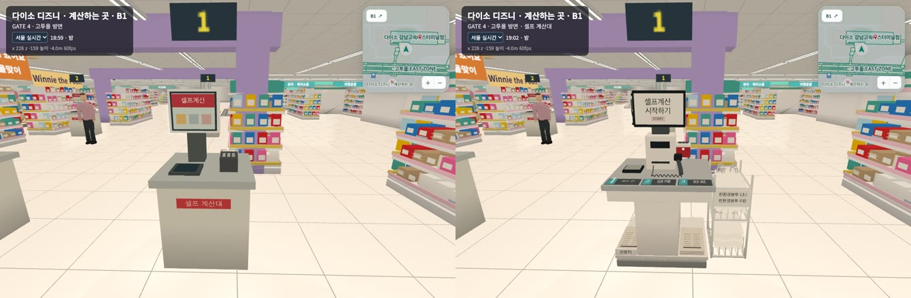

# 강남고속버스터미널점 B1 셀프계산대

지점 방문 사진에서 검은 테두리의 터치 화면, 손에 쥐는 바코드 리더와 꼬인 선, 상판의 결제 순서, 아래쪽 포장용 신문지와 오른쪽 철망 봉투함을 확인했다. 게임에서는 1번·4번 출입구 계산 구역의 첫 번째 셀프계산대에 이 형태를 적용했다. 2021년 방문 당시의 사진을 참고했고, 기기 치수와 두 구역에서의 정확한 위치는 추정했다. 네이버 지도에서 이 매장의 주소는 신반포로 194 지하 1층 44호다. [지점 방문 사진](https://soon-life.tistory.com/68) · [아성다이소 매장검색](https://www.daiso.co.kr/cs/shop?name_address=%EA%B0%95%EB%82%A8) · [네이버 지도](https://map.naver.com/p/entry/place/931234931)

왼쪽은 기존 4번 출입구 계산대, 오른쪽은 같은 위치에서 본 수정 후 모습이다. 지도(M)에서 **다이소 셀프계산대**를 검색하면 이 계산대 앞에 도착한다.



[편집용 Blender 원본](checkout.blend)의 DaisoPackingCheckout 컬렉션에서 모니터 글자, 신문, 봉투와 철망을 각각 선택할 수 있다. 두 곳은 같은 모델을 공유한다. 매대가 시야에 들어오고 약 8m 안으로 다가가면 상세 파일을 받는다. 웹용 모델은 메시 한 개, 삼각형 9,291개, 108,300바이트다. 원본을 수정한 뒤에는 아래 명령으로 게임 파일을 다시 내보낼 수 있다.

```sh
blender -b assets/models/daiso-checkout/checkout.blend --python-exit-code 1 -P assets/models/daiso-checkout/export.py
```
