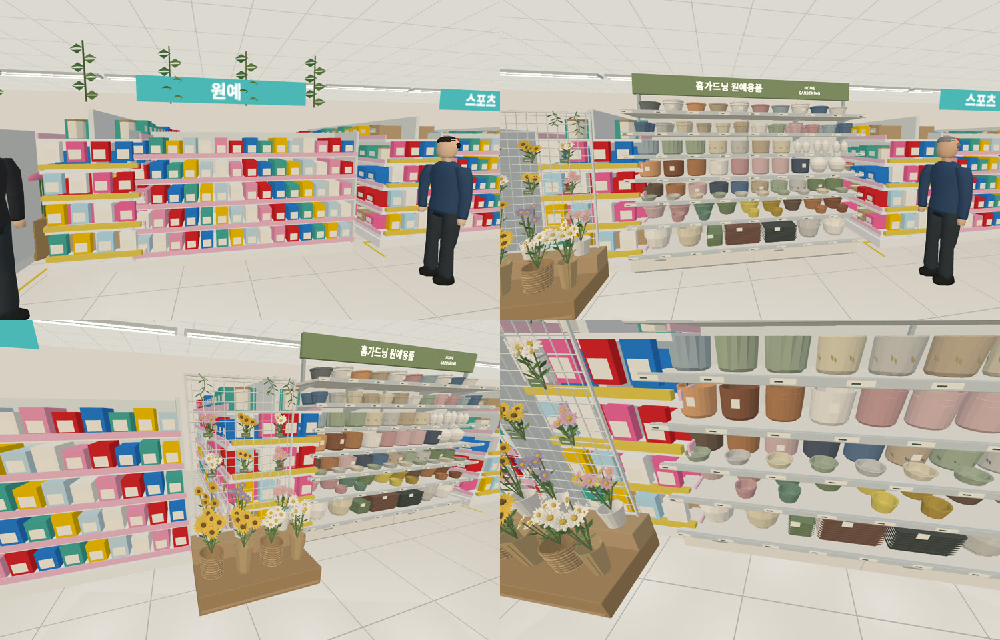

# 다이소 강남고속버스터미널점 홈가드닝 코너



강남고속버스터미널점의 주소는 서울고속버스터미널 지하 1층 44호다. 2026년 4월 6일 이 지점에서 촬영한 두 사진에는 연두색 ‘홈가드닝 원예용품’ 간판, 홈과 무늬가 있는 화분, 작은 목이 달린 흰 화병, 포개 놓은 어두운 사각 받침과 큰 흰 화분이 보인다. 별도 철망 진열대에는 붉은색·노란색·흰색 조화 다발, 직조 바구니와 종이 포장이 있다. 화분에는 안쪽 벽과 바닥을 만들고, 조화에는 꺾인 꽃잎과 줄기·잎을 모델링했다. 개별 크기와 재고, 정확한 수량·배치는 확인되지 않아 기존 매장의 원예 구역에 맞춰 구성했다. [네이버 지도](https://map.naver.com/p/entry/place/931234931) · [아성다이소 공식 매장검색](https://www.daiso.co.kr/cs/shop?name_address=%EA%B0%95%EB%82%A8) · [지점 방문 사진](https://noopy0402.tistory.com/464)

게임 진입은 [연두색 간판 앞 주 통로](https://minwoo19930301.github.io/gangnam-terminal-world/#/gyeongbu/B1?p=214.993,-4,-132.377,11)에서 가능하다. 같은 지하층에서 매장 서쪽 1번 출입구로 들어와 주 통로를 따라 걸어도 두 매대에 닿는다. 화분과 꽃을 보는 거리에 들어올 때 각각 한 번 모델을 받는다. 선반 뒤를 보면 화분 상세가 캐시에 있어도 456삼각형의 등판과 선반만 렌더링한다.

`garden.blend`에 화분 진열 487개와 조화 진열 499개의 편집 가능한 메시가 있다. 여러 화분을 같은 선반에 실제로 겹친 경우만 웹 내보내기에서 가려진 안쪽 면을 제외한다. 분리하거나 기울인 원본은 개별 판정한다. 게임용 파일은 화분 392,680바이트, 조화 393,108바이트이며 각각 한 개의 메시다.

```sh
blender -b -P assets/models/daiso-garden/build.py
blender -b assets/models/daiso-garden/garden.blend -P assets/models/daiso-garden/export.py
node assets/models/daiso-garden/check.mjs
```

첫 명령은 원본을 제작한다. 둘째 명령은 원본 수정을 유지하며 게임 파일만 내보낸다. 보행 검사는 정상 게임 1번 출입구에서 약 53m를 이동하고 두 매대에 대한 충돌, 꽃 진열 앞 통로의 양방향 보행, 다른 코너를 다녀온 후 다운로드 횟수와 등판 렌더링을 확인한다. 출입문과 계산대, 쿠션 선반과 천장등은 각 위치의 가시 범위에서 구성한다.

1000×640 headless Chromium에서 변경 전후 같은 시점마다 80프레임을 측정했다. 주 통로 전체 장면은 919,733삼각형·121드로콜에서 903,552삼각형·135드로콜, 조화 앞 사선 시점은 1,299,683삼각형·136드로콜에서 906,310삼각형·147드로콜이었다. 95백분위 프레임 간격은 두 버전 모두 16.7~16.8ms였다.
