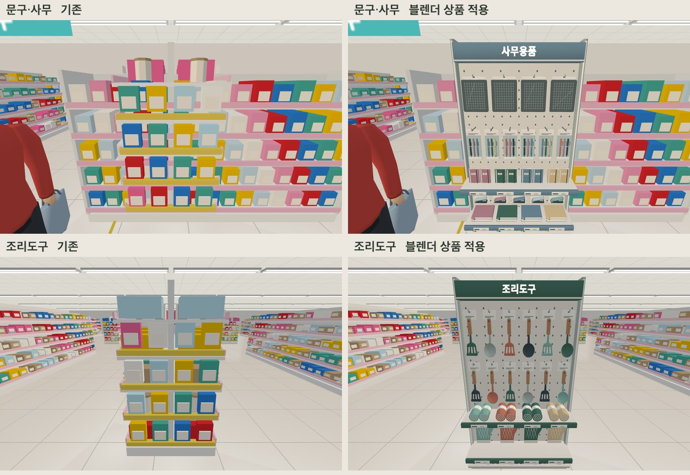

# 강남고속버스터미널점 다이소 B1 진열대



문구·사무 구역에 커팅 매트의 격자와 각도선, 세 자루씩 포장한 클립 볼펜, 금속 심과 힌지가 보이는 미니 스테이플러, 밴드가 달린 수첩을 모델링했다. 조리도구 구역에는 구멍이 뚫린 뒤집개, 안쪽이 오목한 국자, 엄지 부분과 누빔선이 있는 주방장갑, 접거나 말아 놓은 식탁용 천을 배치했다.

2026년 4월 6일 지점 방문 사진에서 B1 매장의 문구류와 주방용품 구역을 확인했다. 아성다이소의 2024년 문구 보도자료는 금속 클립 볼펜, 미니 스테이플러, 눈금 커팅 매트, 수첩을 소개한다. 2021년 주방 보도자료에는 뒤집개와 국자, 주방장갑과 식탁용 천이 나온다. 상품 형태와 색 조합, 걸이별 배치는 이 자료를 참고해 구성했다. 해당 지점의 당일 재고와 개별 진열 위치는 미확인이다. [지점 방문 사진](https://noopy0402.tistory.com/464) · [아성다이소 오피스 문구](https://eng.daiso.co.kr/brand/daiso_news/50139?btype=product&page=3) · [아성다이소 주방용품](https://www.daiso.co.kr/brand/daiso_news/8697?btype=product)

게임에서 매대를 바라보는 주소는 [문구·사무](https://minwoo19930301.github.io/gangnam-terminal-world/#/gyeongbu/B1?p=172.053,-4,-117.569,21)와 [조리도구](https://minwoo19930301.github.io/gangnam-terminal-world/#/gyeongbu/B1?p=258.649,-4,-146.430,201)다. 각 매대는 같은 층에서 앞면이 가까이 보일 때 개별 GLB를 한 번 읽는다. 먼 매대는 한 개의 간략 메시로 표시한다.

`merchandise.blend`의 `DaisoStationeryEndcap`과 `DaisoKitchenEndcap` 컬렉션에서 매대와 상품을 개별 편집할 수 있다. 원본은 Blender Z-up, 단위는 미터다. 두 컬렉션은 편집 화면에서 좌우로 나란히 보이며 개별 GLB에서는 각 진열대의 바닥 중앙이 로컬 원점이다.

원본 생성과 게임 파일 내보내기를 함께 실행하려면 저장소 루트에서 아래 명령을 사용한다.

```sh
blender -b -P assets/models/daiso-merchandise/build.py
```

편집한 `.blend` 파일의 변경을 게임에 반영하려면 아래 두 명령을 실행한다.

```sh
blender -b assets/models/daiso-merchandise/merchandise.blend -P assets/models/architectural-retail/export.py
node assets/models/daiso-merchandise/pack.mjs
```
