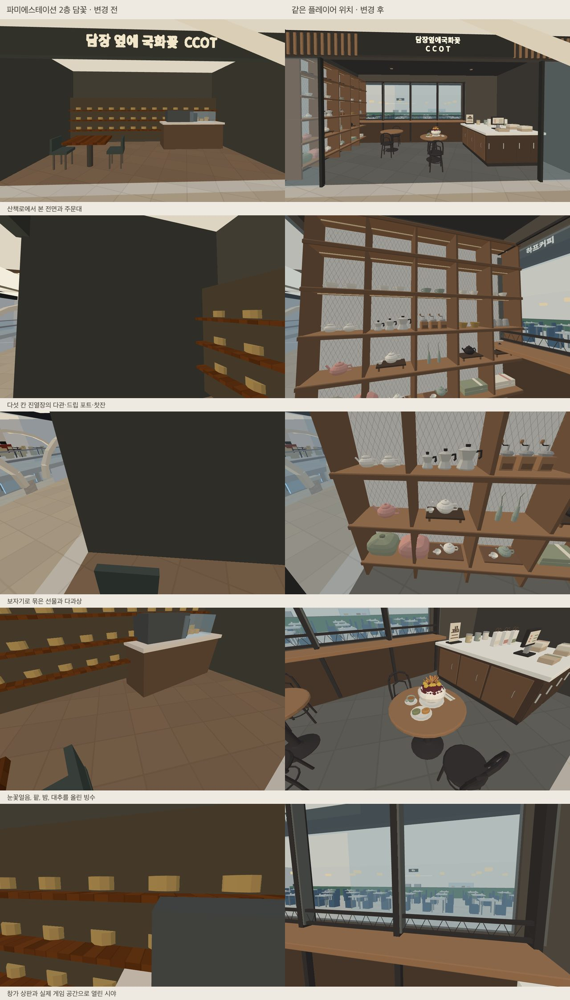

# 담장옆에국화꽃 파미에점 FP204

운영사는 매장을 파미에스테이션 2층 204호로 안내한다. 공식 사진에는 손님 기준으로 왼쪽에 조명 달린 다기 진열장, 오른쪽에 흰 상판과 짙은 하부장이 있고 안쪽에는 곡목 의자와 창가 자리가 있다. 2026년 11월 26일 네이버 지도 장소 번호 36165988을 열어 지점명과 사평대로 205 센트럴시티 파미에스테이션 2층 표기를 대조했다. [운영사 매장 안내 및 사진](https://damccot.com/shopinfo/store.html) · [네이버 지도](https://map.naver.com/p/entry/place/36165988)

파미에점 방문 사진에서 철망을 댄 다섯 칸의 선반, 법랑 드립 포트, 손분쇄기, 모카포트, 검은색·흰색 찻잔, 분홍색·연두색 보자기와 작은 다과상을 확인했다. 밤대추팥빙수 사진은 우유 얼음 위쪽에 팥, 노란 밤, 말린 대추가 쌓이고 낮은 그릇과 받침을 쓴 모습을 보여 준다. [진열장·내부·보자기 사진](https://greenstar94.tistory.com/39) · [밤대추팥빙수 사진](https://dangit.tistory.com/39) · [담꽃 디저트 상품](https://damccot.com/product/list.html)

기존 게임의 가로 6.75m, 깊이 3.40m에 가구를 맞췄다. 진열대의 실제 치수, 전시 수량, 보자기 내용물, 식탁 위 차와 구움찰떡 조합은 추정이다. 방문 사진 속 창 너머로는 아래층 통로가 보인다. 게임에서는 기존 맞은편 식당 공간이 보이며, 실제 아래층까지의 수직 거리와 벽 배치는 확인이 필요하다.

[Blender 원본](fp204.blend)에 편집 가능한 771개 물체가 있다. 찻잔 손잡이, 매듭, 대추 단면, 창틀과 의자도 개별로 수정할 수 있다. 아래 명령은 수정한 원본으로 진열장·가구·디저트를 각각 한 개의 그리기 호출로 내보낸다. 게임에서는 가까이서 보게 된 파일만 불러온다.

```sh
blender -b assets/models/damccot/fp204.blend --python-exit-code 1 -P assets/models/damccot/export.py
node assets/models/damccot/check.mjs
```


