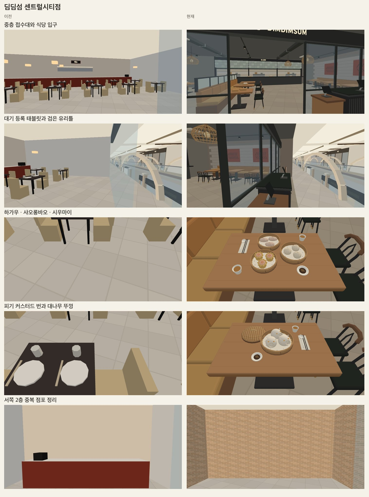

# 딤딤섬 센트럴시티점

네이버의 지점 안내는 호남선 하차장 옆, 파미에스테이션 에스컬레이터 위 아웃백 옆으로 안내한다. 신세계센트럴시티 중층 도면에는 딤딤섬이 아웃백과 나란히 적혀 있다. 운영사의 2층 번호 범례도 서쪽 13번을 딤딤섬으로 표시한다. 게임에서는 중층의 점포 한 곳을 운영하고 서쪽 2층에는 점포 외곽과 문만 남겼다. 기존 안내판에 기록된 층별 점포 이름은 보존했다. [네이버 지도 지점 안내](https://map.naver.com/p/entry/place/1280841149) · [운영사 중층 도면](https://www.shinsegaecentral.com/public/20211116/M1F.png) · [층별 안내](https://www.shinsegaecentral.com/famille) · [2층 번호 도면](https://www.shinsegaecentral.com/public/img/famille_floor_2_ko_map.png)

운영사 실내 사진에서 긴 가죽색 소파, 가림 유리, 목제 상판과 검은 의자, 공개 조리창 위 유리블록, 붉은 벽 패널, 엮은 대나무 조명과 노출 천장을 확인했다. 지점 방문 사진에는 입구의 검은 접수대, 비스듬한 태블릿, 메뉴판, 유아의자가 보인다. 하가우의 접힌 피, 샤오롱바오의 윗주름, 흰 피기 커스터드 번의 돼지코와 노란 눈은 운영사의 메뉴 사진을 참고했다. [운영사 점포 및 메뉴 사진](https://www.shinsegaecentral.com/famille/DimDimSum) · [방문자의 접수대와 식탁 사진](https://h-man.tistory.com/m/194)

기존 게임 점포 16 × 9m 안에 가구를 맞췄다. 실측 자료가 없어 식탁 수, 색과 치수, 착석 간격, 메뉴의 조합, 벽 패널 그림과 조리창 안의 기물은 재구성했다.

[Blender 원본](restaurant.blend)의 다섯 컬렉션에 편집 가능한 메시 979개가 있다. 카트 바퀴, 조명갓의 대나무살, 찜통의 바닥살과 돼지코 안쪽도 개별 물체로 열 수 있다. 게임은 매장 안팎에서 보이는 집기만 가까운 거리에서 5개의 GLB로 불러온다. 식탁 9개, 음식 세트 4상은 같은 모델 데이터를 재사용한다. 전체 전송량은 558,984바이트다.

```sh
blender -b assets/models/dimdimsum/restaurant.blend --python-exit-code 1 -P assets/models/dimdimsum/export.py
node assets/models/dimdimsum/check.mjs
```


