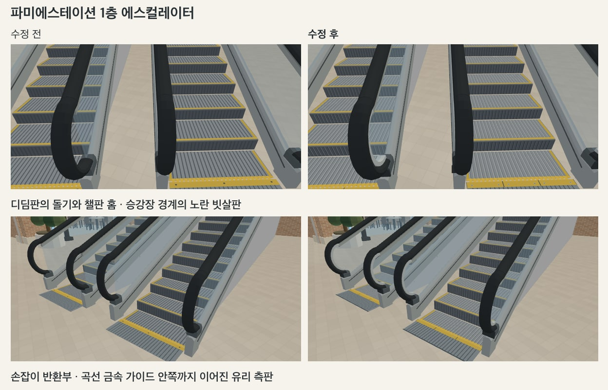

# 공통 에스컬레이터



`escalator.blend`에는 디딤판(Tread), 빗살판과 바닥판(Comb), 측판과 손잡이(Skirt), 손잡이 반환부(Return) 컬렉션이 있다. 디딤판의 솟은 돌기와 수직 챌판의 홈은 옆면에 빛이 닿도록 모델링했다. 승강장에는 분할 빗살판과 고정 나사를 두었다. 고무 손잡이가 되감기는 양 끝에는 곡선형 금속 가이드와 고무 반환구가 있다. 일반 승객용 에스컬레이터의 부품 구분과 실루엣을 참고해 제작했으며 현장 기종과 치수는 확인되지 않았다. [Schindler 9300 제품 안내](https://www.schindler.com/content/dam/website/us/docs/escalators/schindler-9300/schindler-9300-escalator-brochure.pdf/_jcr_content/renditions/original./schindler-9300-escalator-brochure.pdf) · [Schindler 소유자 안내](https://www.schindler.com/content/dam/website/us/docs/safety/schindler-owners-guide.pdf/_jcr_content/renditions/original./schindler-owners-guide.pdf)

## 게임 연결

`K.escalator`가 받는 두 끝점, 층고, 폭, 방향과 속도로 네 부품을 배치한다. 디딤판은 한 구간에 한 번씩 인스턴싱하며, 빗살판에 닿을 때 양 끝의 디딤면이 수평이 된다. 게임 시계와 모터의 수평 속도로 디딤판을 이동시키고 승하차 경계에서 메시를 자른다. 측판과 손잡이 단면은 연장 방향으로만 기울여 곡률과 높이를 유지한다. 키트가 그리는 유리 측판은 양 끝의 금속 가이드 안쪽까지 둥글게 이어진다. 장소별 외장재, 하부 트러스와 승객 물리도 키트가 처리한다. 개별 장소에서 별도로 제작한 경사로·무빙워크는 각각의 모듈이 그린다.

## Blender에서 다시 내보내기

프로젝트 루트에서 `npm ci` 후 설치한 Blender 실행 파일을 사용한다. 편집본 재수출은 한 명령으로 이뤄진다.

```sh
blender -b assets/models/escalator/escalator.blend -P assets/models/escalator/export.py
```

기본 설계로 원본을 다시 만들 때는 `blender -b -P assets/models/escalator/build.py`를 먼저 실행한다. 내보내기는 컬렉션에 기록한 기준점을 기준으로 부품별 메시와 정점색을 취합하고 프로젝트의 glTF Transform 및 meshoptimizer를 거쳐 `parts.glb`를 쓴다.

## 확인

- 모든 장소와 지연 로딩 층을 생성하면 공통 부품을 쓰는 에스컬레이터가 8개 모듈에서 123개 생성된다. 모델 폭은 0.82~1.65m, 평면 길이는 5~30m다.
- `node --max-old-space-size=8192 tools/audit_vertical.mjs`로 승객 이동과 계단을 점검한다. `node tests/newcore-transfers.mjs`는 뉴코아의 서서 타기와 양끝 승하차까지 검사한다.
- 파미에 1층(폭 1.10m)과 뉴코아 1층(폭 1.26m)에 일반 게임 URL로 입장해 상행·하행을 촬영했다. 두 페이지에서 GLB HTTP 200과 Chrome 콘솔 오류 0건을 확인했다.
- 파미에의 나란한 두 11.01m 구간에서 이동 키를 놓고 탔다. 초속 0.6m로 상행·하행 모두 반대편 승강장에 도착했고, 탑승 중 디딤판이 사라지거나 뒤로 튀는 현상은 관찰되지 않았다. 뉴코아 자동 검사에서는 20개 구간의 진입·탑승·하차와 2,020개 지점의 통과 여유를 확인했다.
- 파미에와 뉴코아의 같은 시점에서 디딤판 시각만 0.247초 바꾸면 각각 42,268픽셀과 49,415픽셀의 RGB 채널 하나 이상이 8단계 넘게 달라졌다(900×610). 파미에 손잡이 측면 시점의 드로 호출은 수정 전후 모두 140회였다.

비교 사진은 파미에스테이션 1층의 같은 카메라 위치·방향과 같은 디딤판 위치에서 찍었다. 게임에서 주간을 선택하면 두 시점을 다시 볼 수 있다. [디딤판과 빗살판](https://minwoo19930301.github.io/gangnam-terminal-world/?pitch=-29.79#/famille/1F?p=20.55,0,155.0,199) · [손잡이 반환부 측면](https://minwoo19930301.github.io/gangnam-terminal-world/?pitch=-26.36#/famille/1F?p=18.45,0,155.05,237)
