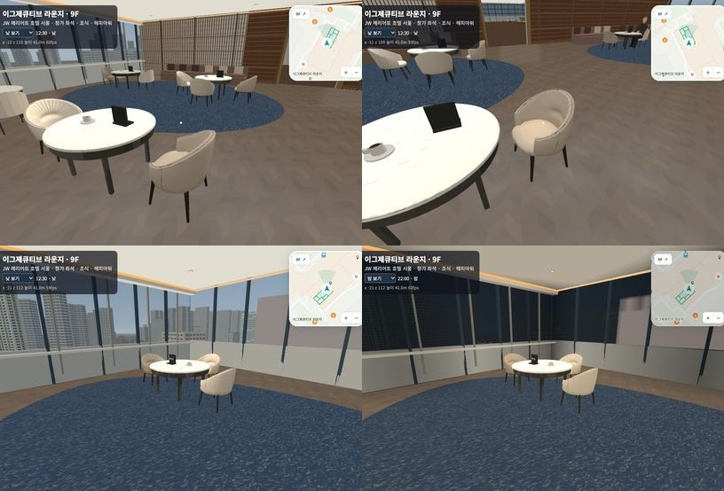
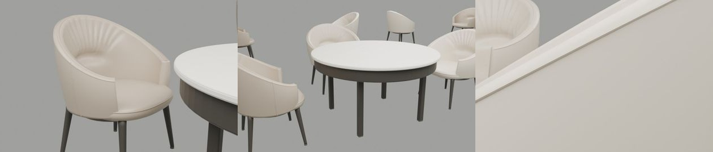

# JW 서울 9층 창가 좌석

방문 사진의 짙은 목재 다리, 앞쪽으로 낮아지는 가죽 팔걸이, 등판 한가운데로 모이는 주름과 옆판 박음질을 Blender에서 다시 만들었다. 아이보리 원탁에는 둥글게 다듬은 끝, 검은 에이프런과 네 개의 다리가 있다. 32석과 테이블 12개의 배치는 게임 평면에 맞춘 추정이다. [네이버 방문 사진](https://m.blog.naver.com/ssunnyp/224463195614) · [호텔 공식 이그제큐티브 라운지](https://www.marriott.com/ko/hotels/seljw-jw-marriott-hotel-seoul/rooms/executive-lounge/)

`seating.blend`에 편집 가능한 메시 580개와 조명 5개를 담았다. 원본에 놓인 네 가지 2·3석 조합은 같은 좌석을 활용하며, 웹에서는 의자 GLB 하나(156,012바이트)와 원탁 GLB 하나(145,576바이트)만 각자 한 번 받는다. 가까운 테이블에서만 원본 상세를 그린다. 들이는 방향, 좌석색, 테이블 직경은 각 배치가 보관한다.

`node assets/models/executive-seating/check.mjs`는 다른 층과 회랑에서 상세 요청 0건, 중앙 통로 8.4m 보행, 낮·밤과 파일 재사용을 확인한다. 1,000×650 Metal Chromium에서 마지막 보행의 p95와 p99는 16.8ms, 최대 33.3ms였다.
