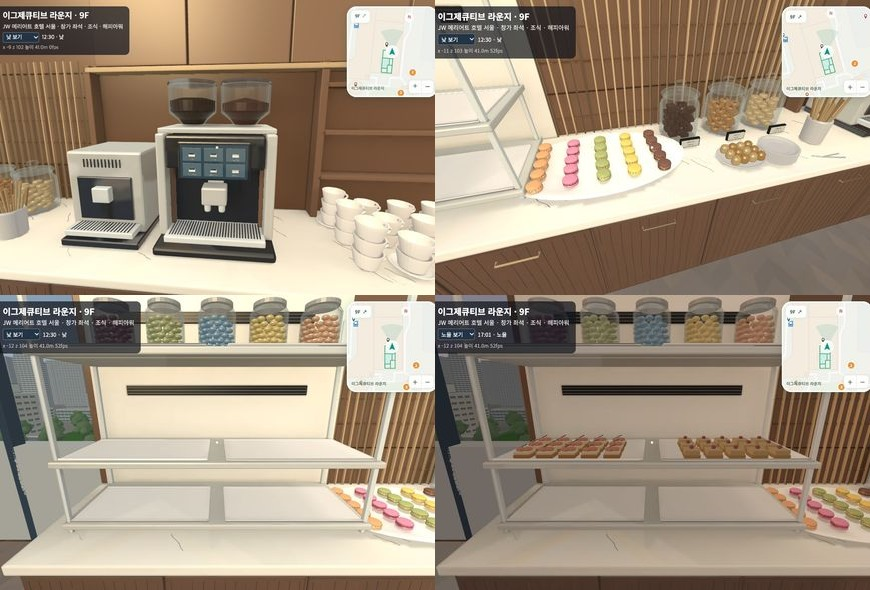
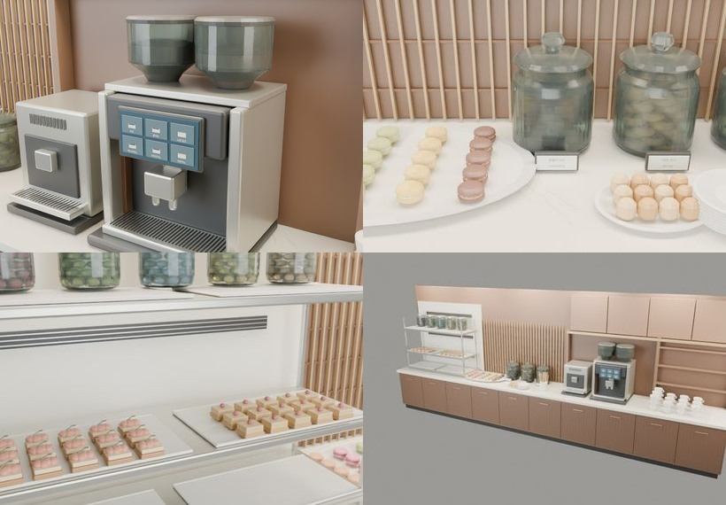

# JW 메리어트 서울 9층 이그제큐티브 라운지

6월 방문객 사진에서 확인되는 두 원두통, 전면 터치 메뉴와 추출구, 금속 물받이, 얇은 목재 벽장, 세 개의 뚜껑 달린 쿠키 단지, 마카롱과 작은 페이스트리, 빵 스틱과 사탕 선반을 제작했다. 서빙대 치수와 방 안의 위치는 사진 및 기존 게임 평면에서 추정했다. 화면 속 메뉴와 카나페는 대표 형태로 재구성했다. [네이버 방문 사진](https://m.blog.naver.com/ssunnyp/224463195614) · [호텔 공식 9층 라운지 안내](https://www.marriott.com/ko/hotels/seljw-jw-marriott-hotel-seoul/rooms/executive-lounge/)

호텔이 안내하는 이브닝 오르되브르 시간인 서울 16:30부터 21:00 직전까지 가운데 선반에 카나페와 작은 페이스트리를 올린다. 낮과 야간에는 흰색 플래터가 비어 있다. 게임의 실시간 시계와 시간대 미리보기 모두 같은 조건을 적용한다.

`lounge.blend`에는 편집 가능한 메시 2,441개, 조명 7개, 상세 배치 16개가 있다. `build.py -- --bake --render`로 Blender 소스·게임 모델·조명맵을 재생성할 수 있다. `capture-reflection.mjs`는 9층 창가와 수납장에 맞는 반사 환경을 생성한다.

`node assets/models/executive-service/check.mjs`는 카메라 세 곳의 외부 요청 0건, 서울 16:29·16:30·20:59·21:00 경계, 낮·노을·밤의 선반 상태와 파일 재사용, 4.48m 보행을 검사한다. 1,000×650 Metal Chromium에서 최종 보행 p95·p99 16.8ms였다.
