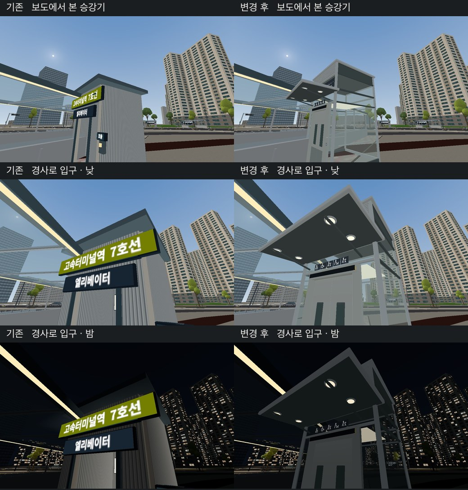

# 고속터미널역 4번 출구 지상 승강기

게임에서 지도를 열고 `4번 출구 엘리베이터`를 검색하면 지상 경사로로 이동한다. 문에 가까이 가면 양쪽 스테인리스 문짝이 열리고, E로 승강기를 타면 7호선 대합실 B2에 도착한다. 반포 방면과 내방 방면 B3 승강장은 대합실의 서로 다른 승강기로 내려간다.

서울교통공사의 2026년 9월 승강기 현황에서 7호선 고속터미널역 3호기는 지상–B2, 1호기와 2호기는 B2–B3로 기재돼 있다. 기존 게임의 지상 승강기는 B1·B3에도 정차했고, 대합실에서는 두 승강장 승강기 앞의 칸막이가 진입을 막고 있었다. 두 문 앞에 통행 폭을 확보했다. [서울교통공사 승강기 설치현황](https://www.data.go.kr/data/15044261/fileData.do)

시민기자가 찍은 지상과 B2 사진에 보이는 돌출 차양·네 매립등·루버·금속 프레임·외벽 유리·문짝 관찰창·역명과 노선 표식을 Blender로 제작했다. 같은 기사의 대합실 안내판에서도 지상행과 두 승강장행이 구분된다. 네이버 거리뷰로 공원 옆 도로, 병원 건물과 주변 경사를 대조했다. 실제 경사로의 경사도, 승강장의 절대 위치와 지하 통로 길이는 현장 실측하지 않았다. [서울시 사진과 승강기 안내](https://mediahub.seoul.go.kr/archives/2016717) · [공원 옆 보도 거리뷰](https://map.naver.com/p?p=h51PUh0v3HkqSGUy7YkYHg,45,2,78,Float)



`pavilion.blend`에는 프레임, 유리, 문짝이 따로 들어 있다. 통합 원본의 도시 전경에서 `고속터미널역 · 4번 출구 승강기`를 선택할 수 있다. [도시 원본에서 렌더한 낮과 밤](city-view.jpg) 게임에서는 건물과 공용 문짝 GLB를 시야에 들어올 때 각각 한 번 받는다. 문짝 두 개가 한 메시를 공유한다. 밤에는 차양등과 승강기 천장등 주변에만 조명을 더했다.

- 게임에서 지상 보도 → 경사로 → 3호기 B2, B2 → 지상 왕복을 확인했다.
- B2 하차 후 두 방향 승강기까지 각각 일반 보행으로 이동해 E로 B3에 도착했다. 승강기를 잘못 탈 수 있었던 벽 너머 지점까지 포함해 검사한다.
- 수정한 Blender 원본을 내보낼 때는 프로젝트 루트에서 아래 명령을 실행한다.

```sh
blender -b assets/models/exit4-pavilion/pavilion.blend --python-exit-code 1 -P assets/models/exit4-pavilion/export.py
node tests/exit-four-lifts.mjs
```
