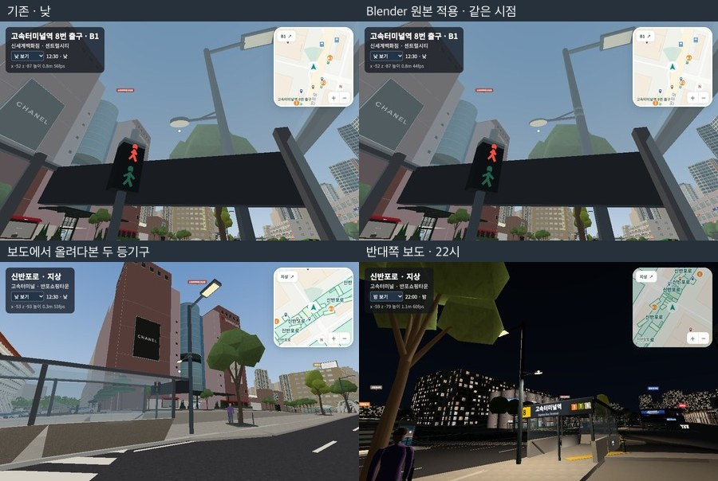

# 고속터미널역 8번 출구 보도등

2026년 1월 네이버 거리뷰에서 등주 하나에 차도용 상부 등과 보도용 하부 등이 달린 모습을 확인할 수 있다. 낮은 등에는 수평 팔, 사선 버팀대, 얕은 타원형 갓이 보인다. 밴드 단면, 렌즈 곡률과 치수는 사진의 비례에 맞췄다. 야간 조도는 게임에서 정한 값이다. [네이버 거리뷰](https://map.naver.com/p?c=18.00,0,0,0,adh&p=lHsXW6lxT97x-yAj0PFdXA,101,8,32,Float)



게임에서는 기존 등주 한 개를 같은 위치에서 교체한다. 하부 광원은 보도 방향으로 1.05m 떨어져 있고, 상부 광원에 대한 상대 세기는 0.23이다. 지주의 받침과 광점 아래 보도의 게임 지형 높이 차이도 모델에 반영했다. 8각형 보행 충돌은 기존 규격을 따른다. [게임 근접 시점](../../../?q=low#/street?p=-52.2,0,-86.5,125.64617,37)

## 원본 편집 및 배치

`lamp.blend`의 `Exit8_Sidewalk_Lamp` 컬렉션에 기둥, 두 등기구, 버팀대와 고정 밴드 등 11개 편집 부품이 있다. 설정한 색과 발광 렌즈 표시는 `mesh.js`로 내보낸다. 428개 삼각형은 게임의 기존 거리 재질 배치에 들어간다. Blender에서 렌즈는 도시의 서울 태양 고도를 따라 밤에 켜진다.

수정을 마친 뒤 이 디렉터리에서 실행한다.

```sh
blender -b lamp.blend --python build.py -- --export-current
```

통합 도시에는 `assets/models/world/indoor-layout.mjs`의 실제 거리 배치를 통해 원본 컬렉션 한 개가 연결된다. 도시 배치 갱신은 기존 `assets/models/world/indoor-layout.py`를 사용한다.

저화질 일반 게임의 접근·근접·반대쪽 보도·뒤돌아본 시점을 낮과 22시에 대조했다. 8장 모두 기존과 같은 드로콜 수였으며, 수정 후 구간별 p95는 16.7~16.8ms였다. 22시에 가까운 나무 수관, 수피, 보도의 휘도 중앙값은 수정 전후 각각 96.0, 71.9, 199.4로 일치했다(0~255). 실측 조도가 아닌 게임 화면의 밝기다.
