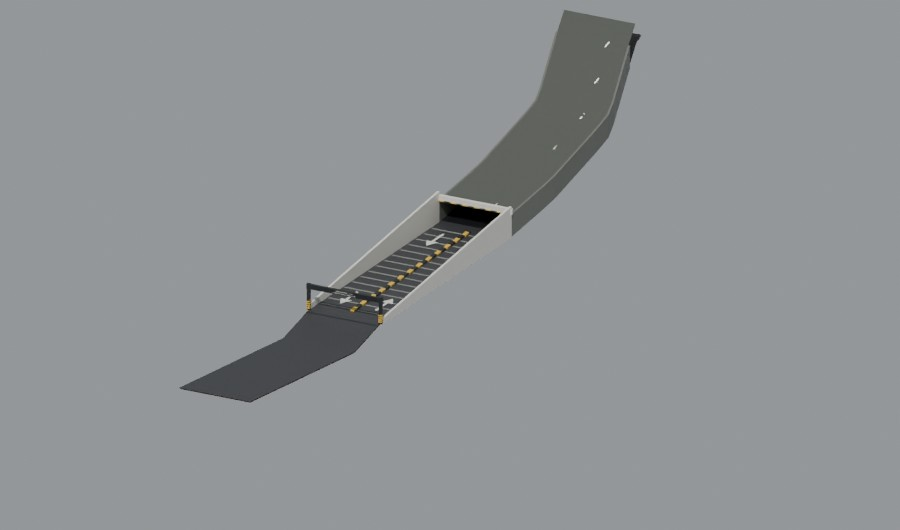

# 파미에주차장 상부 경사로

[Blender 편집 원본](ramp.blend)을 열면 노면, 중앙분리대, 방향별 화살표, 측벽, 포털, 진입 표지, 천장과 등기구를 선택할 수 있다. 게임의 아스팔트·콘크리트 무늬와 입구 간판 이미지는 파일에 포함했다. [실제 게임에서 본 상행·하행 화면과 공개 사진 근거](../../../docs/map-audit/famille-parking/README.md)



원본은 거리 모듈의 경사로 생성 함수를 실행해 만든다. 정상 게임과 같은 표고 보간, 면 분할, 간판 UV, 노면 방향을 사용한다. 네 화살표의 위치는 게임 안내를 위한 근사다. 주변 호텔 화단과 나무는 해당 시설에서 관리한다.

통합 배치 ID는 `streets/FamilleParkingRamp/1`이고 컬렉션 이름은 `FamilleParkingRamp`다. 도시 배치 스크립트를 실행하면 거리 시설과 도시 전경에서 같은 컬렉션 인스턴스를 공유한다. 브라우저는 기존 거리 함수를 사용한다. 원본 재생성은 Blender에서 개별 편집한 메시를 덮어쓴다.

```sh
blender -b --factory-startup -t 4 --python-exit-code 1 --python assets/models/famille-parking-ramp/build.py
blender -b --factory-startup -t 4 --python-exit-code 1 --python assets/models/famille-parking-ramp/check.py
```

검사는 임시 도시 파일에 실제 배치행을 연결하고, 11개 메시의 삼각형 4,428개를 게임이 출력한 정점과 대조한다. 정점의 최대 월드 좌표 오차는 0.00000191m였다. 면 모서리별 UV·색, 네 화살표 끝의 오르내림과 방향도 확인한다.
