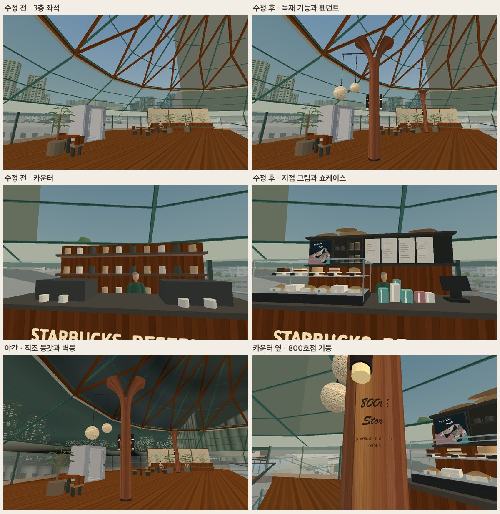

# 스타벅스 파미에파크R점 · 3층 실내



2025년 10월 14일 방문 사진에서 호두색 목재 기둥의 세로 이음, 위로 넓어지는 날개, 검은 원통 벽등과 성기게 짠 구형 등갓을 확인했다. 스타벅스 코리아는 이 매장을 국내 800호점으로 소개한다. 주문대 옆 기둥에는 목재에 직접 붙인 짙은 ‘800th Store’ 글자가 있다. 연구 논문 그림 6과 7에서도 이 지점의 목재 기둥, 둥근 펜던트와 좌석을 볼 수 있다. [지점 방문 사진](https://onespotdiary.com/starbucks-reserve-famille-park-seoul-coffee-tree-concept/) · [Kalay와 Kandemir, 2025, 그림 6·7](https://iconarp.ktun.edu.tr/index.php/iconarp/article/download/1276/547) · [스타벅스의 800호점 소개](https://www.starbucks.co.kr/whats_new/planner.do) · [공식 매장 안내](https://www.starbucks.co.kr/store/store_map.do?in_biz_cd=9990)

계산대 사진에는 왼쪽부터 ‘Famille Park’와 삼각 돔 그림을 넣은 액자, 찻잔과 원두 보관병, 밝은 메뉴판이 이어진다. 장 위에는 생두 자루를 포개 놓았다. 낮은 냉장 쇼케이스의 빵과 케이크, 옆의 민트색·흰색 포장과 기울인 계산 단말기도 사진을 바탕으로 만들었다. 무늬목의 결, 등갓과 포스터 그림은 새로 제작했다. 기둥 세 개의 위치·높이와 제품 배치는 게임의 원형 데크, 난간과 기존 카운터에 맞춘 근사치다. [주문대 사진](https://onespotdiary.com/wp-content/uploads/2025/10/20251014_093233-1024x577.jpg) · [800호점 기둥 사진](https://onespotdiary.com/wp-content/uploads/2025/10/20251014_112303-577x1024.jpg)

일반 지도에서 ‘파미에파크R’을 검색해 3층에 도착한 후 좌석과 주문대를 걸어서 방문할 수 있다. 시야에 들어온 근거리 실내 마감은 텍스처를 내장한 247,536바이트 GLB 한 개, 17,921삼각형, 한 드로로 그린다. 벽등의 따뜻한 반사광은 기둥 정점에 구워 넣었다. [좌석 쪽 게임 시점](https://minwoo19930301.github.io/gangnam-terminal-world/#/famille/3F?p=-51.75,9.6,222.06,37,14) · [주문대 게임 시점](https://minwoo19930301.github.io/gangnam-terminal-world/#/famille/3F?p=-35.22,9.6,214.05,277,5)

블렌더 원본에는 기둥 면, 벽등, 직조 갓, 글자, 선반과 상품이 각각 개체로 들어 있다. 원본에서 저장한 편집은 아래 명령으로 게임 파일에 반영한다. 전체 편집 도시에 배치할 때는 센트럴시티 모듈의 3층 제작 좌표에 연결한다. [Blender 원본](coffee-trees.blend) · [내보내기](export.py) · [보행·가시성 검사](check.mjs)

```sh
blender -b -t 4 assets/models/famille-reserve-timber/coffee-trees.blend --python-exit-code 1 -P assets/models/famille-reserve-timber/export.py
node assets/models/famille-reserve-timber/check.mjs --gpu
```
