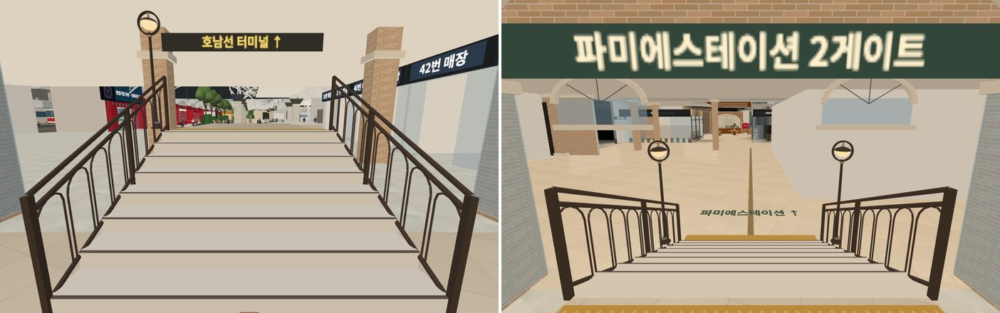

# 파미에스테이션 1층과 호남선 사이 계단

서울성모병원의 고속터미널 경로 영상 29~32초에는 밝은 돌에 짙은 가로 디딤코, 계단 위·아래의 황색 점형 경고판, 아치 무늬가 반복되는 세로 금속 난간과 원형 고리 속 흰 유리 조명이 보인다. 계단 입구부터 아래쪽 바닥까지 보이는 프레임에서 짙은 가로선이 적어도 여덟 개 보인다. 운영사 1층 안내도에 표시된 터미널 연결을 따라 승차 대합실 쪽 계단에 적용했다. 기둥에 적힌 1 GATE와 그 오른편의 스타벅스는 [승차장에서 찍은 사진](https://gaesung.tistory.com/251)에서도 확인할 수 있다. [서울성모병원 공식 보행 영상](https://www.youtube.com/watch?v=HgbY_flKpMI&t=29s) · [신세계 센트럴 파미에스테이션 층별 안내](https://www.shinsegaecentral.com/famille)

게임은 8단, 높이 0.17m, 디딤깊이 0.36m, 폭 3.3m로 재현했다. 총 높이 1.36m와 이 위치는 모델 추정치다. 천천히 오르내리는 보행 카메라에는 매끄러운 경사면을 사용한다. 계단 옆으로도 높이 변화 없이 지나갈 수 있다. 디딤판 단면과 조명은 기존 [Blender 계단](../staircase/staircase.blend)과 [파미에 광장 집기](../famille-atrium/atrium-fittings.blend)를 사용했다.



```sh
node tests/famille-grade.mjs
node tests/famille-stair-view.mjs
```

첫 검사는 지형 적용 전후의 물리를 확인한다. 두 번째 검사는 실제 게임에서 세 보행선과 옆 평지 통로를 왕복하고, 낮과 밤에 양방향 시선 앞 5m에 조명·난간·안내판이 걸리는지 검사한다. 중앙과 양옆에서는 렌더된 24개 디딤판 지점을 따로 측정한다.
