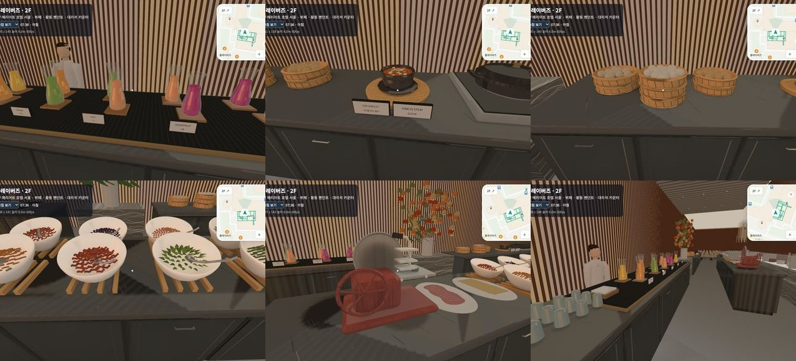
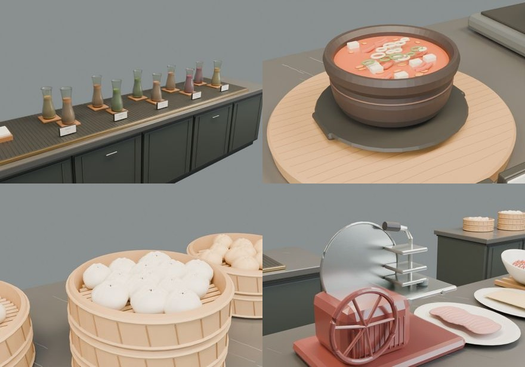

# JW 메리어트 서울 2층 플레이버즈 조식

공식 호텔 식당 소개와 네이버 플레이스의 2층 위치, 6월 29일 방문 사진에 나온 조식 카라페·검은 뚝배기와 표찰·찬 그릇·붉은 슬라이서를 참고했다. 대나무 찜기 재질과 만두 담음새에는 이전 조식 사진도 참고했다. 석재 조리대 배치와 그릇 크기는 게임 평면과 사진에 맞춘 추정치다. 음식은 방문 사진에 담긴 한 서비스의 재구성이다.

- [JW 메리어트 서울 플레이버즈](https://www.marriott.com/ko/dining/restaurant-bar/seljw-jw-marriott-hotel-seoul/6396017-.mi)
- [네이버 지도 플레이버즈](https://map.naver.com/p/entry/place/1736859138)
- [방문객의 호텔 및 조식 사진](https://m.blog.naver.com/ssunnyp/224463195614)
- [이전 조식 찜기와 델리 사진](https://myliving.net/entry/플레이버즈-조식-2024년-7월-말-JW-메리어트-서울-호텔-뷔페)

`build.py`는 Blender에서 세 조식대의 편집 가능한 오브젝트와 20개 상세 모델을 만든다. `--bake`는 주요 7개 표면의 조명을 굽는다. `capture-reflection.mjs`는 같은 식당의 반사 환경을 만든다. `check.mjs`는 다른 공간 네 곳에서 요청이 0건인지 확인하고 음료 바에서 조리대로 걸으며 화면별로 모델을 확인한다. 9.8m 보행의 최종 측정은 p95·p99·최대 모두 16.8ms였으며, 별도의 첫 방문 측정에서는 최대 150ms 한 프레임을 관찰했다.
