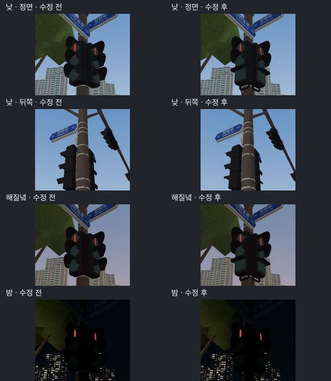
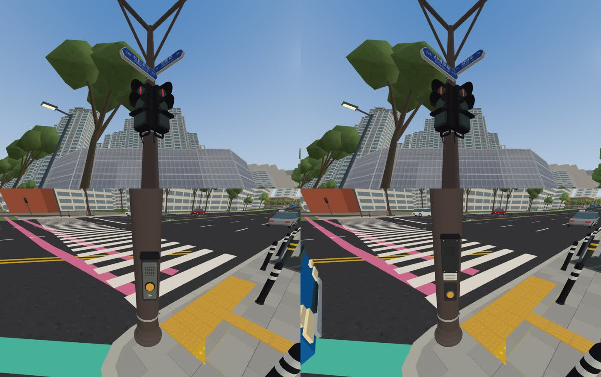

# 신반포로와 잠원로가 만나는 고터사거리


2026년 1월 23일 네이버 거리뷰 두 곳에서 같은 갈색 신호주를 찾았다. 두 촬영점에서 본 방향을 게임의 미터 좌표로 옮기면 기존 기둥 자리에서 약 3.1 m 떨어진 곳에서 만난다. 신반포로 방향의 차량 신호 세 묶음은 사진에 보이는 가로암 길이에 맞췄다. 모서리를 도는 4.3 m 우회전 차로와 보행섬 사이에는 모델에서 최소 0.19 m가 남는다. 서초구는 2025년 12월 8일 사거리의 네 방향 횡단보도를 개통했다. 신호주 높이, 볼라드 간격과 보도 재료의 치수는 사진 추정값이다. [네이버 거리뷰 A](https://map.naver.com/p?p=HK5BFh1JiYwO0LFmRGUw-A,19,0,80,Float) · [네이버 거리뷰 B](https://map.naver.com/p?p=Xj8lR0my1cNJYr0iBlNBng,156,0,80,Float) · [서초구의 횡단보도 개통 기록](https://www.seocho.go.kr/site/seocho/ex/bbs/View.do?bcIdx=406159&cbIdx=61)


[signals.blend](signals.blend)에 신호주와 기구의 편집 가능한 메시를 12개 컬렉션으로 나눴다. 두 방향의 보행 신호에는 따로 접힌 차광판, 적색 보행자 형상과 대기 중인 숫자면이 있다. 주철 기단의 앵커, 강관 이음, 양면 도로명판, 음향신호기 스피커 구멍과 노란 버튼은 가까이 가서 볼 수 있다. 신호 표시는 촬영 당시의 장면을 따른다. 보행섬에는 엇갈린 화강석 포장, 점형·선형 유도 블록과 두 줄 반사띠 볼라드가 있다.

2026년 1월 거리뷰에서 보행 신호의 위 두 칸에는 원형 차광판이 있고, 맨 아래 잔여시간 표시창은 편평한 사각형으로 보인다. 모델에는 아래 칸의 접힌 금속 윗면과 옆면, 외함 밑의 U자 받침과 짧은 검은 선을 표현했다. 접힘 길이와 선의 굴곡은 사진을 보고 추정했다. [보행 신호 거리뷰](https://map.naver.com/p?p=HK5BFh1JiYwO0LFmRGUw-A,19,0,80,Float)



동남쪽 보행섬에서 보면 신반포로 명판 위에 금속 가로대가 보인다. 게임에도 이 가로대와 두 매달림쇠를 넣었다. 기둥 아래에는 음향 안내함과 황색 단추함을 따로 달고, 그 사이에 거리뷰에서 확인되는 흰 표찰을 배치했다. 사진으로 읽기 어려운 표찰의 작은 글자는 색과 줄만 표현했다. 기구 간격과 받침 두께는 사진 비례로 추정했다. [네이버 거리뷰 · 신반포로 보행섬](https://map.naver.com/p?p=HK5BFh1JiYwO0LFmRGUw-A,19,0,80,Float)



게임은 부품별로 거리를 판정한다. 8 m 이내에서 보이는 점자블록만 돌기 원본을 불러오며, 원본 2개로 점 704개와 선 104개를 그린다. 블록과 두 돌기 파일을 합쳐 17,168 B다. 전체 상세 자산 14개는 322,224 B다. 높이를 신호주의 DEM 기준에 고정해 플레이어 얼굴 앞의 작은 버튼도 화면에 보이는 동안 유지한다.

세 곳에서 새로 접속해 근처에서 뒤돌아본 경우, 먼 거리, 고투몰 지하의 상세 요청이 각각 0건임을 확인했다. 접근·회전·재방문에서 각 파일을 한 번씩 받았고, 보행섬 안 6.62 m를 이동하는 동안 측정한 프레임 간격은 p95 16.7 ms, p99 16.8 ms였다. 사용한 기기는 로컬 Mac의 Chromium Metal이다.

```sh
blender -b --factory-startup -P assets/models/goter-crossing/build.py
node assets/models/goter-crossing/photo-fit.mjs
node assets/models/goter-crossing/check.mjs
```
