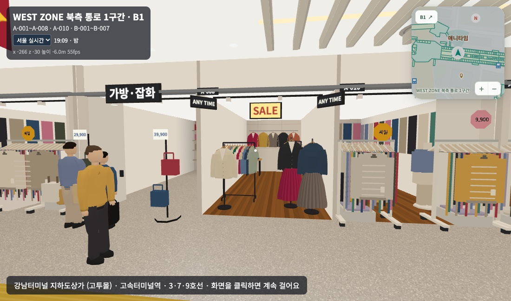

# 서편 A-008 애니타임

ANYTIME 고투몰점의 네이버 지도 주소는 신반포로 200 고투몰 A008이다. [네이버 지도](https://map.naver.com/p/entry/place/31263946)



고투몰 점포 안내 대표 사진에서 입구 왼편의 밝은 가디건과 색상별 티셔츠 행거, 오른편의 검정 가디건·붉은 주름치마와 남색 상의·회갈색 주름치마를 확인했다. 옷걸이의 둥근 스탠드와 이동식 행거 바퀴, 뒤쪽의 상의와 접은 니트, 통로로 돌출된 검은 ANY TIME 간판과 노란 세일 종이도 반영했다. 측정 자료가 없어 진열대 사이 간격과 옷 수량은 게임 매장의 기존 폭에 맞췄다. [점포 안내와 대표 사진](https://gotomall.kr/stores/65e3d4b6-f7ee-4898-bdba-8282f5e004a9)

`anytime.blend`의 `AnytimeApparel` 아래에 전면 코디·왼쪽 티셔츠·오른쪽 니트·후면 상품 컬렉션이 있다. 상의 30벌과 주름치마 2벌, 옷과 분리된 삼각형 옷걸이, 스탠드와 바퀴를 편집할 수 있다. 게임 파일은 단일 메시, 삼각형 18,563개, 231,544바이트이며 기존 고투몰 진열의 거리·가시성 전환을 사용한다.

```sh
blender -b assets/models/gotomall-anytime/anytime.blend -P assets/models/gotomall-anytime/export.py
```

[게임에서 애니타임 입구로 이동](https://minwoo19930301.github.io/gangnam-terminal-world/#/gotomall/B1?p=-266.92,-6,-32.11,20.53)
