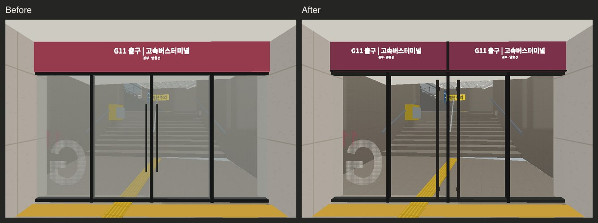

# 고투몰 중앙광장 G11 유리문

고투몰 쪽에서 본 현장 사진에는 계단 앞에 검은색 세로 당김봉 두 개와 분홍 안내판 두 개가 보인다. 유리 네 장을 고정창과 출입문으로 나누고, 각 손잡이의 봉·연결대·유리 고정판을 따로 모델링했다. 폭과 높이는 기존 연결통로에 맞춘 추정치다. [현장 사진이 실린 방문기](https://m.blog.naver.com/marketer_jyh/224465977099)

Blender 원본은 [g11.blend](g11.blend)다. 금속 프레임과 유리는 렌더링 방식이 달라 두 컬렉션으로 나누었다. 기존 고투몰 안내 문구는 게임에서 겹쳐 그린다. 게임에서 문을 통과하면 계단 위의 다이소 4번 출입구로 연결된다.



게임 파일과 거리별 간략 모델을 함께 다시 만들려면 저장소 루트에서 실행한다.

```sh
blender -b --python-exit-code 1 -P assets/models/gotomall-g11/build.py
```
