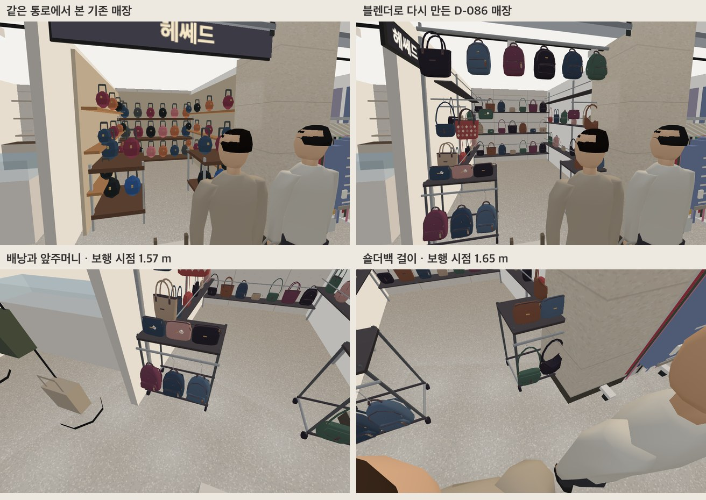

# 헤쎄드 D-086



고투몰 점포 안내에는 헤쎄드가 D-086, 모자·악세서리 업종으로 등록돼 있다. 대표 사진에 보이는 전면 상단의 어두운 배낭, 입구 양쪽 행거와 그 사이 통로, 붉은 마름모 토트, 원형 꼬리표와 왼쪽의 작은 검은 간판을 반영했다. 사진 확인일은 2026년 11월 26일이다. [점포 안내와 대표 사진](https://gotomall.kr/stores/1429441b-a03a-46fb-9133-417cc4a676ea)

블렌더에서 가방 몸통과 옆폭, 앞주머니, 지퍼 손잡이, 버클과 핀, 열린 어깨끈과 안감을 만들었다. 게임 안 매장에는 배낭 18개, 손목 끈 파우치 17개, 플랩 숄더백 13개, 토트 13개, 호보백 7개가 있다. 내부 선반의 상품 순서와 수량, 끈과 봉제선의 위치, 색과 소재 표현은 사진을 참고해 구성했다. 실제 상품의 브랜드, 재질, 재고 수량은 미확인이다.

[게임에서 남측 통로의 헤쎄드 보기](https://minwoo19930301.github.io/gangnam-terminal-world/#/gotomall/B1?p=73.46,-6,-146.23,188)

게임은 먼 거리에서 낮은 해상도의 전시 형상을 쓰며 30m 안에서 중거리 모형, 8.5m 안에서 근거리 모형을 화면에 보일 때 불러온다. 근거리 모형은 93,380바이트와 삼각형 24,360개, 중거리 모형은 8,632바이트와 삼각형 1,402개다. 각 거리에서 가방과 선반을 함께 한 번 그린다. 입구 행거와 벽 선반은 보행 충돌을 따로 처리한다.

원본 `hessed.blend`에서 `HessedShop` 컬렉션을 편집한다. 진열대, 통로 쪽 상품, 머리 위 걸이, 내부 상품이 하위 컬렉션으로 나뉜다. 같은 모양과 색의 가방은 메시를 공유한다. 원점은 점포 전면 중앙 바닥이며 앞면은 Blender −Y다. 원본의 천·가죽풍 마감과 금속 재질은 별도 재질 슬롯에 있다.

편집한 원본에서 두 게임용 파일을 내보낼 때는 아래 명령을 실행한다.

```sh
blender -b assets/models/gotomall-hessed/hessed.blend -P assets/models/gotomall-hessed/export.py
```

생성 스크립트에서 원본과 두 게임 파일을 다시 만들 때는 아래 명령을 사용한다.

```sh
blender -b -P assets/models/gotomall-hessed/build.py
```
