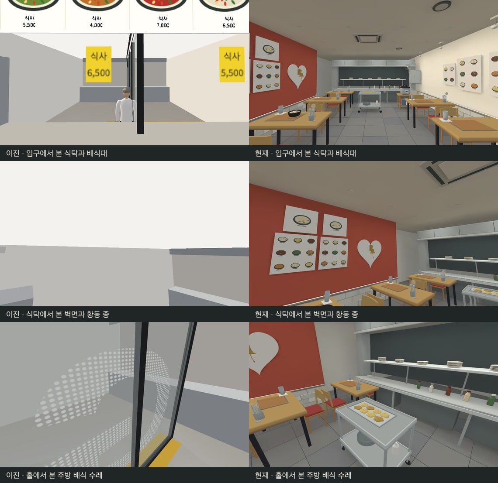
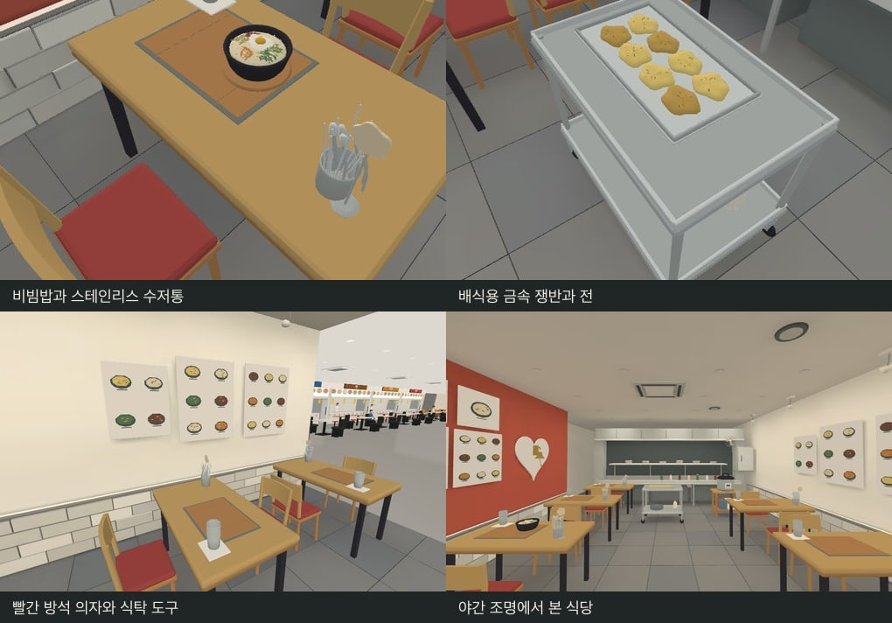

# 서편 G-010 마당

서초구 일반음식점 인허가 자료의 `3210000-101-2012-00324`는 점포명 마당, 신반포로 지하 200 G-10호, 영업장 면적 53.53㎡로 등록되어 있다. 게임의 이전 구획은 5.53 × 6.15m의 약 34.01㎡였다. 서울시설공단 1구역 도면에서 G-011 뒤쪽으로 꺾이는 경계를 읽어 총면적을 맞췄다. 개별 변의 길이와 지하상가 외곽에 접하는 사선은 게임에 맞춘 추정이다. 공개 사진에 보이는 좌석과 배식 창구까지 집기를 제작했다. 네이버 지도에서는 동일 주소와 상호로 개별 핀을 확인하지 못했다. [서초구 인허가 자료](https://data.seoul.go.kr/dataList/OA-18673/S/1/datasetView.do) · [공단 1구역 배치도](https://www.sisul.or.kr/open_content/com/common/upfiles.do?program=undershop!0923_gosokteomineol_1chabaechido_%281guyeok%29.jpg) · [고투몰 운영사 점포 사진](https://gotomall.kr/stores/7cfea3b4-a229-469b-aa7d-222755fd5b3b)

사진에서 붉은 벽과 흰 하트에 달린 황동 종, 흰 벽돌 마감, 사진 메뉴판, 빨간 방석과 밝은 원목 식탁, 식탁 가운데 바닥판, 수저통과 포갠 물컵, 스테인리스 조리창과 수레, 밥솥을 확인했다. 메뉴와 접시에 보이는 색과 형태를 참고해 달걀 비빔밥과 작은 전 여덟 개를 구성했다. 메뉴 도해, 음식별 재료·개수·위치, 식당 안 좌석 간격과 조명 출력은 모델용으로 구성했다.

## 원본과 실행

`madang.blend`에는 식당 배치 장면과 11개 집기 컬렉션, 메시 1,199개와 조명 14개가 있다. 식탁과 수저통은 양쪽 좌석 열에서 같은 원본을 재사용한다. 게임은 음식과 가까운 집기가 보일 때 개별 GLB를 읽고, 식당 조명 지도 두 장은 해당 표면과 함께 읽는다. 11개 GLB 합계는 501,356바이트, 조명 두 장은 37,104바이트다. Blender에 보관된 원본 밥알·수저·벽돌의 세부 형상은 웹용 내보내기에서 줄였다.

저장소 루트에서 원본 전체는 `blender -b --python assets/models/gotomall-madang/build.py`, 편집한 원본의 게임 데이터는 `blender -b assets/models/gotomall-madang/madang.blend --python assets/models/gotomall-madang/export.py`로 갱신한다. `node assets/models/gotomall-madang/check.mjs`는 폴리곤 면적과 기존 지하상가 경계, 복도에서 입장해 두 식탁 열 사이를 지나 배식대까지 걷고 복귀하는 동선, 측벽·뒷벽에서의 요청 여부를 확인한다.
