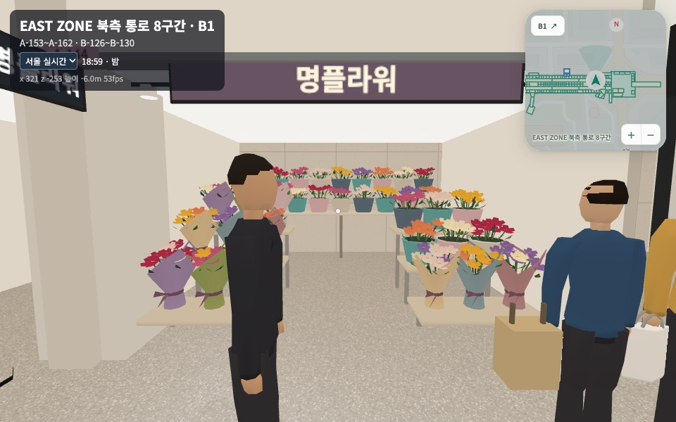

# 명플라워 · A-144



고투몰 점포 안내의 첫 번째 사진을 참고했다. 전면 왼쪽의 리본 묶은 꽃다발, 높이가 다른 밝은 진열대, 오른쪽의 색색 양동이와 뒤쪽 절화가 보인다. 호수와 업종은 안내에서 확인했다. 점포의 폭과 깊이, 내부 상품의 종류와 수량은 사진에 맞춰 추정했다. [점포 안내와 사진](https://gotomall.kr/stores/2262a6d2-4ea7-47c4-97ea-e8ec3f9d95ae)

편집 원본은 `myeong.blend`의 `MyeongFlower` 컬렉션이다. 36개 꽃 묶음과 계단형 선반을 개별 오브젝트로 편집할 수 있다. 게임용 `myeong.glb`는 단일 메시, 삼각형 16,376개, 139,380바이트다. 보행자는 입구의 두 진열대 사이를 지나 뒤 선반 앞까지 갈 수 있다. 기존 고투몰 진열의 39m 거리 전환과 진열 구역 가시성 검사를 공유한다.

```sh
blender -b assets/models/gotomall-myeong/myeong.blend -P assets/models/gotomall-myeong/export.py
```

[게임에서 명플라워 앞에 서기](https://minwoo19930301.github.io/gangnam-terminal-world/#/gotomall/B1?p=321.12,-6,-252.54,20.53)
