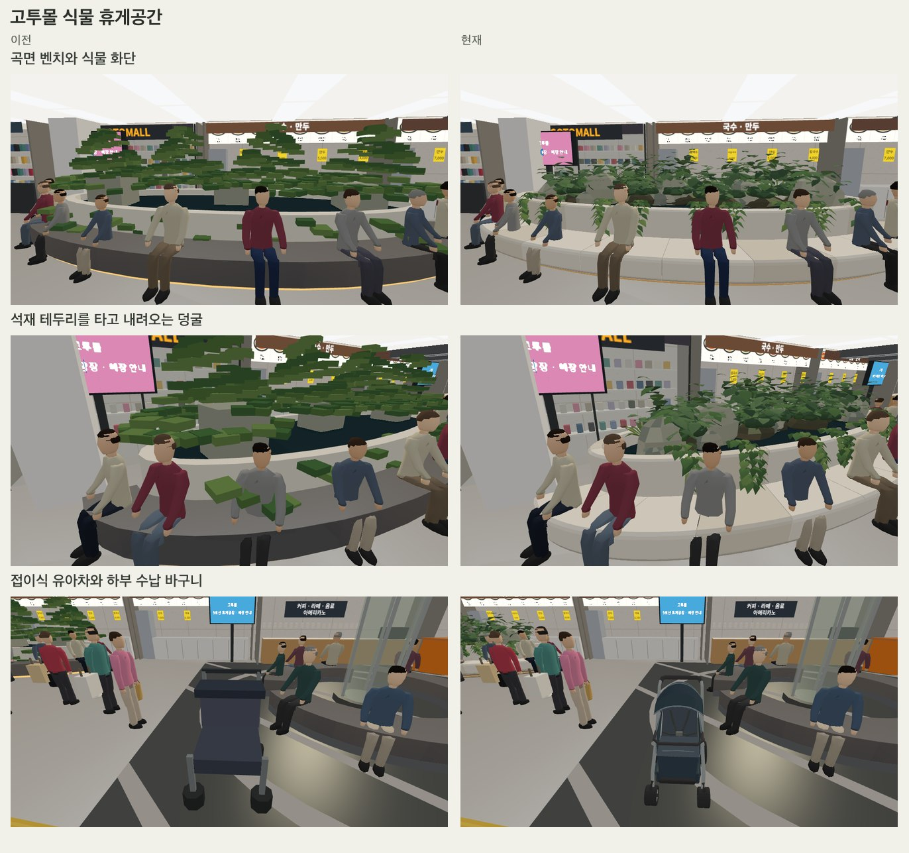

# 고투몰 식물 휴게공간

2026년 8월 현장 취재 사진에서 화단 둘레의 밝은 곡면 좌석, 들어간 하부의 따뜻한 조명, 회색 돌 사이에 자라는 초록 잎과 수면을 확인했다. 사진의 오른쪽에는 서편의 검은 석재 좌석과 유리 기둥이 따로 보인다. 2021년 현장 조사 표 7에도 식재 둘레를 감싼 밝은 휴게석이 실려 있다. [현장 취재](https://rurubu.jp/andmore/article/25097) · [두 휴게공간을 담은 사진](https://img.rurubu.jp/img_srw/andmore/images/0000743968/Ft3inl0CXSwiZMRAGv8gksdvbw6jKsoDQcN5alsk.jpg) · [지하광장 연구, 표 7](https://www.kieae.kr/xml/30143/30143.pdf)

네이버 지도에서 신반포로 200 고투몰 지점을 확인했다. 식재와 유아차에는 프로젝트에 있던 9호선 인근 위치를 사용했다. 좌석 치수와 곡률, 개별 바위와 잎의 위치, 유아차 기종은 게임에 맞춰 구성했다. 유아차가 있는 휴게 공간은 이전 보행 영상 판독을 따랐다. [네이버 지도](https://map.naver.com/p/entry/place/21714783) · [보행 영상](https://www.youtube.com/watch?v=rLMagJuViqo&t=860s)

[Blender 원본](plaza.blend)에서 인조석 단위 패널, 덩굴과 잎, 유아차 차양과 벨트를 포함한 2,340개 메시를 편집할 수 있다. 게임에서는 좌석·식재·유아차를 나눠 불러온다. 같은 광장에 있어도 화면 밖 대상을 위해 파일을 받지 않는다.

화단의 웹 모델을 줄이기 전에는 29,154삼각형, 513,696바이트였다. 원본에서 부드럽게 지정한 잎의 표면을 유지해 같은 잎의 정점을 공유하게 한 뒤, 가까이 보는 모델을 15,261삼각형과 193,252바이트로 줄였다. 먼 거리에서는 380삼각형으로 보인다. 같은 시점 세 곳의 녹색 잎 영역은 1픽셀 이내에서 서로 99.5% 이상 겹쳤다. 전체 세 파일은 340,732바이트다.

```sh
blender -b assets/models/gotomall-rest-garden/plaza.blend --python-exit-code 1 -P assets/models/gotomall-rest-garden/export.py
node assets/models/gotomall-rest-garden/check.mjs
```


