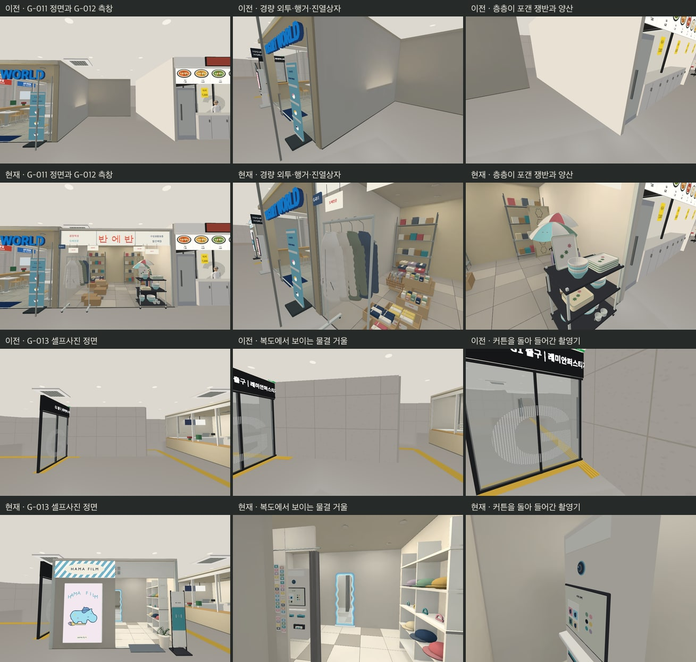
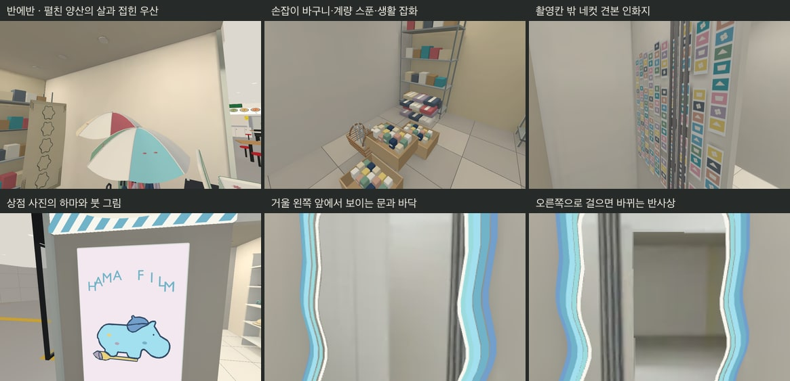

# 서편 G-011 반에반과 G-013 셀프사진

고투몰 운영사 안내와 서울시설공단 1구역 배치도를 대조해 요거트월드 G-012에 맞붙은 반에반과 측창 건너편 셀프사진 매장을 배치했다. 반에반은 네이버 지도에서도 G011로 확인된다. 셀프사진은 운영사 목록의 명칭이다. 운영사 사진과 2025년 방문 사진에는 HAMA FILM 간판이 있다. 운영사가 연결한 네이버 플레이스는 2026년 11월 26일에 찾을 수 없었고, 같은 이름의 지도 검색에서도 일치하는 지점이 나오지 않았다. 현재 영업 상태는 미확인이다. [공단 1구역 배치도](https://www.sisul.or.kr/open_content/com/common/upfiles.do?program=undershop!0923_gosokteomineol_1chabaechido_%281guyeok%29.jpg) · [반에반 네이버 지도](https://map.naver.com/p/entry/place/31315348) · [셀프사진 운영사 페이지](https://gotomall.kr/stores/5f6efe1c-8284-4252-a8a8-3677dcb55d3a)

반에반 사진에는 붉은 입체 글자에 양옆으로 ‘공장직영 도매전문’과 ‘수입생활용품 할인매장’이 붙어 있다. 크롬 행거의 누빔 외투, 펼친 양산, 쌓인 종이상자와 쟁반, 금속 생활용품, 뒤쪽의 긴 테두리 무늬 직물을 모델링했다. 가격과 재고 수량은 사진 촬영 이후 바뀔 수 있어 일반 상품 표기로 구성했다. [고투몰 반에반 매장 사진](https://gotomall.kr/stores/73bd8e2d-9358-409a-9d6e-633d1b2cc644) · [옆 점포에서 본 외투 행거](https://gotomall.kr/stores/aae2c578-f923-4abd-98bf-3475da5694f4) · [방문자가 촬영한 매장과 생활용품](https://m.blog.naver.com/ssapt406/223816380383)

셀프사진의 사선 간판, 하늘색 베레모를 쓴 하마와 붓 그림, 통로 입간판, 액자처럼 발광하는 물결 거울, 회색 커튼, 흰 촬영기와 네컷 인화구는 상점 사진과 방문 사진을 참고했다. 견본 종이에 인쇄한 컵·꽃·우산은 이 모델용으로 그렸다. 스튜디오의 실제 치수와 현재 가구 위치는 측정하지 않았다. [셀프사진 매장 정면](https://gotomall.kr/stores/5f6efe1c-8284-4252-a8a8-3677dcb55d3a) · [거울·부스·촬영 화면 방문 사진](https://m.blog.naver.com/leeke1214/223734561042)

## Blender 원본과 웹

`west-corner.blend`의 진열 편집 장면에 12개 집기 컬렉션이 있다. 서편 점포 장면에서는 게임 좌표와 같은 배치, 조명 12개, 반사상에 쓰이는 공용 통로를 확인할 수 있다. 불투명 집기는 각각 독립된 GLB로 내보낸다. 사진 견본은 Blender 원본의 각 인화지에 붙인 그림을 작은 아틀라스로 구워 48장 모두 합해서 삼각형 96개로 표시한다. 거울 안쪽에는 네이티브 은경의 외곽과 동일한 메시가 있다. 근처에서 실제 거울 면을 볼 때만 Blender에서 렌더링한 파노라마를 불러온다. 카메라의 반사 광선이 실내 벽·바닥 또는 열린 문 밖 복도에 닿는 위치를 계산하므로 보는 위치에 따라 반사가 바뀐다. 움직이는 캐릭터나 다른 방문객은 이 파노라마에 포함되지 않는다.

`blender -b --python-exit-code 1 --python assets/models/gotomall-west-corner/build.py`로 원본과 파생물을 생성한다. 수정한 원본의 웹 모델만 갱신할 때는 `blender -b assets/models/gotomall-west-corner/west-corner.blend --python-exit-code 1 --python assets/models/gotomall-west-corner/export.py`를 실행한다. 실제 게임 보행과 로딩은 `node assets/models/gotomall-west-corner/check.mjs`로 검사한다. 서편 통로에서 두 상점을 차례로 들어갔다 나오고, 인접 매장과 뒷벽에서는 상세 자산 요청이 없으며, 거울 앞에서는 좌우 시점에서 반사상이 달라지는 것을 확인한다.
