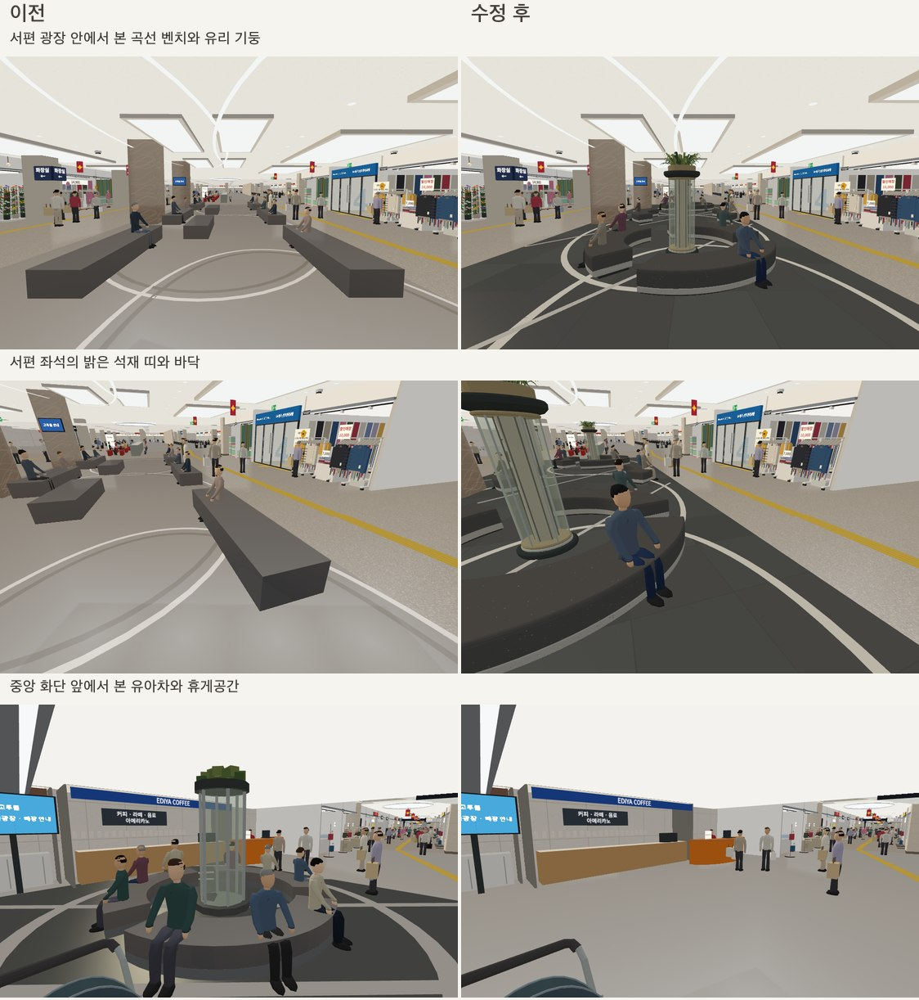

# 고투몰 서편 휴게광장

2026년 8월 현장 취재는 식물이 있는 휴게석과 서쪽의 넓은 좌석을 각각 소개한다. 서쪽 사진에는 짙은 곡면 석재 벤치의 밝은 가로 띠, 기둥을 두른 유리와 위쪽 화분, 짙은 바닥을 지나는 밝은 상감선이 보인다. 네이버 지도에서 고투몰의 주소를 확인했다. [현장 취재](https://rurubu.jp/andmore/article/25097) · [두 공간을 담은 현장 사진](https://img.rurubu.jp/img_srw/andmore/images/0000743968/Ft3inl0CXSwiZMRAGv8gksdvbw6jKsoDQcN5alsk.jpg) · [네이버 지도](https://map.naver.com/p/entry/place/21714783)

게임에서는 두 기둥 둘레에 한 사람이 지날 수 있는 간격을 두고 좌석을 배치했다. 기존 중앙 화단 앞에 중복되어 있던 석재 가구와 바닥 무늬는 서편으로 옮겼다. 중앙에는 흰 식재 벤치와 유아차가 있다. 정확한 부재의 개수와 치수, 각도, 상감선의 교차점은 공개 사진과 기존 광장 폭에 맞춘 근사치다.

[Blender 원본](west-lounge.blend)은 좌석, 식재와 금속틀, 투명 유리, 바닥 상감의 네 컬렉션으로 나뉜다. 석재 면의 반점과 개별 잎을 포함한 편집 가능한 메시가 430개다. 게임은 이들을 화면에 들어온 거리에서만 불러온다. 좌석 8개와 기둥 2개가 네 웹 파일, 총 98,948바이트를 공유한다. 원본 전체를 다시 만들 때는 아래 첫 명령의 파일명을 `build.py`로 바꾸고 기존 .blend 인수를 생략한다.

```sh
blender -b assets/models/gotomall-west-seats/west-lounge.blend --python-exit-code 1 -P assets/models/gotomall-west-seats/export.py
node assets/models/gotomall-west-seats/check.mjs
```

같은 눈높이와 위치에서 광장 입구, 좌석 옆, 기둥 사이의 게임 화면을 1000×640으로 각각 80프레임씩 측정했다. 세 시점 모두 수정 전후 95백분위 프레임 간격은 16.7~16.8ms였다. 중앙 화단에서 출발하거나 서편에서 등지고 있을 때 서편 가구 다운로드는 0회였다. 돌아서 좌석 사이로 걸은 후에는 네 파일을 한 번씩 받았다.


