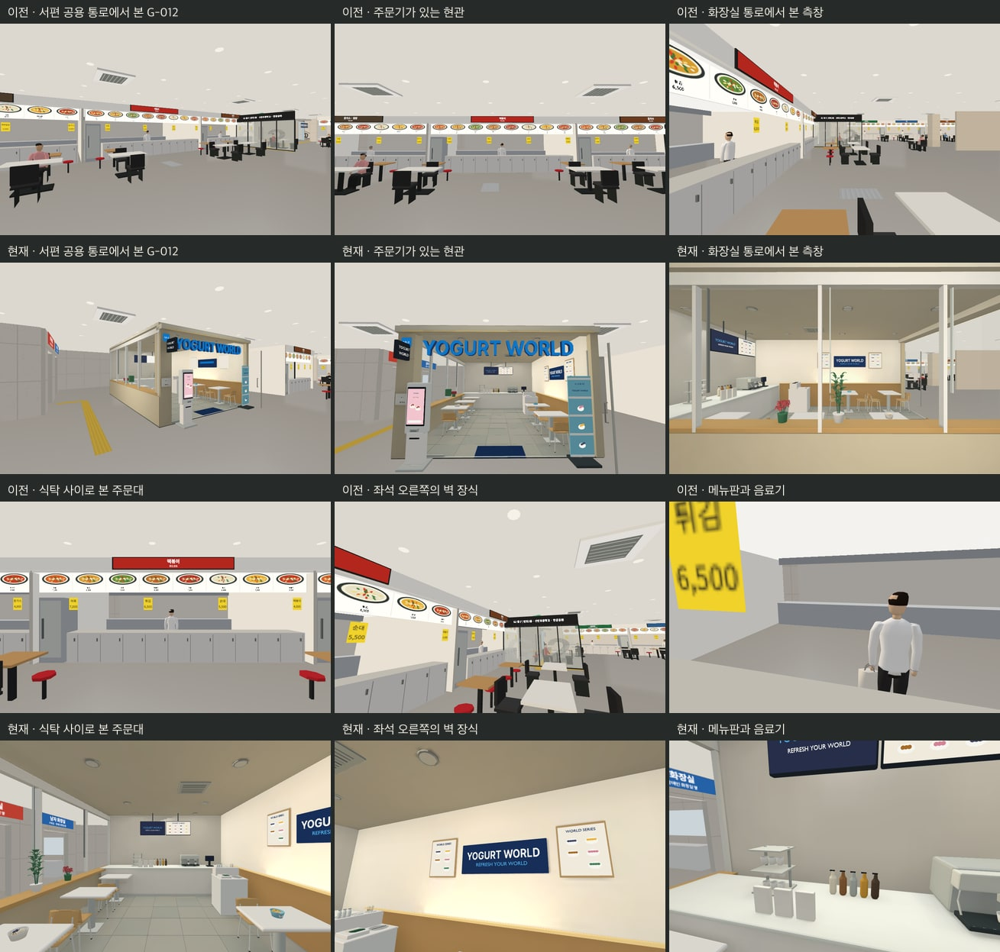
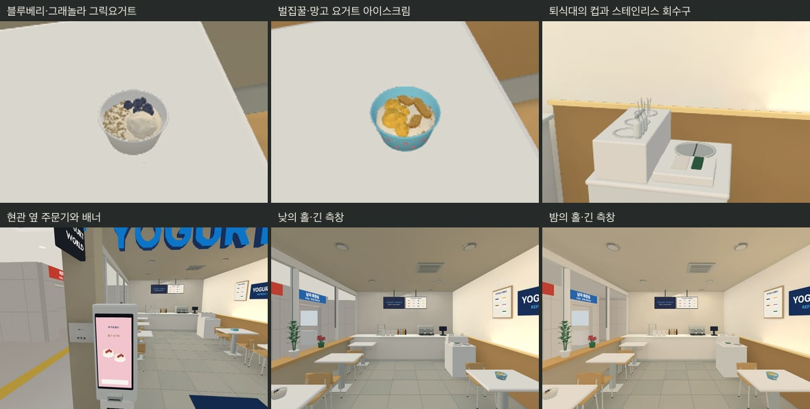

# 서편 G-012 요거트월드 반포고투몰점

서울시설공단 1구역 배치도에서 G-012는 G-011의 남쪽과 뒤를 감싼다. 긴 측창을 따라 난 통로 건너편에는 G-013과 화장실이 있다. 운영사·브랜드 안내와 네이버 지도에서도 이 지점의 호수를 확인했다. 방문기에 삽입된 네이버 핀(37.5052266, 127.0012725)은 현재 모델의 매장 중심에서 약 45m 떨어져 있어 점포끼리의 상대 위치는 공단 도면에 맞췄다. [공단 원본 도면](https://www.sisul.or.kr/open_content/com/common/upfiles.do?program=undershop!0923_gosokteomineol_1chabaechido_%281guyeok%29.jpg) · [고투몰 점포사진](https://gotomall.kr/stores/aae2c578-f923-4abd-98bf-3475da5694f4) · [브랜드 매장 찾기](https://www.yogurtworld.co.kr/bbs/content.php?co_id=store) · [네이버 지도](https://map.naver.com/p/entry/place/1670376995)

서초구 휴게음식점 등록번호 `3210000-104-2024-00386`은 2024년 10월 29일 인허가된 G-012 요거트월드(고투몰점)의 면적을 54.65㎡로 기재한다. 공단 도면의 ㄴ자 구획에 이 면적을 맞췄다. 사진에 보이는 홀과 주문대까지는 집기의 위치를 유지했고, 사진이 닿지 않는 후면은 외곽과 바닥·천장만 구성했다. 후면의 정확한 깊이와 개별 변 길이는 추정이다. [서초구 휴게음식점 인허가](https://data.seoul.go.kr/dataList/OA-18698/S/1/datasetView.do)

현관의 파란 영문 간판, 검은 돌출 간판, 흰 주문기와 배너, 넓은 측창, 흰 식탁과 나무 의자, 빨간 포인세티아, 벽면 상품 안내, 음료기와 모니터 두 개, 금속 원통과 퇴식구가 달린 정리대는 공개된 현장 사진을 참고했다. 그릭요거트 볼의 블루베리 꽃받침과 그래놀라, 파란 컵 위의 망고와 깨진 벌집 조각을 따로 모델링했다. 영문 글자의 윤곽은 브랜드 헤더를 따랐다. 매장의 실제 치수와 좌석·집기의 정확한 간격은 미실측이다. 모니터의 상품 도해와 주문 화면, 조명 세기, 개별 식재료의 배열은 모델용으로 구성했다. [매장·그릭요거트 방문 사진](https://m.blog.naver.com/hyobin_table/223675076224) · [망고·벌집꿀 볼 방문 사진](https://m.blog.naver.com/cowberry96/223711055605) · [브랜드 로고](https://www.yogurtworld.co.kr/images/header_logo.png)

## 원본과 게임

`g012.blend`에는 실내 배치 장면과 각 집기를 나눠 편집할 수 있는 장면이 있다. 집기 컬렉션 13종 중 5개 식탁 세트가 원본 하나를 공유한다. 실내 조명 12개와 가구를 배치한 상태에서 벽체와 주문대의 조명을 베이크했다. 유리는 Blender 원본 그대로 작은 인라인 메시로 내보낸다. 그 밖의 가구와 소품은 시야에 들어올 때 12개 GLB와 표면 조명 2개를 개별 요청한다. 음식은 3.25m 안에서 보이며, 인접 불투명벽 뒤에서는 세부 모델을 요청하지 않는다. 유리창 밖에서 들여다보면 보이는 집기가 먼저 뜬다.

저장소 루트에서 `blender -b --python assets/models/gotomall-yogurtworld/build.py`로 원본과 런타임 자료를 생성한다. Blender로 수정한 뒤 런타임 자료만 갱신하려면 `blender -b assets/models/gotomall-yogurtworld/g012.blend --python assets/models/gotomall-yogurtworld/export.py`를 실행한다. `node assets/models/gotomall-yogurtworld/check.mjs`는 실제 게임에서 입구와 측창, 주문대, 주변 통로와 G1·G2 하부의 보행, 등진 시점·벽 너머·거리 구간별 요청을 검증한다.
