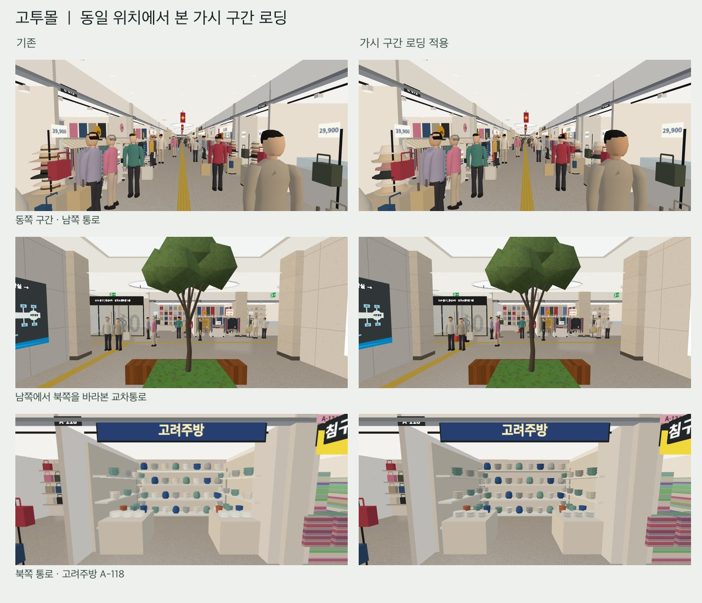

# 고투몰 상점 진열

`shop-interiors.blend`의 의류, 아동복, 주방용품, 침구, 꽃, 타로 컬렉션을 16개 매장에서 사용합니다. 진열 구성과 사진·안내도 대조 기록은 [고투몰 조사 자료](../../../data/research/gotomall.json)에 있습니다. D-086 헤쎄드는 [가방 진열 전용 원본](../gotomall-hessed/README.md)을 사용합니다.

Blender에서 점포를 편집한 뒤 텍스트 편집기의 `export_mesh.py`를 실행하면 업종별 GLB 6개가 갱신됩니다. 저장한 원본을 터미널에서도 내보낼 수 있습니다.

```sh
blender -b assets/models/gotomall/shop-interiors.blend --python-exit-code 1 -P assets/models/gotomall/export.py
```

게임은 B1의 남북 통로를 약 17m 단위로 나눕니다. 가까운 매장의 입구가 보일 때 업종별 진열 파일을 내려받으며, 같은 업종은 앞서 받은 모델을 재사용합니다. 통로를 볼 때에는 가로통로에서 실제로 보이는 반대편 매장까지 포함합니다. 멀리 있는 진열은 단순화한 형태로 표시합니다.

`node tests/gotomall-streaming.mjs`는 실제 게임에서 가로통로를 건너고 돌아온 뒤 6개 업종, 서편 원단 매장 2곳, 모자와 천장 조명이 불러와지는지 검사합니다. 다음 화면은 같은 카메라 위치의 변경 전후 모습입니다.


