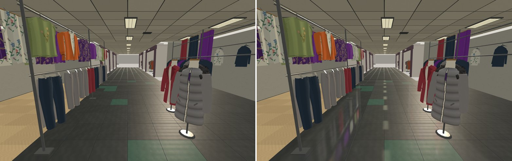

# 경부선 6~8층 의류 통로의 바닥

8층 여성복 통로를 같은 위치에서 촬영했다. 왼쪽은 기존 바닥이고, 오른쪽은 천장등과 맞은편 진열의 색을 타일에 반영한 모습이다. 옆으로 걸으면 타일에 비친 등과 상품의 위치도 시점에 맞춰 달라진다.



관광공사의 의류상가 사진에는 어두운 타일을 따라 천장등이 길게 비친다. 운영사 7층 사진에서는 양복이 통로를 좁게 감싸고, 8층 사진에서는 바로 맞은편 진열에 주황·보라·붉은 옷이 걸려 있다. 이 층들의 Blender 원본에서 천장과 양쪽 집기를 각각 촬영해 타일의 반영을 만들었다. 바닥의 광택과 반사율, 점포 폭은 사진을 참고해 정한 값이다. [관광공사 매대·바닥 사진](https://tong.visitkorea.or.kr/cms/resource/95/1920595_image2_1.jpg) · [운영사 7층 사진](https://exterminal.co.kr/images/floor07.jpg) · [운영사 8층 사진](https://exterminal.co.kr/images/floor08.jpg)

| 게임에서 보기 | Blender 원본 | 가까워졌을 때 추가 다운로드 |
| --- | --- | ---: |
| [6층 아동복](../../../index.html#/gyeongbu/6F?p=75.194,25,25.559,-159.194) | [childrens-aisle.blend](../gyeongbu-childrens-aisle/childrens-aisle.blend) | 4,958바이트 |
| [7층 신사복](../../../index.html#/gyeongbu/7F?p=75.194,29.5,25.559,-159.194) | [suiting-aisle.blend](../gyeongbu-suiting-aisle/suiting-aisle.blend) | 4,920바이트 |
| [8층 여성복](../../../index.html#/gyeongbu/8F?p=75.194,34,25.559,-159.194) | [womens-aisle.blend](../gyeongbu-womens-aisle/womens-aisle.blend) | 4,654바이트 |

6층 야간에는 가까운 점포의 형광등과 옷이 바닥에 비친다. 건물 실내 조명은 게임의 시간 설정을 따른다. [6층 야간 게임 화면](night.jpg)

## 재생성과 검증

Blender Cycles에서 33.6m 구간의 천장·왼쪽 진열·오른쪽 진열을 미터당 20픽셀로 베이크한다. 타일에서 반사된 시선이 천장과 양쪽 진열면 중 처음 만나는 곳의 색을 기존 복도 재질에 합성한다. 상세 의류와 집기는 기존 재질로 먼저 그리고, 그래픽 드라이버가 반사용 셰이더를 준비하면 바닥 마감만 바꾼다. 이미지 다운로드가 실패하면 매장을 계속 보여 주면서 가까운 곳에서 다시 받는다. 이동하는 사람이나 점포 밖 풍경은 이 반영에 포함되지 않는다.

```sh
blender -b --threads 2 --python-exit-code 2 --python assets/models/gyeongbu-aisle-reflections/bake.py
node assets/models/gyeongbu-aisle-reflections/check.mjs
```

Blender 재실행 후 세 이미지의 SHA-256이 각각 일치했다. 게임 안에서는 각 층 두 시점에서 바닥에 대한 천장등의 거울상을 화면에 투영하고 중심과 양옆 픽셀을 비교했다. 세 층 모두 시점당 7~8개 등이 예상 위치에 나타났다. 앞·뒤·좌우에서 확인한 12개 장면에서 반영을 켜기 전후 드로 콜과 삼각형 수는 같았다. 7층 이미지 다운로드를 한 번 끊은 실험에서는 기존 상세 매장이 보였고, 5초 뒤 재시도가 성공했다.

로컬 Chromium Metal, 1110×735, 기기 배율 1에서 각 층 진입 및 6.23m 보행을 변경 전후 두 번씩 확인했다. 드라이버 캐시를 쓰지 않은 첫 진입에서는 6·7·8층 상세 매장이 각각 73·45·44ms에 표시되고 반영은 323·228·94ms에 준비됐다. 해당 진입의 90프레임 중 가장 긴 프레임은 각각 33.3·16.8·16.8ms였다. 준비된 복도의 88프레임 보행 p95는 16.7~16.8ms였다. 각 층의 기존 보행·충돌·다섯 가지 시간 설정 검사도 통과했다.
