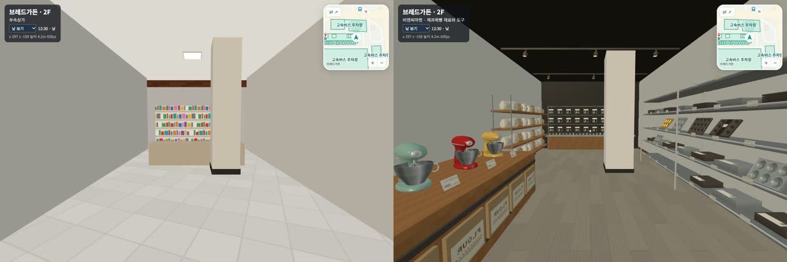

# 경부선 부속상가 2층 비앤씨마켓 반포점

유리 입구에서 매장 안을 보면 왼쪽에는 네 가지 색의 반죽기, 오른쪽에는 마들렌·피낭시에·레몬 틀, 안쪽에는 깍지와 제과 재료가 보인다. 반죽기 헤드 아래에는 둥근 스테인리스 볼과 와이어 휘퍼가 있고, 틀에는 반죽이 들어갈 홈을 냈다. 문 양쪽의 거품기·짤주머니·쿠키 모양 선화와 빨간 문틀도 현장 사진을 참고했다.



운영사 부속상가동 2층 도면은 브레드가든을 안내 목록 16번으로 표시한다. 2026년 11월 26일 확인한 네이버 지도 지점 주소는 부속상가동 2층 대형 1호다. 매장명과 업종은 브랜드 안내와도 대조했다. [운영사 2층 목록](https://exterminal.co.kr/include/floor_sub.asp?floornum=sf2) · [운영사 층별 도면](https://exterminal.co.kr/images/n_floorf2_sub.jpg) · [브랜드 매장 안내](https://www.breadgarden.co.kr/market/market_020100.html) · [네이버 지도](https://map.naver.com/p/entry/place/11595041)

반죽기 진열, 금속 팬, 포장 깍지, 목재 진열대를 두 방문자의 지점 사진과 대조했다. 게임은 기존 부속상가 2층 방에 사진에서 식별한 진열을 모아 배치했다. 실내 폭과 깊이, 품목별 위치·수량은 추정했다. 포장 그림과 글씨는 새로 그렸다. [2022년 7월 방문 사진](https://chordq0539.tistory.com/1052) · [두 번째 방문자의 사진](https://ovo0605.tistory.com/39)

[게임에서 입구 보기](../../../index.html#/gyeongbu/2F?p=297.194,4.200,-153.042,-7.815) · [입구](entrance.jpg) · [반죽기와 휘퍼](mixers.jpg) · [제과 틀](moulds.jpg) · [깍지 진열](tips.jpg) · [야간 실내](night.jpg)

## Blender와 게임 표시

[편집 원본](baking-shop.blend)의 `부속상가 2층 비앤씨마켓 · 반죽기와 제과 도구` 컬렉션에 바닥·입구·반죽기·팬·깍지 등 열 부품이 들어 있다. 색상 1024px, 표면 노멀 512px, 금속도·거칠기와 발광 256px 아틀라스 네 장을 원본에 포함했다. 게임 오브젝트는 `경부선 부속상가 · 비앤씨마켓 반죽기와 제과 도구`이며 경부선 좌표 `W(311.15,8)`, 부속상가 높이 4.2m, 회전 `ROT`에 배치한다.

같은 층에서 입구가 보이면 원거리 메시 16,265바이트(730개 삼각형)를 받는다. 16m 안에서는 747,988바이트(39,442개 삼각형)의 상세 모델을 사용하고 22m 밖에선 원거리 표시로 돌아간다. 어느 거리든 이 매장은 한 번에 그린다. 다른 층이나 옆 점포의 불투명 벽 뒤에서는 두 파일 모두 요청하지 않는다.

```sh
blender -b --threads 2 --python-exit-code 2 --python assets/models/gyeongbu-baking/build.py
node assets/models/gyeongbu-front-entrance/pack.mjs assets/models/gyeongbu-baking/baking-shop.glb
node assets/models/gyeongbu-baking/check.mjs
```

일반 게임에서 매장 앞 복도 9.9m와 매장 안쪽까지 12.6m 왕복 경로를 검사했다. 세 갈래 진입선에서 통행이 가능했고 네 진열대에는 정상적으로 부딪혔다. 일출·낮·일몰·밤·서울 실시간 모드와 재방문 캐시를 확인했다. Chromium Metal 1110×735, DPR 1에서 6.22~6.23m 보행을 기존·변경·변경·기존 순으로 측정한 p95는 16.8, 16.7, 16.8, 16.7ms였다. 네 번 모두 최장 16.8ms였다.
