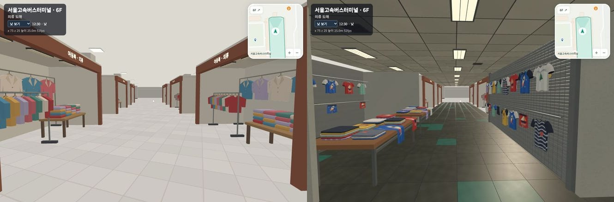

# 경부선 본관 6층 아동복 도매 통로

같은 시점에서 왼쪽은 기존 게임, 오른쪽은 이번 Blender 모델을 적용한 화면이다. 대합실에서 엘리베이터로 6층에 올라가 의류 도매 통로 안쪽으로 걸으면 양쪽 진열을 볼 수 있다.



사진에 보이는 회색 셔터와 철망 앞에 높이가 다른 두 줄의 옷걸이를 달았다. 넓게 늘어진 반소매, 일부 긴소매와 칼라, 작은 목 라벨, 허리 밴드가 있는 반바지까지 각각 입체로 만들었다. 맞은편 탁자에는 겹겹이 접은 옷과 모서리로 늘어진 옷이 놓인다. 짙은 타일 사이의 녹색 조각과 천장의 형광등은 두 가게 앞을 지나 이웃 점포로 이어진다. [통로](aisle.jpg) · [철망과 아동복](wire.jpg) · [접은 상품](folded-stock.jpg) · [야간 실내](night.jpg)

## 현장 자료와 해석 범위

- 서울고속버스터미널 층별 사진과 한국관광공사의 안내에서 6층 아동복 도매 용도를 확인했다. [터미널 층별 안내](https://exterminal.co.kr/main_floor/main_floor.html) · [운영사 6층 사진](https://exterminal.co.kr/images/floor06.jpg) · [한국관광공사 국문 안내](https://korean.visitkorea.or.kr/detail/ms_detail.do?cotid=dd4442f8-2df6-4601-9561-bb1df0ad67e1)
- 한국관광공사 갤러리의 공개 사진 두 장에서 셔터, 이중 상품 진열, 접은 옷, 반사되는 어두운 바닥과 부분 녹색 타일, 형광 천장의 관계를 읽었다. 동일 갤러리 중 지하상가 구역 표시가 보이는 다른 사진은 제외했다. [아동복 통로 사진](https://tong.visitkorea.or.kr/cms/resource/96/1920596_image2_1.jpg) · [매대와 바닥 사진](https://tong.visitkorea.or.kr/cms/resource/95/1920595_image2_1.jpg) · [관광공사 원문 갤러리](https://english.visitkorea.or.kr/svc/contents/contentsView.do?vcontsId=190294)
- 사진에는 개별 점포의 호수, 치수, 현재 입점 관계를 확인할 정보가 없다. 두 점포의 위치와 수량은 게임의 기존 6층 공간에 맞춰 정했다. 돛단배·로켓·곰·식물 그래픽과 옷감 표면은 직접 그렸다.

## 편집과 재생

`childrens-aisle.blend`의 `6층 아동복 · 철망 행거와 접은 상품` 컬렉션 안에서 바닥, 천장, 셔터, 철망, 옷, 행거, 탁자, 접은 상품 여덟 부분을 개별 편집할 수 있다. 게임 배치는 경부선 로컬 `W(38,109.5)`, 높이 25 m, 기본 건물 회전각이다. [기본 카메라 위치 열기](../../../index.html#/gyeongbu/6F?p=75.066,25,25.137,-161.285)

원거리에는 무텍스처 메시 912개 삼각형을 그린다. 같은 층에서 16 m 안으로 접근해 상품이 시야에 들어오면 456,228바이트 GLB를 한 번 받아 20,094개 삼각형 메시로 교체한다. 22 m를 벗어나면 원거리 표현으로 돌아간다. 두 표현 모두 드로 콜 한 번이다. 근경은 1024×1024 원본 색상 아틀라스와 거칠기·금속도·형광등 마스크를 쓴다.

```sh
blender -b --threads 2 --python-exit-code 2 --python assets/models/gyeongbu-childrens-aisle/build.py
node assets/models/gyeongbu-front-entrance/pack.mjs assets/models/gyeongbu-childrens-aisle/childrens-aisle.glb
node assets/models/gyeongbu-childrens-aisle/check.mjs
```

회귀 검사는 7층 및 시야 밖 미요청, 6층 근접 교체, 골목 중앙 네 줄의 충돌과 지지면, 셔터·탁자의 충돌, 9 m 키보드 보행과 다섯 시간 모드, 재입장 시 캐시 재사용을 확인한다. 로컬 Chromium Metal에서 1110×735로 6.23 m씩 걸은 측정은 변경 전 p95 16.7/16.8 ms, 변경 후 16.7/16.7 ms였다. 네 회 모두 최대 16.8 ms였다. 각 주행은 그래픽 자산이 준비된 뒤 시작했다.
