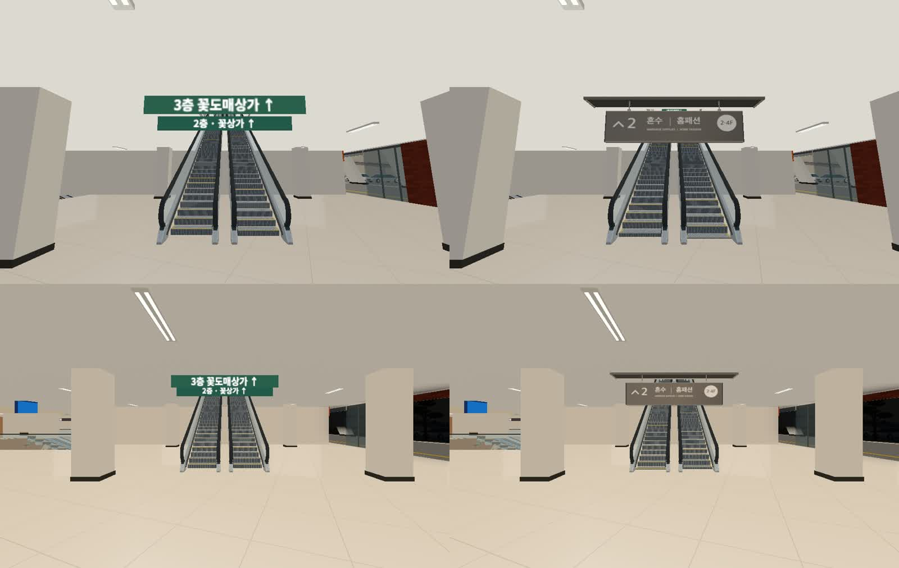

# 본관 1층에서 혼수·홈패션 매장으로 가는 에스컬레이터

1층에서 2층으로 올라가는 첫 에스컬레이터 앞에는 ‘2층 · 꽃상가’와 ‘3층 꽃도매상가’가 겹쳐 있었다. 2024년 광고 운영사 자료 91쪽 사진에는 이곳의 회갈색 표지, 흰 꺾쇠와 큰 숫자 2, 혼수·홈패션 한영 표기, 동그란 2·4F 표식이 보인다. 터미널 운영사 층별도는 2층과 4층의 품목, 3층 꽃도매상가를 구분한다. 사진의 지하철역 방향 본관 1층 상행 입구를 게임의 기존 1→2층 설비에 대응시켰다. 안내판 폭과 매다는 높이는 사진 비례와 게임 천장에 맞춘 값이다. 광고 운영사가 명시한 2×3m는 옆 광고판의 규격이다. [AD강남 사진, 91쪽](https://ad-gangnam.com/wp-content/uploads/2024/03/2024_AD-GANGNAM_%EC%84%9C%EC%9A%B8%EB%B2%84%EC%8A%A4%EB%A7%A4%EC%B2%B4-%EC%A0%9C%EC%95%88%EC%84%9C.pdf#page=91) · [서울고속버스터미널 운영사 층별 안내](https://exterminal.co.kr/main_floor/main_floor.html)

위는 낮 근접 시점, 아래는 밤의 접근 시점이다. 왼쪽이 변경 전, 오른쪽이 변경 후다. 3층 꽃도매상가 표지는 2층에서 출발하는 다음 에스컬레이터 앞에 있다. [게임에서 입구 보기](https://minwoo19930301.github.io/gangnam-terminal-world/#/gyeongbu/1F?p=40.1768,0,-15.8648,200.806,0)



금속 소핏, 행거 두 곳, 접힌 케이스, 한영 인쇄면은 같은 Blender 원본에서 편집할 수 있다. 소핏은 기존 마감 천장 높이 3.30m에 붙고 안내판 하단은 약 2.30m다. 상행을 걸어 게임 높이 0→6m, 반대편 하행은 6→0m를 확인했다. 근접 모델은 192삼각형 한 번 그리기다. 980×620 저화질 고정 해상도의 정지 접근 시점에서 100프레임씩 두 번 잰 p95는 수정 전 16.8ms와 16.8ms, 수정 후 16.8ms와 16.7ms였다. 반대 방향과 윗층에서 새로 시작하면 표지 메시 모듈의 요청은 0건이었다. 상세 모듈 응답을 끊어도 기본 표지에서 목적지를 읽을 수 있다.

저장소 루트에서 재생성과 보행 회귀 검사를 실행한다.

```sh
d=assets/models/gyeongbu-escalator-directory
node "$d/print-native.mjs" /tmp/gyeongbu-escalator-face.png
blender -b -t 4 -P "$d/build.py" -- /tmp/gyeongbu-escalator-face.png
blender -b "$d/directory.blend" -t 4 -P "$d/export.py"
node "$d/check.mjs"
```
