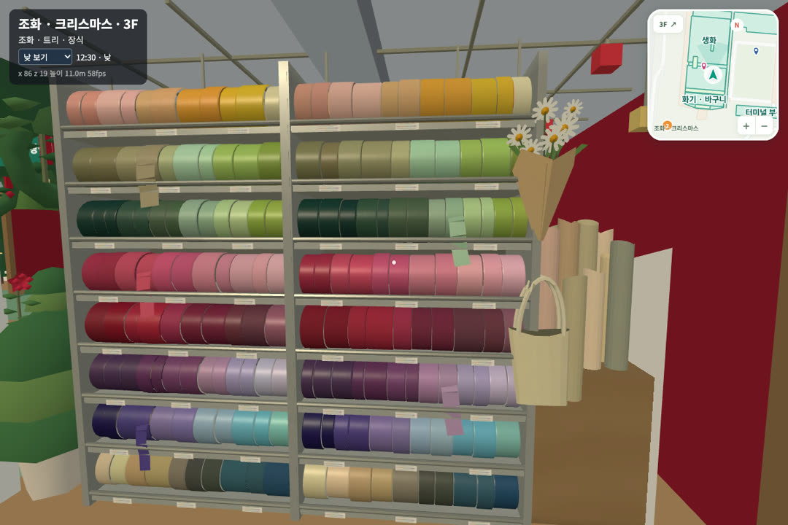
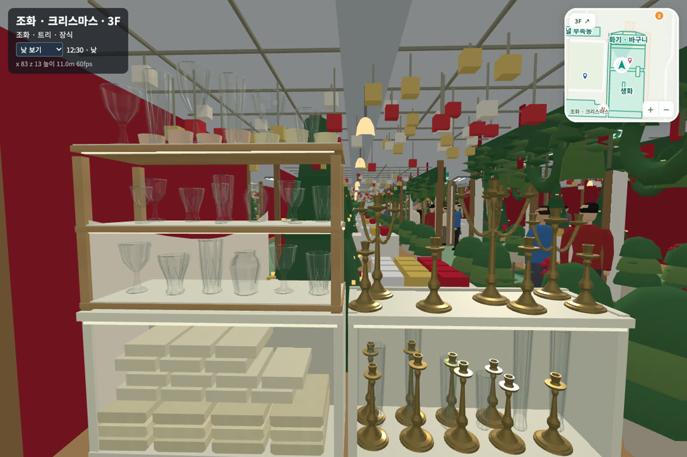

# 경부선 3층 현대데코



금속 선반 두 칸에 여덟 단씩 리본을 걸었다. 롤마다 폭과 지름, 원단의 결을 달리했고 줄 끝에서는 심의 구멍과 감긴 가장자리가 보인다. 다섯 롤에서 풀린 리본, 진열대 끝의 포장지, 천 가방과 데이지 꽃다발도 개별 Blender 메시로 편집할 수 있다. [현대데코 방문자의 2023년 2월 사진](https://japankoreadiary.tistory.com/64)



다른 쪽 통로에는 원목 프레임의 밝은 진열장과 황동 촛대를 놓았다. 촛대는 가지가 아래로 휘었다가 열린 소켓까지 올라간다. 유리잔과 화병에는 안쪽 면, 두꺼운 입술, 세로 골과 사선으로 교차하는 절삭선을 넣었다. Blender로 만든 선반·벽·형광등에서 반사를 미리 구워, 걸을 때 유리 가장자리와 금속에 비치는 색이 달라진다.

네이버 지도에서 서울 서초구 신반포로 194의 고속터미널 꽃도매상가를 확인했다. 상호와 진열 품목은 방문 사진을 따랐고, 기존 3층 크리스마스 매대의 두 옆면에 맞추어 폭·깊이·수량을 정했다. 실제 재고와 진열장 실측은 확보하지 못했다. [네이버 지도 꽃도매상가](https://map.naver.com/p/entry/place/1720885459) · [서울관광재단 꽃시장 소개](https://korean.visitseoul.net/editorspicks/서울-꽃-시장_/35275)

| 편집 원본 | 시작 후 원거리 파일 | 근거리 GLB | 원거리 / 근거리 삼각형 |
| --- | ---: | ---: | ---: |
| [색상별 리본, 포장과 데이지](ribbon/ribbon.blend) | 18,117 B | 585,480 B | 924 / 40,578 |
| [진열장, 황동과 유리의 절삭선](case/case.blend) | 24,245 B | 389,068 B | 1,480 / 27,792 |
| [투명 절삭 유리](crystal/crystal.blend) | 3,993 B | 387,364 B | 162 / 19,256 |

각 GLB를 한 번에 그린다. 리본과 진열장은 10.5m 안에서, 유리는 7.4m 안에서 해당 면을 바라본 경우에 내려받는다. 장과 유리는 950 B 반사 이미지 하나를 공유한다. 원본에는 색상 512px, 노멀 256px, 거칠기·금속도와 조명용 128px 지도가 포함돼 있다. 게임에서 유리는 한 번의 투명 드로우와 정적 반사로 처리한다.

```sh
blender -b --threads 2 --python-exit-code 2 --python assets/models/gyeongbu-florist-stock/build.py
node assets/models/gyeongbu-front-entrance/pack.mjs assets/models/gyeongbu-florist-stock/{ribbon/ribbon,case/case,crystal/crystal}.glb
node assets/models/gyeongbu-florist-stock/check.mjs
```

일반 플레이에서 4층은 세 상세 파일 요청 모두 0건이었다. 3층 리본 앞에서는 리본만 요청했고, 반대편 찬장까지 본 뒤 두 통로에 재방문해도 파일별 요청은 한 번이었다. 양측 통로를 각각 6.3m 걸었고 일출·낮·일몰·밤·실시간 모드에서 점검했다.

1110×735, DPR 1, Chromium Metal에서 리본과 찬장을 옆으로 보며 각각 6.2m를 걸었다. 기존·변경·변경·기존 순서의 여덟 측정 모두 보행 p95와 최장은 16.7~16.8ms였다. 새 캐시에서 처음 돌아본 90프레임의 리본 쪽 최장은 기존·변경 각각 83.3ms, 찬장 쪽은 각각 33.3~33.4ms였다. 새 상세가 보인 시점은 리본 159.0~159.1ms, 유리 67.4~78.4ms였다.
