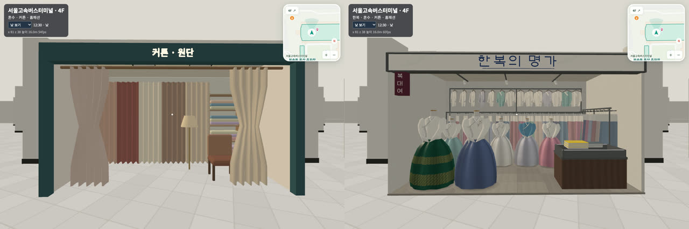

# 경부선 본관 4층 고명재한복

복도에서 보면 입구 왼쪽에 흰 저고리를 입은 마네킹 두 점이 선다. 녹색 치마에는 넓이가 다른 금직 띠 두 줄이 있고, 회청색 치마 위에는 가슴에 자수를 놓은 저고리가 걸려 있다. 오른쪽 견본대와 마네킹 사이로 가게 안까지 걸어 들어갈 수 있다.



운영사는 본관 4층을 한복·혼수·커튼·홈패션 매장으로 안내한다. 2026년 11월 26일 네이버 지도에서 고명재한복의 주소가 경부선 4층 22호로 표시되는 것을 확인했다. 2026년 2월 방문자가 올린 현장 사진에서는 입구 간판에 21~23호가 적혀 있다. 모델은 해당 사진에 보이는 금직 치마, 자수 저고리, 흰 허리말기가 달린 치마 행거, 저고리를 걸어 둔 상단 봉, 견본 책자와 장신구 진열대를 참고했다. [네이버 지도](https://map.naver.com/p/entry/place/31248200) · [운영사 층별 안내](https://exterminal.co.kr/main_floor/main_floor.html) · [방문자의 매장 사진](https://artsynyc.tistory.com/61)

실내 호수별 도면과 치수는 확인되지 않아 기존 게임 4층 복도에서 커튼 점포가 반복되던 한 칸에 배치했다. 가게 폭·깊이, 진열 간격과 수량은 추정값이다. 금직 무늬와 저고리 자수는 실물을 보며 새로 그렸다. [게임 시점](../../../index.html#/gyeongbu/4F?p=80.530,16,37.856,110.160)

[입구](entrance.jpg) · [금직 치마와 자수 저고리](brocade.jpg) · [치마와 저고리 행거](rails.jpg) · [견본대](counter.jpg) · [야간 실내](night.jpg)

## Blender 원본과 게임 표시

[편집 원본](hanbok-showroom.blend)의 `4층 고명재한복 · 금직 치마와 저고리 진열` 컬렉션에는 바닥·벽·조명과 행거·간판·전면 및 후면 마네킹·걸린 상품·견본대·장신구가 아홉 부품으로 나뉘어 있다. 색상, 직조 노멀, 금속도·거칠기, 조명 표면을 파일에 함께 넣었다. 게임 오브젝트 이름은 `경부선 4층 · 고명재한복 치마와 저고리`이며 경부선 좌표 `W(34.2,118.5)`, 높이 16m, `ROT + π/2`를 사용한다.

같은 층에서 점포가 시야에 들어오면 18,825바이트의 원거리 메시(918개 삼각형)를 받는다. 16m 안으로 다가가면 464,932바이트의 상세 모델(24,924개 삼각형)이 보인다. 22m 밖에서는 원거리 표시로 돌아간다. 두 버전 모두 한 번에 그린다.

```sh
blender -b --threads 2 --python-exit-code 2 --python assets/models/gyeongbu-hanbok/build.py
node assets/models/gyeongbu-front-entrance/pack.mjs assets/models/gyeongbu-hanbok/hanbok-showroom.glb
node assets/models/gyeongbu-hanbok/check.mjs
```

일반 게임에서 매장 입장·퇴장과 앞 복도 11m 보행, 세 줄의 진입 경로, 전면 두 마네킹·견본대·안쪽 진열의 충돌을 검사했다. 3층이나 점포에 등을 돌린 시야에서는 모델 요청이 없었다. 일출·낮·일몰·밤·실시간 모드와 재방문 시 캐시를 확인했다. Chromium Metal 1110×735, DPR 1에서 기존·변경·변경·기존 순으로 복도 6.22~6.23m 보행을 측정한 p95는 16.7, 16.8, 16.7, 16.7ms였고 네 번 모두 최장 16.8ms였다.
