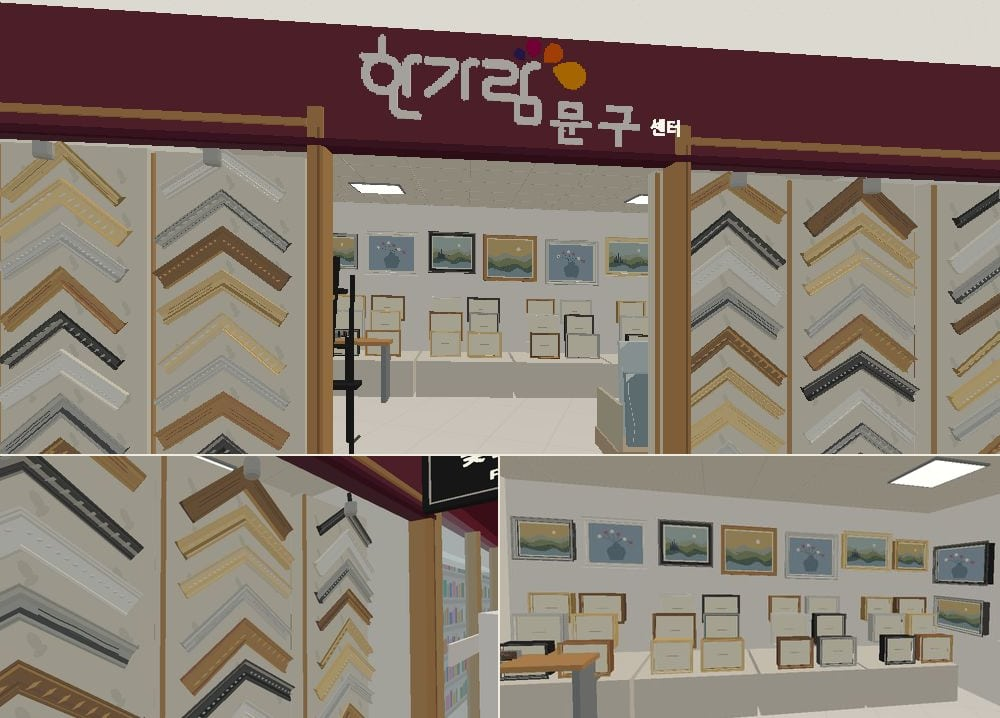

# 경부선 지하 1층 한가람문구 반포본점 맞춤액자



한가람문구 반포본점의 공식 매장 안내와 네이버 지도 점포 사진에서 지하 1층 위치, 자줏빛 처마, 흰색 한글 간판과 네 가지 잉크 방울을 확인했다. 공개 CI의 외곽선과 글자 속 빈 곳을 블렌더 메시로 만들고 실제 점포처럼 밝은 조명 문자로 구성했다. [반포본점 공식 안내](https://www.hangaram.kr/shop/offline.php?ps_tab=1) · [한가람문구 공식 로고](https://www.hangaram.kr/shop/skin/renewal/images/logo_new.png) · [네이버 지도 점포](https://map.naver.com/p/entry/place/11527750)

방문자가 촬영한 맞춤액자 코너에는 금색·은색·검정·원목 몰딩이 V자로 이어지는 진열창, 양면 ‘맞춤액자 / Frames’ 돌출 간판, 검정·원목 이젤, 포장된 캔버스, 벽과 계단식 매대의 완성 액자가 보인다. [반포본점 내부 및 맞춤액자 진열창 사진](https://writelab.tistory.com/21)

- 기존 게임의 맞춤액자 안내가 있던 남측 점포 한 칸에 모델링했다. 문과 선반 치수, 견본 개수와 상품 배치, 액자 속 풍경·화병 그림은 재구성했다. 44개 모서리 견본에 사면과 곡면을 만들고, 가까이에서 금박 잎사귀, 작은 연주 무늬, 홈과 나뭇결을 볼 수 있게 했다.
- 지도에서 **지하 1층 한가람문구 맞춤액자**를 선택하면 공개 통로에서 입구를 본다. 직접 여는 주소는 `#/gyeongbu/B1?p=93.235,-6,-82.314,-159.19`이다. 양옆 쇼윈도 사이로 걸어 들어가면 이젤, 포장 캔버스와 완성 액자 진열장이 이어진다.
- 같은 지하층에서 점포가 시야에 들어오고 15m 안에 접근하면 기본 실내 모델을 요청한다. 몰딩 장식과 그림 등의 세부는 5.75m 이내에서 보일 때 요청한다. 멀어질 때 각각 21m와 8.25m에서 단순한 표현으로 바뀐다.

[Blender 작업 파일](./hangaram-framing.blend)에는 액자 프로파일의 각 단, 연주 장식, 나뭇결, 이젤 조임 장치, 비닐 접힘, 조명, 직접 그린 견본화가 각각 편집 가능한 메시로 들어 있다.

```sh
blender -b --threads 2 -P assets/models/gyeongbu-hangaram/build.py
blender -b assets/models/gyeongbu-hangaram/hangaram-framing.blend --threads 2 -P assets/models/gyeongbu-hangaram/export.py
node assets/models/gyeongbu-hangaram/check.mjs /tmp/gyeongbu-hangaram-check
```
