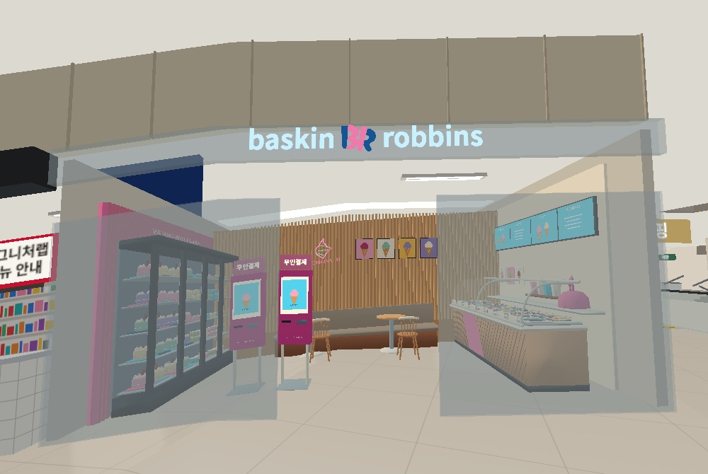

# 배스킨라빈스 고속터미널경부선점



본관 1층 대합실의 배스킨라빈스다. 지점 방문 사진에서는 출입구에서 오른편에 곡면 유리 스쿱 쇼케이스가, 왼편에 검정 테두리의 4문 냉동고가 보인다. 두 대의 분홍 키오스크 뒤로 목재 루버, 등받이 붙박이 좌석, 콘 모양 조명과 액자가 이어진다. 두 방문자가 같은 배치를 찍었다. [2026년 6월 26일 매장 전경](https://m.blog.naver.com/tlsendud7/224327454997) · [2026년 7월 16일 쇼케이스·케이크·키오스크 근접 사진](https://m.blog.naver.com/nanine0516/224348409701) · [본사 매장 검색](https://www.baskinrobbins.co.kr/store/map.php)

[편집용 Blender 원본](./gyeongbu-scoop-parlor.blend)에는 각 집기와 상품이 나뉘어 있다. 스쿱 통에는 퍼낸 홈과 리본 무늬, 쿠키 조각이 있다. 케이크 받침·크림·토퍼와 포장 컵이 냉동고의 서로 다른 칸을 채운다. 간판의 파란색과 분홍색 BR·31은 지점 사진과 본사의 과거 로고를 참고했다. [본사 로고 원본](https://www.baskinrobbins.co.kr/assets/images/story/story/img_logo_2005.png)

- 게임 주소 `#/gyeongbu/1F?p=81.12,0,-7.353,110.81`에서 입구를 볼 수 있다. `#/gyeongbu/1F?p=77.163,0,-6.619,37`은 스쿱 진열대 앞이다.
- 점포 위치와 출입구는 기존 게임 좌표를 따른다. 카운터 길이, 좌석 간격, 상품 수와 배색, 메뉴 화면은 사진에서 추정한 모델링이다.
- 실제 배치를 따라 출입구 가운데부터 좌석 사이까지 비워 두었다. 집기는 아래층 에스컬레이터 개구부 밖에 있다. 케이크장 앞의 자동 배치 기둥은 지점 사진에 보이는 시야를 가려 해당 좌표에서 제외했다.
- GLB는 같은 층의 화면에 10m 이내로 들어오면 요청하며 14m 밖에서 단순한 배경으로 바뀐다. 본체와 식품, 투명 유리, 발광 메뉴판·네온이 세 묶음이다.

```sh
blender -b --threads 2 -P assets/models/gyeongbu-icecream/build.py
blender -b assets/models/gyeongbu-icecream/gyeongbu-scoop-parlor.blend --threads 2 -P assets/models/gyeongbu-icecream/export.py
```
