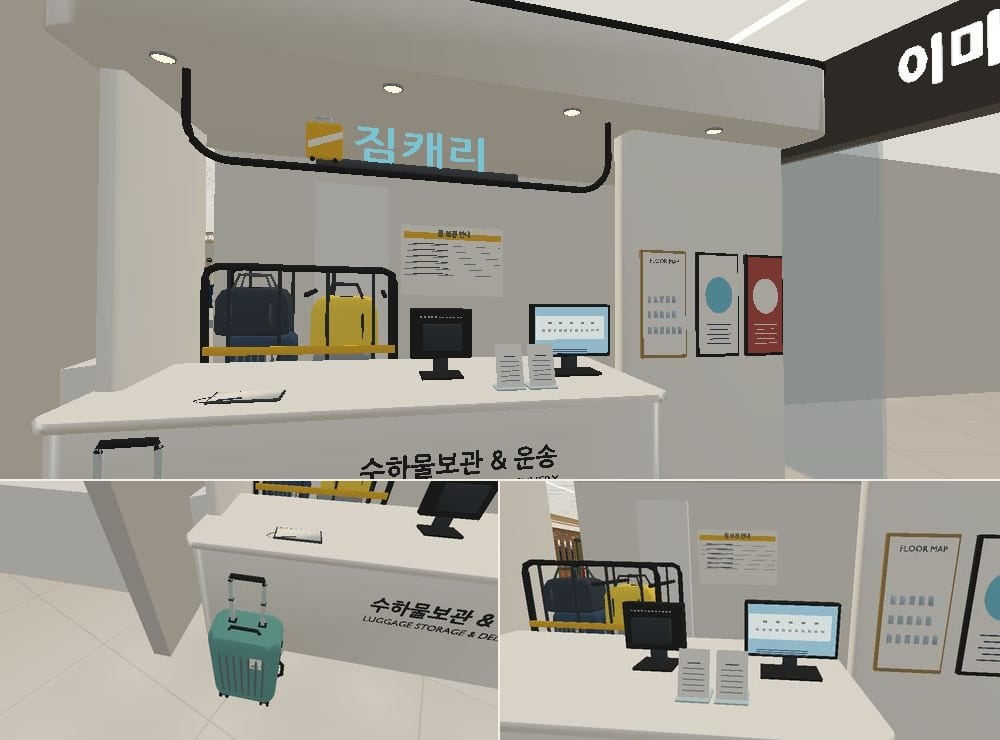

# 경부선 본관 1층 짐캐리 수하물보관 창구



짐캐리의 서울고속버스터미널 지점 안내에는 매표소 옆이라는 설명과 배치도, 승객이 바라본 창구 사진이 있다. 사진에서 흰 카운터의 ‘수하물보관 & 운송’ 문구, 검은색 U자형 간판틀, 검정·노랑 가방을 올려놓은 랙, 고객용 모니터, 아크릴 안내판을 확인했다. 2025년 4월 방문 사진에서도 같은 창구가 보인다. [짐캐리 운영사 지점 안내·배치도](https://zimcarry.net/reserve/item.php?it_id=1606884478) · [운영사 창구 사진](https://zimcarry.net/data/item/1606884478/thumb-DSC09660_600x338.jpg) · [2025년 방문 사진](https://dawn-sunup.tistory.com/718)

- 네이버 지도에는 신반포로 194 서울고속버스터미널 **1층 13호**로 등록돼 있다. 지도 핀은 37.50568°N, 127.0058468°E이며 게임의 창구 기준점과 약 28.6m 차이가 난다. 매표소와의 관계, 기존 현장 사진에서 정합한 창구 좌표를 따라 배치했다. 폭과 깊이, 창구 방향, 여행객의 민트색 캐리어, 가방 수, 화면 그림은 게임용 재구성이다. [네이버 지도 지점](https://map.naver.com/p/entry/place/1518242796)
- 지도에서 **1층 수하물보관 · 짐캐리**를 선택하거나 `#/gyeongbu/1F?p=60.565,0,-53.565,-159.19`로 진입한다. 흰 상판까지 접근할 수 있고, 기존 환불기 앞 통로를 거쳐 인접한 매표소로 갈 수 있다.
- 여행 가방의 성형 리브, 지퍼 솔기, 바퀴와 신축 손잡이, 부드러운 가방의 천 주름과 웨빙, 카운터의 펜과 안내 카드는 [Blender 원본](./zimcarry-counter.blend)에서 편집할 수 있다. 창구의 한글 안내는 나눔고딕 글자 외곽을 메시로 만들었다.
- 같은 층에서 승객의 시야에 창구가 들어오고 12m 안에 접근하면 GLB 한 개를 요청한다. 17m 이상 떨어지면 단순한 창구 형태로 전환한다.

```sh
blender -b --threads 2 -P assets/models/gyeongbu-luggage/build.py
blender -b assets/models/gyeongbu-luggage/zimcarry-counter.blend --threads 2 -P assets/models/gyeongbu-luggage/export.py
node assets/models/gyeongbu-luggage/check.mjs /tmp/gyeongbu-luggage-check
```
