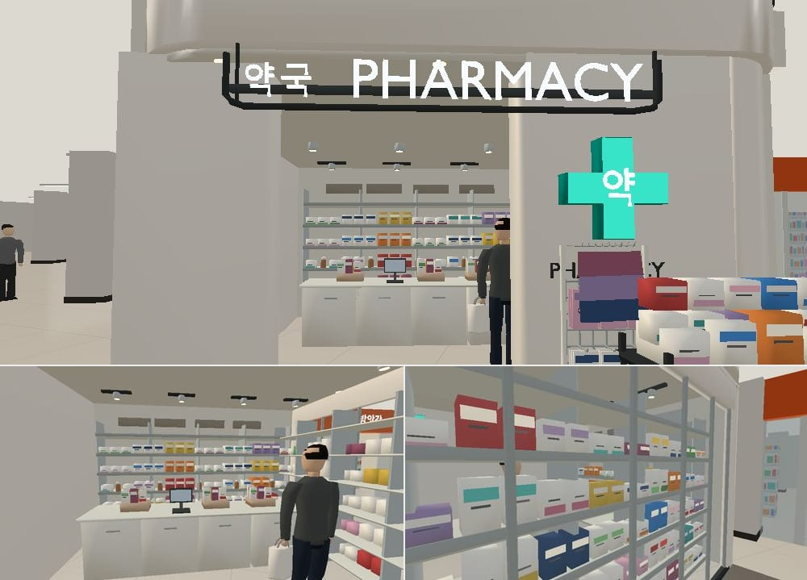

# 경부선 본관 1층 고속터미널약국



네이버 지도 점포 **고속터미널약국**의 대표 사진에는 검은 몰딩과 흰색 곡면 처마, 매달린 ‘약국 PHARMACY’ 간판, 청록색 십자가, 코너를 돌아가는 유리 진열장이 보인다. 2026년 4월 8일 현장 영상에는 같은 입구 앞에 놓인 검은 상품 선반과 안내판, 십자가 아래의 마스크 안내와 철망 포장 진열대가 보인다. [네이버 지도](https://map.naver.com/p/entry/place/1822188514) · [네이버 지도 점포 사진](https://ldb-phinf.pstatic.net/20200315_159/1584262093543GSjeI_JPEG/vd_H0IPO8GKRDFcd-OQzG4N3.jpg) · [2026년 현장 영상](https://www.youtube.com/watch?v=joS_TjqngD8)

- 운영사 본관 1층 도면의 안내 번호는 **24**다. 네이버 지도 핀은 37.5044587°N, 127.0056913°E로, 프로젝트 좌표에서 도면으로 배치한 점포 중심과 약 19.9m 떨어져 있다. 기존 도면 배치와 통로를 기준으로 모델링했다. 코너 치수와 정확한 출입구 위치, 매대 크기와 재고 수, 포장 색은 추정이다. [운영사 1층 안내](https://exterminal.co.kr/include/floor.asp?floornum=f1)
- 지도에서 **1층 고속터미널약국**을 선택하거나 `#/gyeongbu/1F?p=88.520,0,51.957,110.81`로 진입한다. 흰색 입구로 걸어서 들어가 카운터 앞에 설 수 있고, 코너를 돌면 옆면 쇼윈도 안의 제품을 볼 수 있다.
- [Blender 원본](./gyeongbu-pharmacy.blend)에는 글자, 십자 조명, 출입문 틀, 선반, 병과 접은 종이 제품, 진열 고리, 여러 장이 포개진 파우치, 마스크 안내판이 따로 들어 있다. 게임은 같은 층에서 점포가 보이고 11m 안에 접근할 때 GLB 하나를 요청한다. 16m 이상 멀어지면 단순한 건물 형태로 바뀐다.

```sh
blender -b --threads 2 -P assets/models/gyeongbu-pharmacy/build.py
blender -b assets/models/gyeongbu-pharmacy/gyeongbu-pharmacy.blend --threads 2 -P assets/models/gyeongbu-pharmacy/export.py
node assets/models/gyeongbu-pharmacy/check.mjs /tmp/gyeongbu-pharmacy-check
```
