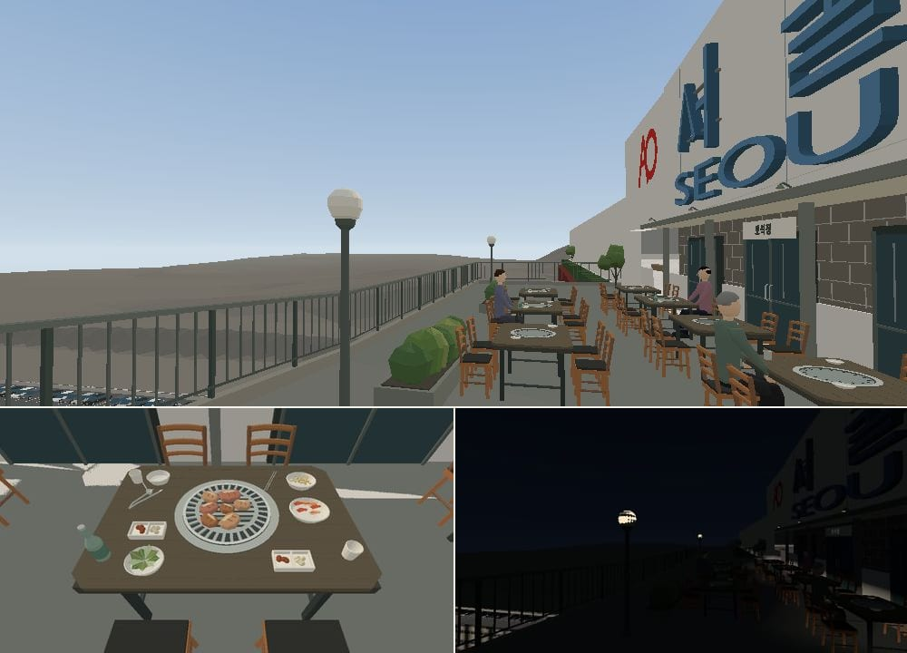

# 경부선 본관 10층 포석정과 옥상 산책로



서울고속버스터미널의 10층 사진에는 청색 입체 간판과 영어 표기, 그 앞의 포석정 차양, 검은 난간과 둥근 가로등이 함께 보인다. 2025년 1월 서초구 소식지 11쪽에서도 옥상의 식당과 산책로를 소개한다. [터미널 운영사 10층 사진](https://exterminal.co.kr/images/floor10.jpg) · [서초구 소식지 인쇄 11쪽, PDF 6쪽](https://seocho.newstool.co.kr/pdf/seocho_202501.pdf#page=6)

2026년 5월 방문 사진을 보고 원형 불판이 매립된 어두운 식탁, 사다리 모양 등받이와 검은 방석, 금속 집게와 흰 반찬 그릇을 만들었다. 2025년 4월 방문 사진에서는 밤의 야외 식탁과 식당 전면을 확인했다. 게임에서 굽는 삼겹살은 살과 지방이 구분되며, 불판의 슬롯 사이로 아래의 숯이 보인다. [2026년 식당과 상차림 사진](https://polle.com/yong/posts/1179) · [2025년 저녁 방문 사진](https://tjsuddl27.tistory.com/24)

- 지도에서 **10층 포석정 옥상 야장**을 선택하면 점포 쪽으로 진입한다. 직접 여는 주소는 `#/gyeongbu/10F?p=86.215,43,6.758,-166.04`이다. 기존 옥상정원에서 두 통로를 통해 같은 높이로 걸어 나올 수 있다.
- 상호, 층, 공개 공간의 관계와 집기 형태는 사진을 따랐다. 통로 두 곳의 위치와 폭, 건물 좌표, 식탁 일곱 개와 의자 스물여덟 개의 수·배치·치수, 상차림은 게임 공간에 맞춘 추정이다.
- 같은 층에서 식당을 보면 18m 이내에서 전면과 가구를 불러온다. 식탁과 의자는 원본 하나를 일곱 번 그린다. 불판과 음식은 5.25m, 입체 간판은 30m 이내에서 보이는 경우 불러온다. 멀어지면 각 24m, 7.5m, 38m에서 간략한 표현으로 바뀐다. 식당 앞 두 구등과 차양등은 게임의 서울 일몰·야간 전환과 연동된다.

[편집용 Blender 원본](./poseokjeong-rooftop.blend)은 상점 전면, 반복용 4인석과 나머지 배치, 대표 상차림, 한글·영문 간판을 컬렉션으로 나눴다. 배치 좌표에서 모델을 다시 만들고 일반 게임의 보행·난간 충돌·카메라 로딩·지도 이동을 확인하려면 다음 명령을 실행한다.

```sh
blender -b --threads 2 -P assets/models/gyeongbu-rooftop/build.py
blender -b assets/models/gyeongbu-rooftop/poseokjeong-rooftop.blend --threads 2 -P assets/models/gyeongbu-rooftop/export.py
node assets/models/gyeongbu-rooftop/check.mjs /tmp/gyeongbu-rooftop-check
```
