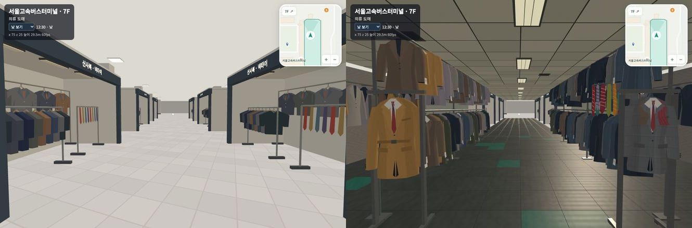

# 경부선 본관 7층 신사복 진열 통로

입구 쪽에 있던 한 점포의 양복·넥타이 진열을 지나면, 다음 두 가게 앞에서 복도 양쪽의 위아래 봉에 재킷이 빽빽하게 걸린다. 사진 왼쪽은 변경 전, 오른쪽은 같은 게임 시점에서 본 현재 통로다.



운영사 7층 사진에서 왼쪽 감청색 재킷과 넥타이, 맞은편 밝은 회색·캐멀색 원단, 각 소매 끝에 걸린 작은 표를 확인했다. 이 특징을 살려 핀스트라이프, 글렌체크, 헤링본, 새눈무늬 원단을 따로 만들었다. 가까이서는 재킷의 꺾인 라펠과 주머니 덮개, 셔츠 칼라, 소매 단추, 회전식 진열대의 무늬 넥타이가 보인다. [운영사 7층 현장 사진](https://exterminal.co.kr/images/floor07.jpg) · [공식 층별 안내](https://exterminal.co.kr/main_floor/main_floor.html)

한국관광공사의 의류도매상가 사진에서도 낮은 천장과 형광등, 짙은 바닥의 녹색 타일, 통로로 나오는 옷걸이를 확인했다. 게임의 두 점포 좌표와 상품 수, 실제 의류 치수와 현재 판매 상품은 사진을 해석해 정했다. 특정 점포 상호와 가격은 붙이지 않았다. [관광공사 통로 사진](https://tong.visitkorea.or.kr/cms/resource/93/1920593_image2_1.jpg) · [관광공사 안내](https://korean.visitkorea.or.kr/detail/ms_detail.do?cotid=dd4442f8-2df6-4601-9561-bb1df0ad67e1)

[통로](aisle.jpg) · [양쪽 행거](racks.jpg) · [넥타이 걸이](ties.jpg) · [원단과 소매 상품표](cuffs.jpg) · [야간 실내](night.jpg)

## 편집, 로딩, 보행

`suiting-aisle.blend`의 `7층 신사복 · 모직 재킷과 이단 봉` 컬렉션에 여덟 편집 부품이 있다. 재킷 몸판과 소매의 노멀을 이어 모직 표면에 빛이 연속적으로 닿도록 하고, 라펠·소맷단의 접힌 모서리는 각을 살렸다. 후열 상품과 다른 점포에서 보이는 상품은 어깨와 소매 실루엣만 남겼다. 원본 컬러 1024², 원단 표면 노멀 512², 거칠기·금속도와 형광등 마스크 256²를 GLB 안에 묶어 한 재질로 그린다.

게임 배치는 경부선 로컬 `W(38,109.5)`, 높이 29.5 m, 건물 기본 회전각이다. 같은 층에서 상품이 보이고 16 m 안에 들어올 때 상세 재질을 불러온다. 22 m 밖에서는 같은 좌표의 원거리 실루엣을 쓴다. [게임 시점 열기](../../../index.html#/gyeongbu/7F?p=75.080,29.5,25.174,-159.194)

```sh
blender -b --threads 2 --python-exit-code 2 --python assets/models/gyeongbu-suiting-aisle/build.py
node assets/models/gyeongbu-front-entrance/pack.mjs assets/models/gyeongbu-suiting-aisle/suiting-aisle.glb
node assets/models/gyeongbu-suiting-aisle/check.mjs
```

일반 게임에서 11.5 m 이상 키보드로 걸어 통로를 통과하고 네 줄의 보행 폭, 양쪽 행거·이동식 받침의 충돌과 천장 높이를 검사한다. 다른 층·카메라 후면에서는 GLB 미요청, 근접·이탈·재방문 동안 HTTP 요청 한 번, 실시간과 네 가지 고정 시간 모드를 확인한다.

원거리 실루엣은 1,938개 삼각형이다. 근경 GLB는 408,960바이트에 19,326개 삼각형이며 원경과 근경 모두 드로 콜 한 번이다. 로컬 Chromium Metal 1110×735에서 자산 로딩 후 6.22–6.23 m를 걸었을 때 변경 전 p95는 16.8/16.8 ms, 변경 후 p95는 16.8/16.7 ms였고 네 번 모두 최대 16.8 ms였다.
