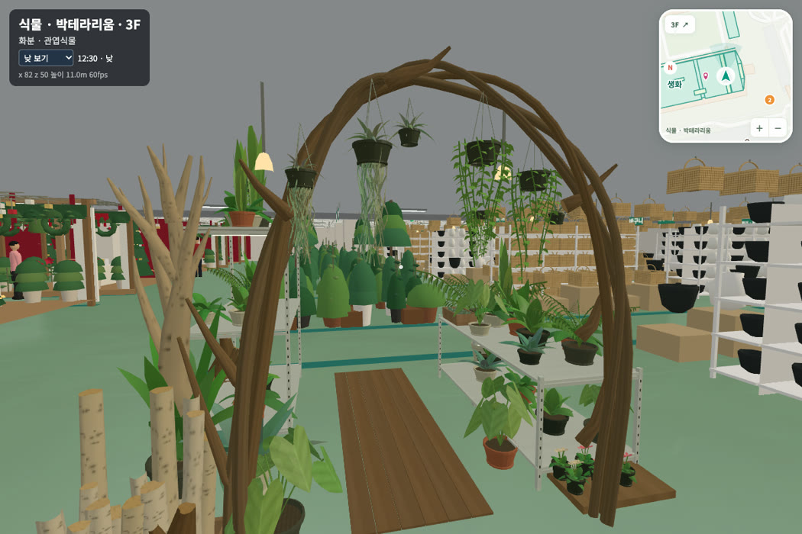
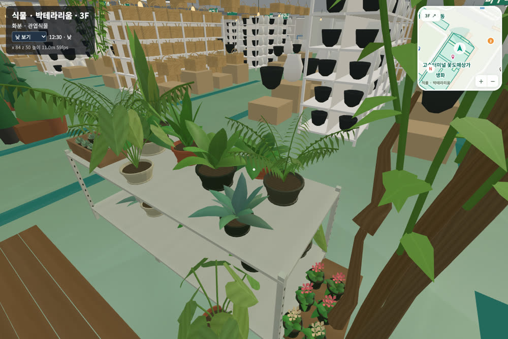

# 경부선 3층 185호 박테라리움



네이버 지도에서 서울 서초구 신반포로 194 강남고속터미널 3층 185호를 확인했다. 선행 현장 기록에서 마지막 자리가 흐렸던 매장 전화번호도 현재 공개 안내의 `535-3056`으로 정정했다. [네이버 지도 박테라리움](https://map.naver.com/p/entry/place/1019600569)

2023년 매장 제공 사진에 보이는 휜 나무 아치, 늘어진 공중식물, 흰 철제 선반, 입구의 밝은 나무줄기와 낮은 모종 트레이를 기존 185호 공간에 배치했다. 자재 진열에는 방문자가 촬영한 껍질이 옅은 통나무와 갈라진 고목을 반영했다. 상품 수량과 품종 조합, 진열대 치수는 추정했다. [매장 사진이 실린 코스모폴리탄 기사](https://www.cosmopolitan.co.kr/article/75796) · [2021년 방문자의 고목과 목재 사진](https://deepbluecolor.tistory.com/41)



Blender 원본에는 칼 모양 잎, 끝을 접은 다육 잎, 갈라진 야자 잎과 잎자루에서 갈라지는 잎맥을 따로 만들었다. 나무는 가지마다 굵기와 휘는 방향을 달리했고, 입구의 낮은 상자에는 여러 높이로 자른 통나무를 세웠다. [Blender 원본의 고목과 잘린 나이테](bark-study.jpg)

| 편집 원본 | 근거리 GLB | 근거리 삼각형 |
| --- | ---: | ---: |
| [자연목 아치와 걸이 공중식물](arch/arch.blend) | 177,688 B | 10,884 |
| [백색 철제 선반과 입구 마루](stand/stand.blend) | 15,488 B | 784 |
| [왼편 산세베리아와 화분](left/left.blend) | 255,668 B | 15,594 |
| [오른편 잎식물과 다육 트레이](right/right.blend) | 506,556 B | 28,658 |
| [자작 통나무와 고목 진열](timber/timber.blend) | 77,120 B | 5,824 |

다섯 상세 메시가 색 512px, 노멀 256px, 금속도·거칠기와 발광 128px 지도를 공유한다. 네 WebP의 합계는 35,194 B다. 선반·마루와 양옆 식물을 각각 불러오므로 오른편 화분을 보는 입장 시 왼쪽 식물과 고목 파일의 요청은 0건이었다. 한 층 위에서는 이 점포의 상세 메시와 표면 이미지 요청이 없었다. 3층에서 가게를 다시 돌아보아도 각 파일은 한 번씩만 받았다.

```sh
blender -b --threads 2 --python-exit-code 2 --python assets/models/gyeongbu-terrarium/build.py
node assets/models/gyeongbu-terrarium/pack.mjs
node assets/models/gyeongbu-terrarium/check.mjs
```

일반 플레이에서 중앙 아치를 통과해 6.23m를 걷고 같은 통로로 돌아왔다. 중앙 및 양옆 보행선에서 바닥 높이와 가구 충돌을 확인했다. 낮·일출·일몰·밤·실시간 모드를 점검하고, Blender를 다시 실행해 다섯 GLB와 네 WebP의 SHA-256 일치를 확인했다.

Chromium Metal 1110×735, DPR 1에서 기존·변경·변경·기존 순으로 여덟 차례 걸은 결과 보행 p95 16.7~16.8ms, 최장 16.8ms였다. 새 캐시에서 처음 돌아본 90프레임의 최장은 입구에서 기존 83.3~100.0ms·변경 100.0~100.1ms, 오른편 매대에서 기존·변경 모두 50.0ms였다. 이때 새 입구 아치는 131.0~142.6ms, 오른편 화분은 51.5~60.2ms 후에 보였다.
