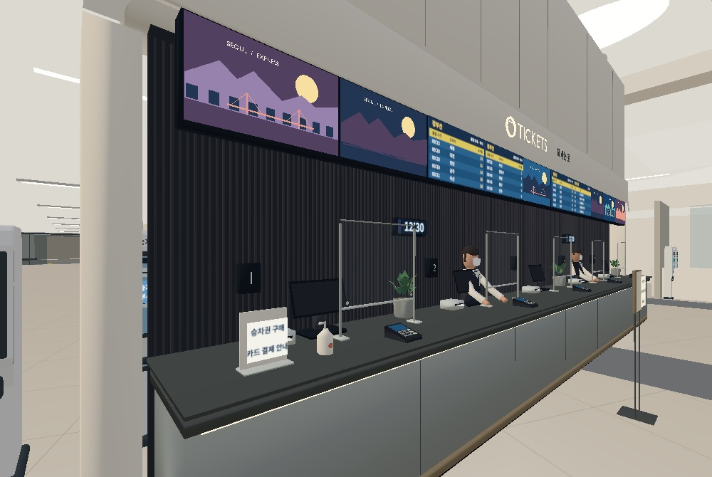

# 경부선 본관 1층 통합매표소



광고 운영사의 2024년 자료 100쪽은 통합매표소 상단 인포TV 여섯 대의 규격을 42인치로 표기한다. 같은 사진에서 연속된 스테인리스 창구, 어두운 세로 루버, 모서리가 둥근 흰색 사인 띠와 ‘Ⓣ TICKETS 표 사는 곳’, 탁상 모니터, 유리 칸막이, 벽시계, 화분, 안내문을 확인할 수 있다. [운영사 현장 사진과 디스플레이 규격, 100쪽](https://ad-gangnam.com/wp-content/uploads/2024/03/2024_AD-GANGNAM_%EC%84%9C%EC%9A%B8%EB%B2%84%EC%8A%A4%EB%A7%A4%EC%B2%B4-%EC%A0%9C%EC%95%88%EC%84%9C.pdf#page=100)

[편집용 Blender 원본](./gyeongbu-ticket-office.blend)은 42인치 16:9 패널, 장비, 카드 단말의 키와 투입구, 프린터에서 나온 승차권, 안내판 지주, 매입 조명, 창구 직원의 옷과 손까지 개별 메시로 갖고 있다. 게임에서 창구를 보면 위에는 예시 출발표가, 그 아래 두 시계에는 서울 시각이 표시된다. 시간 미리보기에서는 선택한 장면의 시각을 표시한다.

- 네이티브 모델을 현재 게임의 매표소 구간에 맞췄다. 창구 다섯 곳, 운행 안내 화면의 개수, 원형 기둥 앞 카운터 위치와 길이, 직원과 고객 수, 집기 치수는 모델링을 위한 추정이다. 광고 화면 여섯 곳에는 직접 그린 여행 그림을 넣었다.
- 지도에서 **1층 매표·환불**을 골라 이동하면 창구를 정면으로 본다. 직접 접근하는 주소는 `#/gyeongbu/1F?p=70.016,0,-44.319,110.81`이다.
- 같은 층에서 매표소의 실제 박스가 화면에 들어오고 14m 안에 있을 때 GLB를 요청한다. 20m 밖에서는 간이 상호와 TV 띠로 보인다. 시계 두 대가 작은 텍스처 하나를 공유하며 분이 바뀔 때 갱신한다.

```sh
blender -b --threads 2 -P assets/models/gyeongbu-ticket-office/build.py
blender -b assets/models/gyeongbu-ticket-office/gyeongbu-ticket-office.blend --threads 2 -P assets/models/gyeongbu-ticket-office/export.py
node assets/models/gyeongbu-ticket-office/check.mjs /tmp/gyeongbu-ticket-office-check
```
