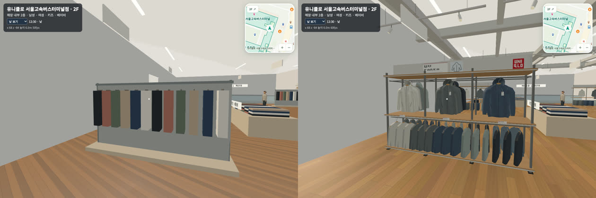

# 경부선 유니클로의 파카·시어서커 진열

유니클로 서울고속버스터미널점의 방문 사진에는 흰색·회색·남색 후드 파카가 앞을 보고 걸려 있고 아래쪽에는 같은 계열의 상품이 옆으로 걸려 있다. 다른 사진에서는 볼륨이 있는 짧은 소매와 주름이 진 원단의 흰색·남색 시어서커 블라우스가 보인다. 두 진열을 각각 블렌더로 만들고 원래 게임에서 색깔 상자로 표현하던 1층 행거 다섯 개와 2층 행거 여섯 개에 배치했다. [시어서커와 파카를 촬영한 2025년 방문 기록](https://m.blog.naver.com/sorbet-/223884572476) · [매장 2층 사진](https://m.blog.naver.com/hmnnowk/223877461403) · [네이버 지도](https://map.naver.com/p/entry/place/2066282793)



파카의 후드는 안쪽에 그늘이 생기는 빈 셸로 만들었다. 앞 지퍼와 지퍼 손잡이, 사선 주머니, 끈 끝과 소매의 밴드가 보인다. 블라우스는 소매와 몸판의 부피를 따로 잡고 색상·노멀 지도에 시어서커의 작은 요철을 넣었다. 아래쪽 재고도 각각 목제 옷걸이에 걸려 있다. 상품 카드는 사진의 구도를 참고해 새로 그렸다. 색상과 상품은 촬영 시점을 기준으로 했으며 진열 순서, 집기 치수와 수량은 기존 게임 공간에 맞춘 추정이다.

[게임 시점](../../../index.html#/gyeongbu/2F?p=68.218,6,-63.972,129.708) · [두 단 파카 진열](parka.jpg) · [후드·지퍼·사이즈 태그](hood.jpg) · [시어서커 소매와 원단](seersucker.jpg) · [야간 매장](night.jpg)

## 원본과 로딩

| 편집 원본 | Blender 컬렉션 | 원거리 파일 | 상세 파일 | 상세 삼각형 |
|---|---|---:|---:|---:|
| [파카](parka/parka-rail.blend) | 유니클로 · 경량 후드 파카 양면 행거 | 6,201 B | 453,044 B | 24,632 |
| [블라우스](blouse/blouse-rail.blend) | 유니클로 · 시어서커 블라우스 양면 행거 | 5,817 B | 358,428 B | 19,556 |
| [2층 바닥과 천장](../gyeongbu-uniqlo-finish/upstairs/oak-and-lighting.blend) | 본관 2층 유니클로 · 열린 계단 주위의 참나무 바닥과 노출 천장 | 4,345 B | 118,824 B | 6,210 |

색상 512px, 원단 노멀 256px, 금속도·거칠기와 발광 128px 네 지도가 의류 원본에 포함돼 있다. 행거는 9m 안에서 해당 종류가 시야에 들어올 때 상세 모델을 받아 한 번에 그린다. 13.5m 밖에서는 원거리 표시로 돌아간다. 각 층에 있는 같은 종류의 행거는 메시와 다운로드를 공유한다. 2층 참나무 판재와 천장은 별도의 모델이다. 기존 계단의 개구부는 원거리·상세 마감 양쪽에 냈다.

```sh
blender -b --threads 2 --python-exit-code 2 --python assets/models/gyeongbu-uniqlo-rails/build.py
node assets/models/gyeongbu-front-entrance/pack.mjs assets/models/gyeongbu-uniqlo-rails/parka/parka-rail.glb assets/models/gyeongbu-uniqlo-rails/blouse/blouse-rail.glb
blender -b --threads 2 --python-exit-code 2 --python assets/models/gyeongbu-uniqlo-finish/build.py -- --upper
node assets/models/gyeongbu-front-entrance/pack.mjs assets/models/gyeongbu-uniqlo-finish/upstairs/oak-and-lighting.glb
node assets/models/gyeongbu-uniqlo-rails/check.mjs
```

일반 플레이에서 2층 매장 복도 15.9m를 걸었다. 이어 1층에서 계단을 올라 2층에 도착한 뒤 같은 계단으로 돌아왔다. 계단 구멍 안쪽 다섯 곳과 주위 마루 다섯 곳을 광선으로 확인했다. 파카를 먼저 볼 때 블라우스 상세 파일 요청은 0건이었고, 두 종류를 본 뒤 층을 오가도 각각 한 번만 받았다. 낮·일출·일몰·밤·실시간 모드를 확인했다.

같은 Chromium Metal 1110×735, DPR 1에서 기존·변경·변경·기존 순서로 2층 통로 6.23m를 걸은 네 번 모두 p95 16.7ms, 최장 16.8ms였다. 새 캐시에서 처음 파카 쪽으로 돌아선 90프레임의 기존·변경 p95는 네 번 모두 16.8ms였다. 최장은 기존 33.4·33.3ms, 변경 33.3·33.3ms였으며 변경 버전의 상세 모델은 35.4·42.3ms 후에 나타났다.
