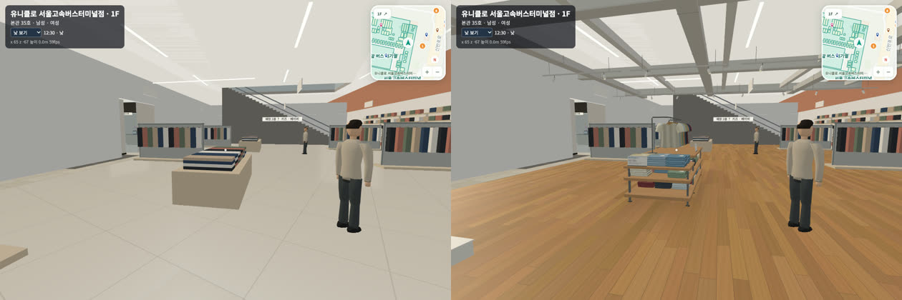

# 경부선 본관 1층 유니클로

입구 안의 목재 진열대에는 밝은 치노와 데님을 접어 쌓고, 나무 옷걸이에는 크루넥 티셔츠를 색 순서대로 걸었다. 가까이서 보면 바지의 뒷주머니와 스티치, 접힌 옷의 안쪽과 사이즈 태그, 티셔츠의 목·소매 마감이 보인다. 옆 단상에는 분홍 셔츠와 반바지, 살구색 반팔과 크림색 와이드 팬츠를 입은 마네킹 두 점이 서 있다. 반달 숄더백의 끈과 지퍼도 따로 만들었다.



네이버 지도에서 유니클로 서울고속버스터미널점의 위치를 확인했다. 터미널 운영사의 본관 1층 매장 안내 번호는 35이며 브랜드 측 지점 주소는 신반포로 194, 1~2층이다. 2025년 5월 개점 직후 두 방문자가 촬영한 사진 46장에서 의류의 색·형태, 목제 진열대, 나무 바닥과 흰 트랙 조명을 대조했다. 사진에서 식별한 의상을 기존 게임의 1층 진열 두 곳에 배치했다. 진열 위치·수량·치수는 추정했고 의상은 당시 사진을 기준으로 했다. [터미널 운영사](https://exterminal.co.kr/include/floor.asp?floornum=f1) · [유니클로 지점 안내](https://uniqlo.scout.co.kr/jobinfo/Shopinfo_view.aspx?groupcode=1209&id=68926) · [네이버 지도](https://map.naver.com/p/entry/place/2066282793) · [5월 26일 방문 사진](https://m.blog.naver.com/hmnnowk/223877461403) · [6월 1일 방문 사진](https://m.blog.naver.com/sorbet-/223884572476)

[게임 시점](../../../index.html#/gyeongbu/1F?p=67.237,0,-65.429,122.848) · [진열대와 단상](entrance.jpg) · [접힌 바지와 사이즈 태그](folds.jpg) · [크루넥과 목제 옷걸이](crew-neck.jpg) · [숄더백과 코디](looks.jpg) · [야간 매장](night.jpg)

## 편집 원본과 게임 표시

[의류와 집기 원본](entrance-fashion.blend)의 `본관 1층 유니클로 · 에어리즘 진열과 토르소` 컬렉션은 목재 선반, 옷걸이, 걸린 의류와 접힌 재고, 두 마네킹과 착장, 가방 및 상품 안내 카드 등 일곱 부품으로 구성했다. 게임에서는 `경부선 유니클로 · 에어리즘과 입구 코디`로 찾을 수 있다. 색상 1024px, 노멀 512px, 금속도·거칠기와 발광 256px 지도를 원본에 넣었다.

[매장 마감 원본](../gyeongbu-uniqlo-finish/oak-and-lighting.blend)의 `본관 1층 유니클로 · 참나무 바닥과 노출 천장` 컬렉션에는 바닥과 조명 두 부품이 있다. 게임 이름은 `경부선 유니클로 · 참나무 판매층과 흰 노출 천장`이다. 두 컬렉션의 게임 기준점은 `W(56,16.5)`, 높이 0m, 회전 `ROT + π/2`다.

의류는 같은 층에서 진열이 보일 때 원거리 파일 14,385바이트(906개 삼각형)를 받는다. 16m 안에서 상세 모델 791,620바이트(39,704개 삼각형)로 전환하고 22m 밖에서 원거리 표시로 돌아간다. 목재 바닥과 조명은 독립적으로 원거리 3,497바이트, 상세 123,244바이트(6,456개 삼각형)를 사용한다. 각 모델은 한 번에 그린다. 상품을 등지고 바닥을 볼 때 상품 파일 두 개의 요청은 0건이었다. 상품을 본 뒤 몸을 다시 돌린 350ms 동안 바닥이 21프레임 그려졌고 등 뒤 상품을 그린 프레임은 0회였다.

```sh
blender -b --threads 2 --python-exit-code 2 --python assets/models/gyeongbu-uniqlo/build.py
node assets/models/gyeongbu-front-entrance/pack.mjs assets/models/gyeongbu-uniqlo/entrance-fashion.glb
blender -b --threads 2 --python-exit-code 2 --python assets/models/gyeongbu-uniqlo-finish/build.py
node assets/models/gyeongbu-front-entrance/pack.mjs assets/models/gyeongbu-uniqlo-finish/oak-and-lighting.glb
node assets/models/gyeongbu-uniqlo/check.mjs
node assets/models/gyeongbu-uniqlo-finish/check.mjs
```

일반 게임에서 매장 앞에서 안쪽까지 14.75m 입장·퇴장, 옆 통로 10.95m 보행, 통행 세 줄과 진열대·마네킹 세 곳의 충돌을 확인했다. 다른 층·등 뒤·옆 불투명 벽에서는 의류 파일 요청이 없었다. 낮·일몰·밤·일출·서울 실시간과 재방문 캐시를 검사했다. Chromium Metal 1110×735, DPR 1에서 기존·변경·변경·기존 순서로 6.23m를 걸었을 때 네 번 모두 p95 16.7ms, 최장 16.8ms였고 33ms를 넘긴 프레임은 없었다.

같은 장비에서 새 브라우저 캐시로 바닥만 보다가 상품 쪽으로 처음 돌아선 90프레임도 따로 측정했다. 변경 버전 두 번은 42.7ms 후 상세 모델을 표시했고 p95는 16.7·16.8ms, 최장은 33.3·33.4ms였다. 회전 직후 33ms를 넘긴 프레임이 한 번씩 있었다. 기존 버전 두 번의 최장은 33.3·16.8ms였다.
