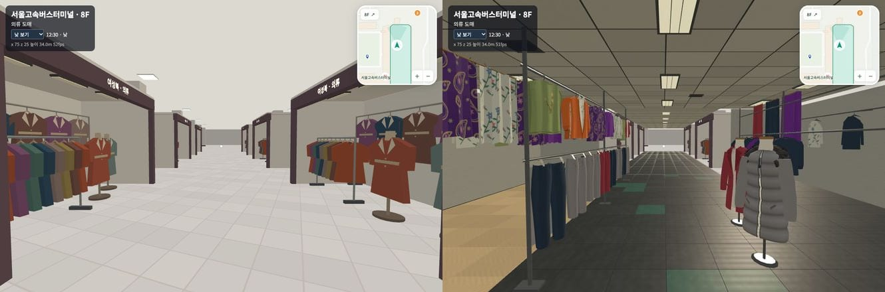

# 경부선 본관 8층 여성복 통로

양쪽 매장의 레일과 진열대를 한 시점에 담았다. 왼쪽 사진은 기존 게임의 동일한 위치에서, 오른쪽은 새 Blender 모델을 적용한 뒤 촬영했다.



서울고속버스터미널 운영사의 8층 사진 왼편에는 자수 장식이 있는 연두색 니트, 꽃무늬 블라우스 위에 걸친 주황색 카디건, 보라색 무늬 원단과 집게에 걸린 바지가 보인다. 맞은편에는 목 부분을 천으로 감싸고 나무색 마개를 씌운 마네킹 두 개가 회색 털 칼라 외투와 붉은 외투를 입고 있다. 두 진열의 높이와 상품끼리 겹치는 관계를 참고했다. [운영사 8층 사진](https://exterminal.co.kr/images/floor08.jpg) · [터미널 층별 안내](https://exterminal.co.kr/main_floor/main_floor.html)

식물과 페이즐리 무늬는 직접 그렸다. 니트와 블라우스는 칼라·앞섶·소매를 분리했고, 바지는 양쪽 다리와 허리띠 고리·주머니·집게를 따로 만들었다. 회색 외투는 누빔 경계가 눌리도록 몸판 단면을 바꿨다. 목둘레에는 짧은 털 다발과 털 방향을 담은 별도 표면을 둘렀다. 가상 점포 좌표, 통로 폭, 의류 치수와 수량은 사진과 기존 게임 바닥에 맞춘 추정값이다. 관광공사는 8층에 여성의류 매장이 있다고 안내한다. [한국관광공사](https://korean.visitkorea.or.kr/detail/ms_detail.do?cotid=dd4442f8-2df6-4601-9561-bb1df0ad67e1)

[통로](aisle.jpg) · [카디건과 자수 조끼](knits.jpg) · [페이즐리](paisley.jpg) · [바지와 집게](trousers.jpg) · [외투 마네킹](coats.jpg) · [야간 실내](night.jpg)

## 편집과 실행

`womens-aisle.blend`의 `8층 여성복 · 식물무늬 니트와 외투 마네킹` 컬렉션은 바닥, 천장, 점포 벽체, 집기, 니트, 무늬 원단, 바지, 마네킹 외투, 뒤쪽 상품의 아홉 부품으로 나뉜다. 원본 표면은 모두 파일에 들어 있다. 경부선 로컬 `W(38,109.5)`, 높이 34 m, 건물 기본 회전각으로 배치했다. [게임 시점 열기](../../../index.html#/gyeongbu/8F?p=75.080,34,25.174,-159.194)

같은 층에서 진열을 바라볼 때 원거리 좌표 파일 37,917바이트를 받는다. 16 m 안으로 접근하면 근경 GLB 356,928바이트를 받고 22 m 밖에서 원경으로 돌아간다. 원거리 1,824개, 근거리 17,140개 삼각형이며 모두 드로 콜 한 번이다.

```sh
blender -b --threads 2 --python-exit-code 2 --python assets/models/gyeongbu-womens-aisle/build.py
node assets/models/gyeongbu-front-entrance/pack.mjs assets/models/gyeongbu-womens-aisle/womens-aisle.glb
node assets/models/gyeongbu-womens-aisle/check.mjs
```

게임에서 중앙 통로 11.55 m를 키보드로 걸어 네 개 통행선과 마네킹·행거의 충돌을 확인했다. 7층과 시야 뒤에서는 원경·근경 요청이 모두 없었고, 8층에서 두 파일을 각각 한 번 받은 뒤 재방문에 재사용했다. 낮·밤·일출·일몰·실시간 모드를 검증했다. 로컬 Chromium Metal 1110×735, 자산이 준비된 뒤 6.23~6.24 m 보행을 변경 전후 각각 두 번 측정한 결과, 네 번 모두 p95 16.7 ms, 최대 16.8 ms였다.
