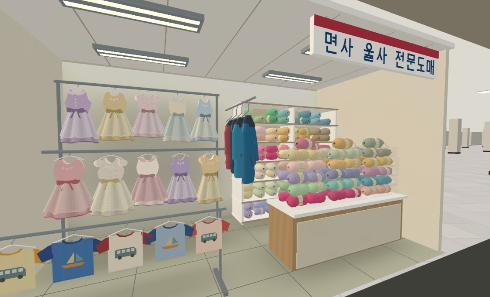

# 경부선 6층 면사·울사와 아동 드레스



서울고속버스터미널 운영사의 6층 사진 오른편에는 흰 바탕에 푸른 글자로 쓴 ‘면사 울사 전문도매’ 표지와 붉은 상단 띠가 있다. 아래에는 색을 맞춘 묶음 상품이 겹쳐 있고, 옆에는 밝은 아동 드레스 두 줄, 푸른 패딩, 낮은 티셔츠 행거가 보인다. 이 구성을 기존 6층 아동복 통로의 다음 점포에 옮겼다. [운영사 현장 사진](https://exterminal.co.kr/images/floor06.jpg) · [터미널 층별 안내](https://exterminal.co.kr/main_floor/main_floor.html)

네이버 지도에서 경부·영동선 건물을 확인했다. 한국관광공사는 신반포로 194의 6층을 아동의류 층으로 소개한다. 사진에서 점포명·영업 호수·실측 치수를 확인할 수 없어 기존 게임 상가 한 칸에 맞춰 치수와 상품 수량을 정했다. 실 감김, 레이스 무늬, 옷의 장식과 그래픽은 직접 만들었다. [네이버 지도](https://map.naver.com/p/entry/place/11567199) · [한국관광공사 의류도매상가 안내](https://access.visitkorea.or.kr/ms/detail.do?cotId=84264473-856a-4c7b-98c1-f41d1f9344b2)

## Blender 원본과 배치

매장 바닥의 집기 접점에는 부드러운 그림자를 넣었다. 봉투 모서리와 접합선은 낱개 실타래와 분리했다. 드레스에는 주름 사이로 물결치는 밑단, 겹치마, 허리띠의 접힌 리본, 벌룬 소매와 칼라를 만들었다. 패딩은 몸판을 따라 봉제선 사이가 부풀고, 여러 높이의 옷걸이가 서로 다른 제품을 받친다. [실타래와 종이띠 게임 화면](skeins.jpg) · [아동복 게임 화면](dresses.jpg) · [원본 Blender 재질 근접 렌더](material-study.jpg)

네 컬렉션은 경부선 로컬 `W(34.2,118.5)`, 높이 25 m, 건물 회전각에서 π/2 회전한 곳에 있다. [매장 앞 게임 시점](../../../index.html#/gyeongbu/6F?p=79.176,25,38.263,110.806)

| 원본 | Blender 컬렉션 | 상세 삼각형 | GLB 바이트 |
| --- | --- | ---: | ---: |
| [진열장과 표지](booth/booth.blend) | 6층 면사·울사 · 진열장과 표지 | 3,924 | 67,808 |
| [실타래와 종이띠](yarn/yarn.blend) | 6층 면사·울사 · 실타래와 종이띠 | 17,011 | 243,668 |
| [도매용 투명 묶음](wrap/wrap.blend) | 6층 면사·울사 · 도매용 투명 묶음 | 3,120 | 65,988 |
| [아동 드레스와 저지](dresses/dresses.blend) | 6층 면사·울사 · 아동 드레스와 저지 | 16,387 | 289,444 |

각 진열은 게임 카메라가 해당 면을 볼 때 한 번씩 받는다. 포장 비닐의 근접 범위는 5.2 m, 실타래와 의류는 각각 7.8 m와 8.1 m다. 불투명한 모델 세 곳은 합계 69,962바이트의 색상·노멀·거칠기와 금속도·발광 지도를 공유한다. 기둥 뒤나 옆 점포에서 차단되는 시야는 전면과 양 측벽 범위로 판단한다.

## 검증

7층에서 출발하거나 6층에서 매장을 등졌을 때 상세 파일 요청은 0건이었다. 실타래만 바라보면 종이띠와 투명 포장이 먼저 열리고, 몸을 돌려 드레스를 볼 때 의류 파일을 받았다. 다시 방문해 네 GLB와 마감 지도가 각각 한 번만 요청됨을 확인했다. 매장 앞을 세 줄로 통행 검사했고, 실제 키보드로 6.22 m를 걸었다. 낮·밤·일출·일몰·실시간 모드도 확인했다.

1110×735 Chromium Metal에서 도매 통로를 6.22~6.23 m씩 걸었다. 변경 전 두 회의 p95는 16.7~16.8 ms, 변경 후 두 회는 모두 16.7 ms였다. 네 번 모두 최장은 16.8 ms였다. 처음 매장 쪽으로 돌 때에는 상세 재질 표시까지 26.2~27.3 ms가 걸렸고, 한 프레임이 33.3~33.4 ms였다.

```sh
blender -b --threads 2 --python-exit-code 2 --python assets/models/gyeongbu-yarn-and-dresses/build.py
node assets/models/gyeongbu-yarn-and-dresses/pack.mjs
node assets/models/gyeongbu-yarn-and-dresses/check.mjs
```
